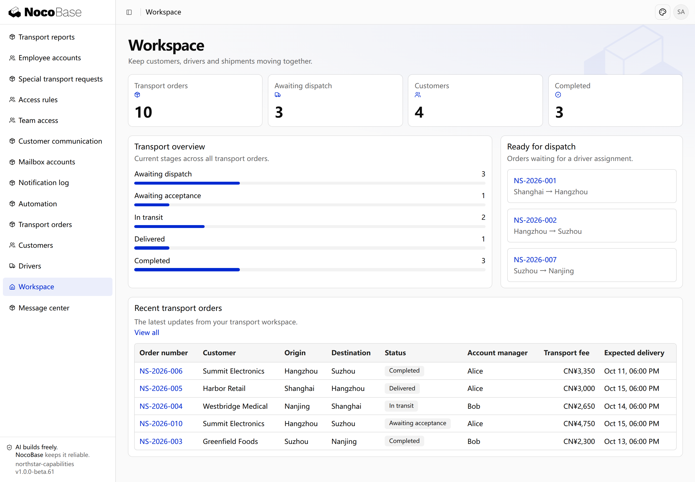
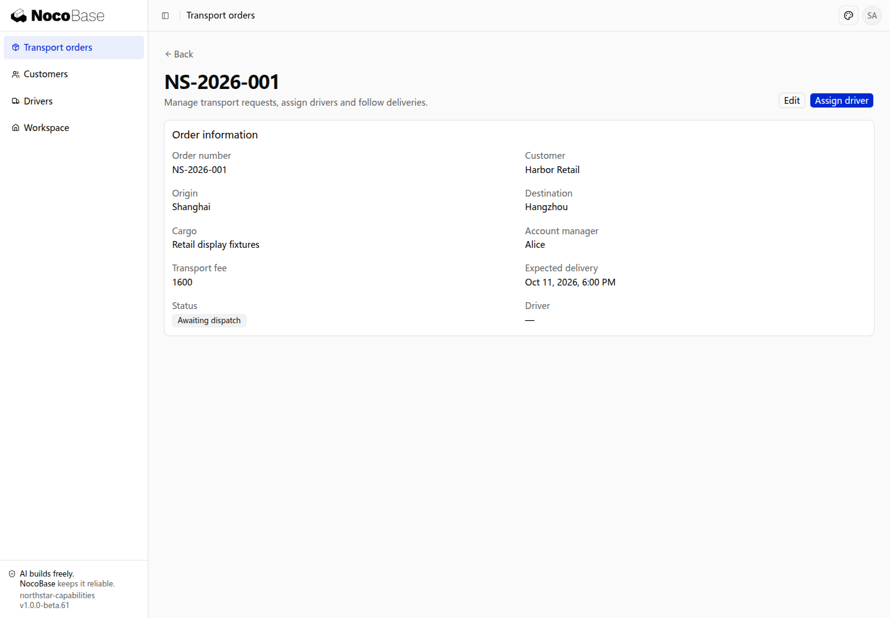

# Quick start

Start a NocoBase application, describe your business to an AI Agent, and begin building your system. This guide uses Northstar Logistics to create customers, drivers, transport orders, and a workspace with one prompt. Later chapters extend the same application with more capabilities.

## Prepare your AI Agent

Prepare a Coding Agent, Node.js 24 or later, and pnpm 11. Use a Bash terminal, or WSL on Windows, to install the global NocoBase 3 Skills:

```bash
npx skills@latest add nocobase/skills-v3 --skill '*' -g
```

Select your Coding Agent when prompted, then start a new Agent session to load the installed Skills. The [lightweight distribution repository](https://github.com/nocobase/skills-v3) provides these Skills, including application creation guidance.

Creating an application synchronizes its development Skills into `.agents/skills/` in the application directory. Start a new session in that directory so the Agent can follow the application’s `AGENTS.md` and project Skills for development.

## 1. Create and start the application

In the directory where you keep projects, run this command to obtain the creation tool and default application template from the npm beta channel and install dependencies:

```bash
PNPM_CONFIG_MINIMUM_RELEASE_AGE=0 pnpm create @nocobase/app@beta northstar-logistics --template-tag=beta
```

Enter the application directory, initialize its configuration, and start it. This example uses SQLite, which requires no separate database service:

```bash
cd northstar-logistics
pnpm nocobase config init --dialect sqlite
pnpm nocobase config check
pnpm dev
```

Open the application URL printed in the terminal and sign in with the administrator account configured during initialization. An Agent can also complete these steps for you using the installed `nocobase-create-app` Skill.

## 2. Build the business with one prompt

Northstar Logistics provides regional transportation and delivery services to business customers. It needs to manage customers, drivers, and transport orders, while helping dispatchers find orders that need a driver.

Start an AI Agent session with the new application directory as its working directory and send this request:

```text
Build a transport management application for Northstar Logistics with four pages: Workspace, Transport orders, Customers, and Drivers. Use a blue theme and left sidebar navigation.
The workspace shows four statistics: total orders, awaiting dispatch, customers, and completed orders, plus stage distribution, orders awaiting dispatch, and recent orders.
Support order search, stage filtering, creation, editing, and driver assignment. Order details show the customer, route, cargo, owner, fee, and expected delivery. Customer and driver pages include lists, details, and related orders.
Add English demo data with 10 orders, 4 customers, and 4 drivers across different transport stages. Connect the statistics, lists, and details to the same data.
```

The Agent builds the data model, business pages, and navigation. Once it finishes, open the application to see the result.

## 3. View the result

### Transport workspace

The workspace brings together total orders, orders awaiting dispatch, customers, and completed orders. Stage distribution shows overall progress, and the dispatch list highlights orders that need a driver. Recent orders link to their details.

This example contains ten orders and four customers. Statistics and lists use the application's order data.



**The workspace brings statistics, stages and pending orders together.**

### Order details

Open **NS-2026-001** to view its customer, route, cargo, owner, fee, and expected delivery. This order is awaiting dispatch, with editing and driver assignment available.



**Order details show business information with editing and driver-assignment entries.**

The application now has baseline customer, driver, and order management pages. Continue describing business needs to add branded sign-in, role permissions, transport workflows, approvals, attachments, and messages in the same application.

## Extend the same application

Later chapters introduce capabilities through Northstar's transport operations. Account managers record requirements, dispatchers assign drivers, drivers deliver goods and upload proof of delivery, operations supervisors monitor progress, and finance reviews additional transport costs.

| Role                      | Responsibilities                                                                               |
| ------------------------- | ---------------------------------------------------------------------------------------------- |
| Account manager           | Maintain customers, create transport orders, track deliveries, and communicate with customers. |
| Dispatcher                | Assign drivers and resolve delays.                                                             |
| Driver                    | Handle assigned transport tasks and upload proof of delivery.                                  |
| Operations supervisor     | Monitor progress and review special transport requests.                                        |
| Finance reviewer          | Review additional costs and relevant financial information.                                    |
| Application administrator | Manage access and inspect scheduled tasks and delivery logs.                                   |

Authentication brings employees into the system, authorization controls which orders each role can access and handle, and workflows advance transport operations. Files, notifications, and email support collaboration. Scheduled reminders, external data sources, languages, and themes are added as business needs arise.

The Agent integrates these capabilities and builds business pages and management interfaces around the company's working practices.
