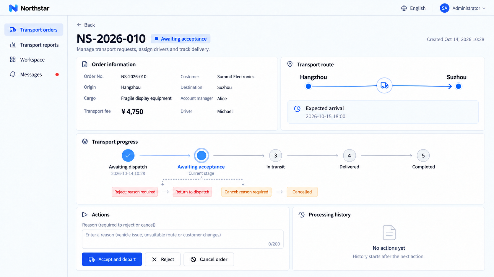

# Process definition and action control

Define the stages a record passes through, the actions allowed in each stage and the next stage after each action. Actions can require designated people, mandatory information or conditions such as an amount limit. Different conditions can lead to branches or return to an earlier stage.

The server checks these rules, while the page presents applicable actions. When two people process the same record simultaneously, the later submission must refresh instead of overwriting the result already saved.

## Example: control the sequence of a transport order

Define acceptance, transport, delivery and confirmation for Northstar orders, returning rejected assignments to dispatch. Describe the sequence first, then the action requirements:

```text
Add a workflow to Northstar orders: Awaiting dispatch → Awaiting acceptance → In transit → Delivered → Completed.
Assign a driver during dispatch. Accept and depart starts transport. Rejection requires a reason, returns to dispatch and clears the assignment.
Require delivery evidence to mark delivery, then confirm completion. Allow cancellation with a reason before departure.
Show only actions applicable to the current stage; ordinary editing must not change workflow stages directly.
Check stages and required inputs on the server and prevent concurrent actions from overwriting another person’s result.
```

| Current stage                   | Action and requirements       | Next stage          |
| ------------------------------- | ----------------------------- | ------------------- |
| Awaiting dispatch               | Select and assign a driver    | Awaiting acceptance |
| Awaiting acceptance             | Accept and depart             | In transit          |
| Awaiting acceptance             | Provide a rejection reason    | Awaiting dispatch   |
| In transit                      | Submit delivery evidence      | Delivered           |
| Delivered                       | Confirm delivery              | Completed           |
| Awaiting dispatch or acceptance | Provide a cancellation reason | Cancelled           |

## View the result

Open order **NS-2026-010**. In the captured Awaiting acceptance stage, **Transport process** offers acceptance, rejection and cancellation, without the later delivery action.



**The order is awaiting acceptance and offers the actions for that stage.**

This example combines acceptance and departure. Ask the Agent for a separate departure stage when needed. Use [Authorization](../authorization/index.md) for page, action and record access.

:::tip Important notes

Process conditions determine whether an action is valid now; permissions determine whether this user may perform it. Configure both. These screenshots use an administrator; employee actions should follow their responsibilities.

:::

## Confirm the business model first

Describe records, roles, stages, triggers, required input, branches and endings. Ask the Agent for a stage table and diagram before confirming implementation. Every unfinished stage needs an exit; define what happens if an external system never responds. Action conditions and permissions must apply consistently across all entry points.

```text
First outline Northstar's transport stages and diagram, showing who or which system advances each step, required input and outcomes. Do not write code yet. Ensure refusal, cancellation and redispatch have exits. Only dispatchers can assign drivers; drivers handle only their own orders. Explain unavailable actions, and require delivery evidence before confirming arrival. List unresolved business decisions for me.
```

Verify delivery, refusal and redispatch, cancellation, missing permissions, missing input and simultaneous actions. Ordinary edits and imports cannot bypass the rules to change stages directly.
