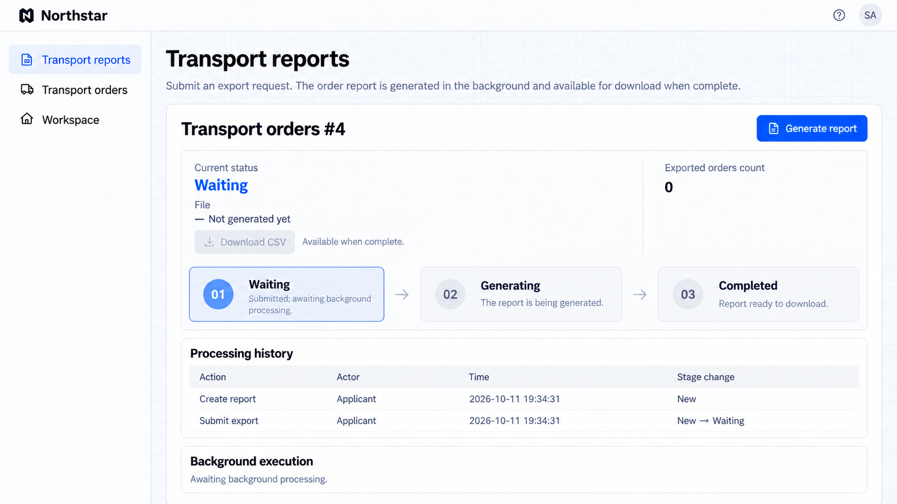

# Waiting, timeouts and reliable execution

A workflow can pause for a person, an external result or a deadline, then continue. Waiting state is saved so processing can resume after application restart.

Failed external calls can be recorded and retried. Repeated results must not advance the same business twice, and late results are handled according to the current stage. Later failures can also require compensating actions, such as releasing reserved vehicles or warehouse space.

## Supported waiting and failure handling

| Capability                 | Purpose                                                                                             |
| -------------------------- | --------------------------------------------------------------------------------------------------- |
| Wait for a person          | A ticket waits for a customer reply, then continues; a deadline can close or escalate it.           |
| Wait for external results  | Invoicing, signing and export requests await callbacks or poll for results.                         |
| Advance on deadlines       | Cancel, renew or escalate when due, without requiring an open browser page.                         |
| Retry and compensate       | Retry failures, hand final failures to a person and undo earlier reservations when needed.          |
| Avoid duplicate processing | Deduplicate repeated requests or events and prevent late results from reversing completed progress. |

## Example: export transport orders in the background

When exporting takes time, submit a task for background processing and download the result afterwards. Users can leave the page and return later to inspect progress and the file.

```text
Add a Northstar transport report page that exports current orders to CSV.
Queue the submitted report for background generation, then complete it automatically and provide a download.
Show the current stage, filename, exported order count and applicant/system processing history.
Retry generation failures according to policy and retain final failures for follow-up. Repeated execution must not create duplicate report files.
Retain progress and results after refresh, and allow only authorized people to export orders.
```

## View execution results

### 1. Submit for background processing

Open **Transport reports** and select **Generate report**. The new report enters **Waiting**, with creation and submission in its history. The file is not yet available for download.



**The task is submitted and its waiting state is saved while background processing continues.**

### 2. Download the completed report

Once generation finishes, the status becomes **Completed** automatically. The page shows **10** exported orders and the filename. **Download CSV** downloads the generated report.


**The system has generated a downloadable CSV and retained waiting, processing and completion records.**

**Processing history** identifies automatic actions as **System**. **Background execution** shows **Succeeded** and the actual attempt count. This run succeeded on its first attempt. The completed status and download remain available after reopening the page.

## Apply the capabilities to transport

The same capabilities support invoicing, monthly exports, reservations and exception tickets. Specify what to wait for, when to time out and what happens after failure.

| Requirement                    | Rules to define                                                                    |
| ------------------------------ | ---------------------------------------------------------------------------------- |
| Invoicing or monthly exports   | Callbacks or polling, waiting limits, retries, and where results appear.           |
| Vehicle or space reservation   | Whether to release on later failure and how to retry or escalate release failures. |
| Warehouse and fee confirmation | Whether both conditions are required and whether their order can vary.             |
| Carrier tracking               | Duplicate and late events, and which results advance the process.                  |
| Exception tickets              | Reply deadlines, reopening and reassignment requirements.                          |

:::tip Important notes

Notifications are one capability a workflow can call. The workflow controls waiting, progress and failure handling. Successful message delivery does not complete the business, and failed delivery should not discard saved business results. Define how retries avoid duplicate payments, invoices or reservations.

:::

## Define deadlines and recovery

Specify when deadlines start, whether reassignment or resubmission restarts them, and whether to remind before escalation. Completed records should receive no waiting reminders. Define retry limits, who handles final failures, and how duplicate, late or unknown results are reconciled. Ask the Agent to build any recovery page for the required responsibilities and permissions.

```text
For Northstar orders awaiting acceptance, remind dispatch after 30 minutes and escalate to the duty manager after 60. Reassigning the driver restarts the deadline; departed orders receive no acceptance reminders. Record automatic actions with reasons and System as the actor. Application restarts must not lose due handling.
Retry failed transport report generation 3 times, then show the reason on the report page for an authorized manager to retry. Repeated requests must not create duplicate reports. Handle duplicate or late carrier notifications according to current progress without reopening cancelled orders; reconcile unknown results before retrying. Confirm the expected outcomes first.
```

Verify deadlines, handling after restarts, duplicate and late results, final failures and manual recovery as well as successful execution.
