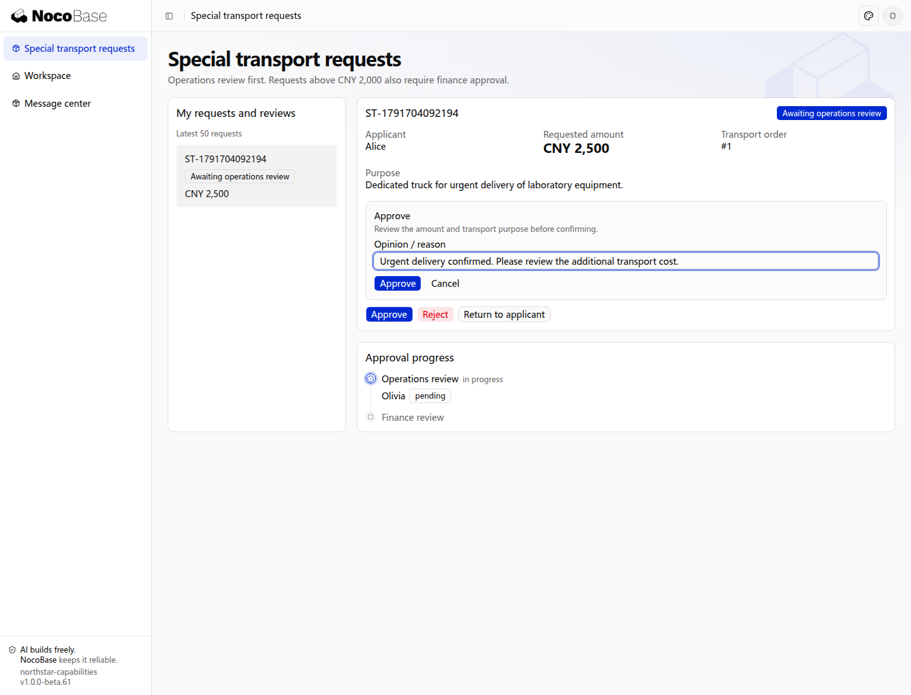
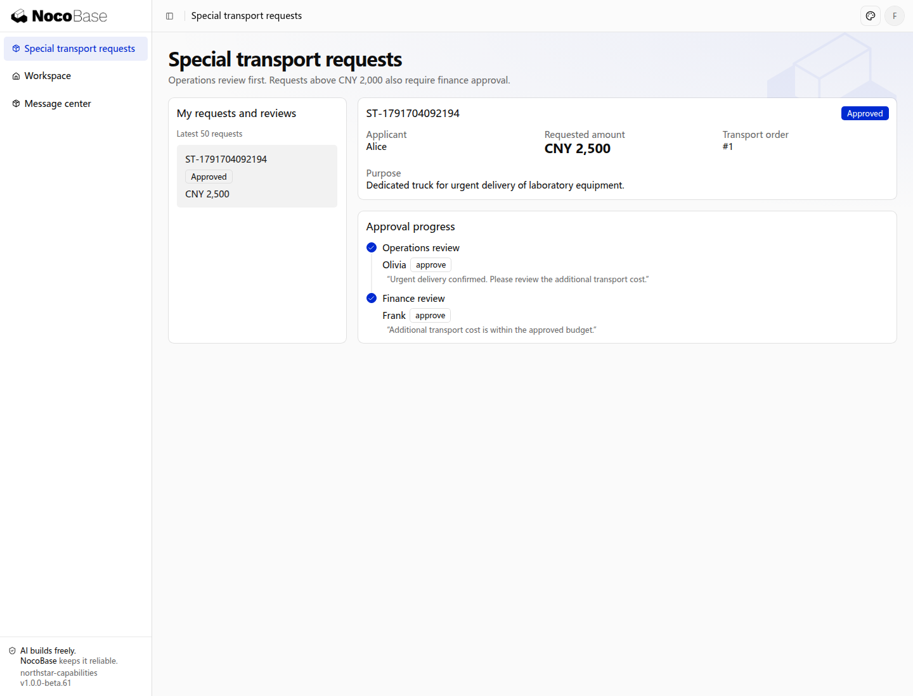

# Approval

Driver acceptance is a role performing a business action. Special transport may require operations and finance decisions or coordinated participants, using Pro approval capabilities.

## Special transport example

An account manager submits cargo details, reasons, extra fees, and evidence. Fees at most 2,000 require operations approval; higher fees continue to finance after operations approval. These are example policies. Approval enables subsequent order actions rather than completing transport itself.

## Prepare the integration

`@nocobase/app-plugin-approval` is a commercial package requiring authorization, a download source, and a compatible version. Ask the Agent to install, register, and synchronize the relevant development references; credentials stay in local configuration.

The plugin supplies data structures, services, and frontend helpers. The application integrates business routes, request pages, and tasks. Installation alone does not create an approval center or business route.

## Give the Agent the requirements

```text
Add Pro approval to Northstar special transport requests.
Provide process and stage tables and business data effects before implementation.
Account managers submit cargo details, reasons, extra fees, and attachments.
Fees at most 2,000 require operations approval; higher fees proceed to finance after operations approval.
Preview actual stages and assignees before submission; do not silently stall without assignees.
Show progress, participants, offered operations, and history in details and personal tasks.
Rejection ends the request. Return requires a reason and allows correction and resubmission with history preserved.
Approval updates the transport condition; execution continues in the order workflow.
Specify actions, withdrawal, deadlines, and people sources for each stage. Use server approval services, not direct result-field writes.
```

## User experience

| Person          | Action                       | Information                                   |
| --------------- | ---------------------------- | --------------------------------------------- |
| Account manager | Prepare and preview          | Route and assignees based on this content     |
| Operations lead | Review personal task         | Reviewed content, fees, actions, reasons      |
| Finance lead    | Handle applicable next stage | Previous result and current financial content |
| Applicant       | Track request                | Current stage, outcome, complete history      |

Return and rejection differ: return permits defined correction and resubmission; rejection ends the current request. Partial votes are not stage completion.

## Additional rules

| Rule                            | Required decisions                                                              |
| ------------------------------- | ------------------------------------------------------------------------------- |
| Multiple stages                 | Order, inclusion conditions, people sources                                     |
| All or any approval             | Decision threshold and rejection behavior                                       |
| Proportional voting             | Participants, threshold, abstention and absence                                 |
| Sequential or parallel handling | Order and stage completion                                                      |
| Added signers                   | Who adds whom, placement, impact on decision                                    |
| Handover                        | Recipients, reasons, closure of original task                                   |
| Return to a stage               | Targets, correction scope, resubmission path                                    |
| Copy and acknowledgement        | Recipients, required acknowledgement, effect on progress                        |
| Deadlines                       | Reminder, escalation, handover, final handling; never assume automatic approval |

Configure or extend permitted actions in each stage. Unconfigured actions should not appear; not every stage needs every operation.

## Approval versus execution

Approval is a decision. Capacity reservations, limit updates, or external execution need separate success, failure, and retry paths. Release held resources on withdrawal, rejection, return, and other exits as required.

Review current authoritative content before approving. Server services validate actors, tasks, and business permissions; pages must not update approval results or bypass outcome processing.

Routes live in application source. Changes need checks, deployment, and explicit handling of in-flight requests.

## View the approval result

Alice requests CNY 2,500 for urgent transport. Olivia approves the operations stage, then Frank approves the finance stage. Each reviewer signs in with a separate account. The result records the decision without paying expenses or changing the order status.





