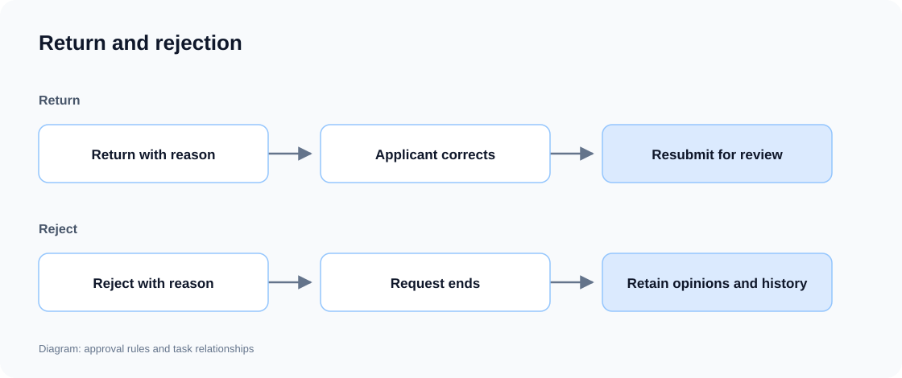

# Request handling and progress

Approval can cover submission, review, correction, resubmission and completion. Applicants track progress, reviewers handle tasks and copied recipients read materials and opinions. Each role has its corresponding actions.

## Return, rejection and withdrawal

| Operation         | Effect                                                                        |
| ----------------- | ----------------------------------------------------------------------------- |
| Return            | Go to a specified stage for permitted corrections and resubmission.           |
| Reject            | End the current request and retain reasons and opinions.                      |
| Withdraw          | The applicant withdraws at permitted stages, closing current review tasks.    |
| Request materials | The reviewer waits for additional material, then continues the original task. |

### Example: return incomplete materials

```text
Allow Northstar supervisors to return requests with missing materials to applicants, with a reason.
Allow correction and resubmission, retain earlier opinions and determine reviewers again on review entry.
Allow applicants to withdraw before completion; reviewers cannot handle closed tasks.
Distinguish return, rejection and withdrawal, and show who should act next.
```



**Returned requests can continue after correction; rejection ends the request, with reasons retained.**

## Copy and acknowledgement

Copy requests to people who need their progress and result. Recipients can read materials and opinions and confirm reading; acknowledgement does not count as an approval vote.

```text
Copy Northstar special transport requests to the responsible account manager.
Provide Copied to me and read confirmation. Recipients can view progress and opinions without deciding approval.
```

## Deadlines and task assignment

Approval supports reminders, escalation and team task claims. Expired claims can be released for others to handle, with time measured against a working calendar when needed.

```text
Remind Northstar supervisors after one working day and escalate to their manager after two.
Allow eligible team members to claim tasks; release claims left unhandled past their deadline.
Show the current handler, deadline and assignment history.
```

## View the approval result

After operations lead Olivia and finance lead Frank approve the existing special transport request, it shows **Approved**. Details retain both reviewers and their opinions.


**Applicants can inspect the final decision, reviewers and opinions from each stage.**

:::tip Important notes

Specify permitted withdrawal stages, return targets and whether earlier opinions are reused on resubmission. Separate copied acknowledgement from voting, and define deadline actions such as reminders, escalation or transfer.

:::
