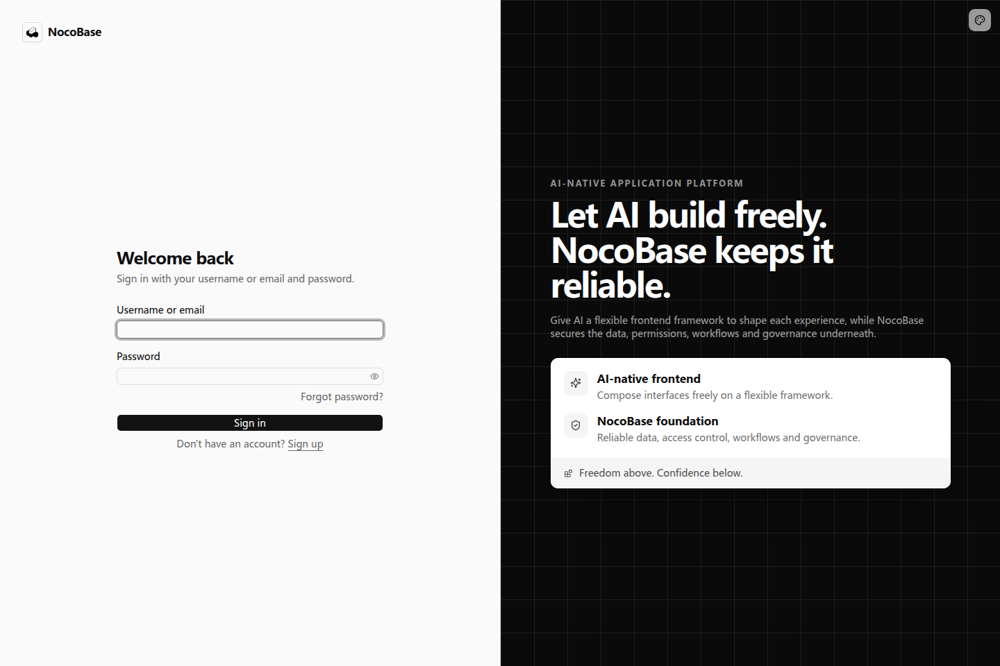

# Authentication

Authentication identifies people accessing an application. After sign-in, a session identifies the current user. [Authorization](../authorization/index.md) determines which data and business actions that user can access.

## Available capabilities

| Capability                                            | What it provides                                                                                                    |
| ----------------------------------------------------- | ------------------------------------------------------------------------------------------------------------------- |
| [Password authentication and accounts](./password.md) | Username or email and password sign-in, registration controls, password requirements, recovery, and sign-in status. |
| [Accounts and sessions](./password.md#company-managed-employee-accounts)                                 | Create or disable employee accounts, sign out, and revoke existing sessions.                                        |
| [API keys](./api-keys.md)                             | Credentials for scripts and integrations, with expiry and revocation.                                               |
| [Additional sign-in methods](./sign-in-methods.md)    | Corporate identity providers, third-party accounts, and other authentication methods.                               |
| [Custom sign-in pages](./login-pages.md)              | Company names, logos, backgrounds, layouts, and sign-in entries.                                                    |
| [Protected pages and APIs](./protecting-access.md)    | Public and authenticated pages, and current-user identity in APIs.                                                  |

## Default sign-in page

A new application provides a default sign-in page for username or email and password authentication. It includes account and password fields, a **Sign in** button, and a password recovery entry. When registration is enabled, it also shows **Sign up**.

This image shows the default page. Registration availability, password recovery emails, and additional sign-in methods depend on the application's authentication configuration and connected services.

## Customize your sign-in page

Once basic sign-in is available, ask an Agent to adapt the page to your company brand. For example, Northstar Logistics can use its own name, logo, and transport background as the entry to its business application.

The appearance can change while the form continues to use the authentication capability. Continue to [Customizing sign-in pages](./login-pages.md) for the prompt and the Northstar result.
