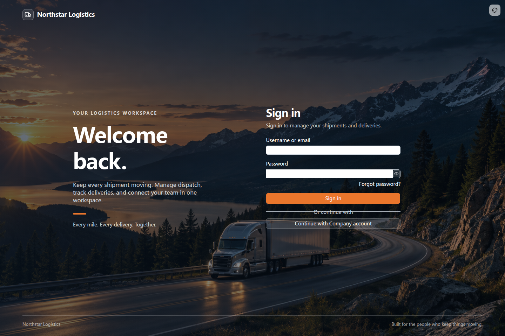
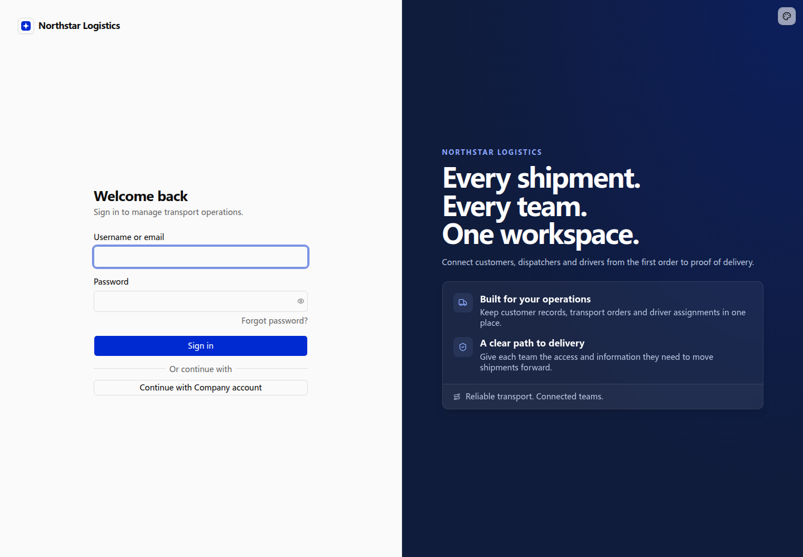

# Customizing sign-in pages

After setting up [Password authentication and accounts](./password.md), customize the sign-in page for your company.

The sign-in page belongs to the application source. Its name, logo, copy, imagery, layout, and colors can follow a company brand while preserving authentication, error feedback, and password recovery.

## Example: Northstar employee sign-in

Northstar wants its employees to recognize the company and the purpose of the transport workspace. Accounts are managed centrally, without public registration.

```text
Customize the existing transport application's sign-in page for Northstar Logistics.

Use a full-page photograph of a truck on a mountain road with a dark blue overlay for readable text.
Show the company name and icon at the top. Place a welcome message and transport dispatch, delivery tracking, and team collaboration copy on the left.
Place the sign-in form on the right, with white text, white inputs, and an orange sign-in button.
Preserve username or email and password sign-in, password visibility, error feedback, and password recovery.
Disable public registration on both the page and the server while retaining the registration page and components for future use.
Use consistent branding on sign-in and password recovery pages, with Chinese and English copy.
```

## View the result

The sign-in page uses a full-page mountain-road and truck background with company branding and transport business copy. Welcome copy appears on the left, and the form sits directly on the background on the right. White text and an orange button make the form easy to distinguish. Backgrounds, colors, and layouts can follow the company’s needs.



**The sign-in page uses the company’s background, branding and layout while retaining authentication.**

The corporate sign-in entry in the screenshot comes from an example with an identity provider already connected; see the section below. Page customization reuses existing forms and authentication actions. Hiding a registration link must be accompanied by disabling registration on the server.

## Keep password and company-account entries

When some users use a company identity provider and others retain application password accounts, offer both entries on the same page so they can choose.

```text
Keep the Northstar password form and add a company-account sign-in button.
Use the same brand layout for both entries and open the business workspace after sign-in.
Use the identity provider already connected to the application for company accounts.
```



**The same page provides password and company-account sign-in entries.**

This example shows the layout of the entries. The identity provider behind the button must be connected; see [Adding authentication methods](./sign-in-methods.md) for configuration, sign-in redirects, and authorization.

## Further customization

Describe background images, form position, brand colors, fonts, or role-specific landing pages. Consider narrow screens and dark mode, and enforce business access on the server.

Password recovery requires an actual configured reset-email service. A visible link does not mean that service is ready.
