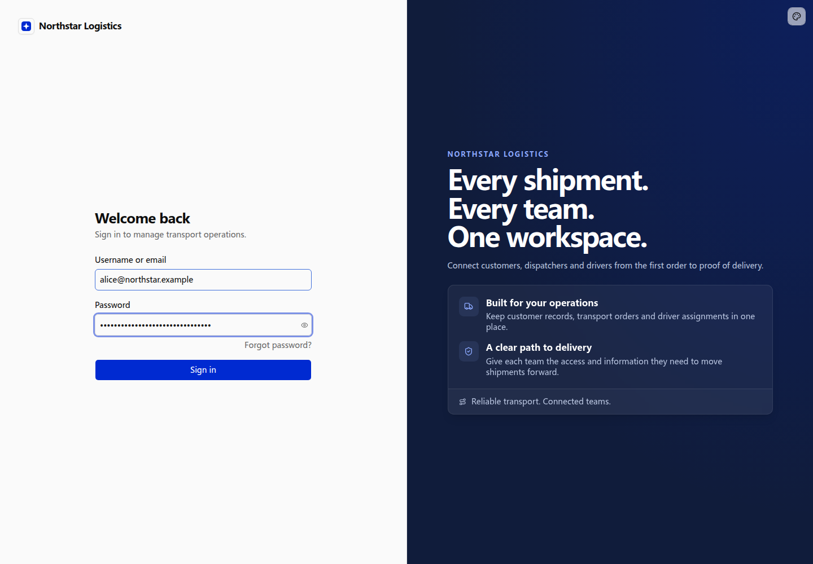
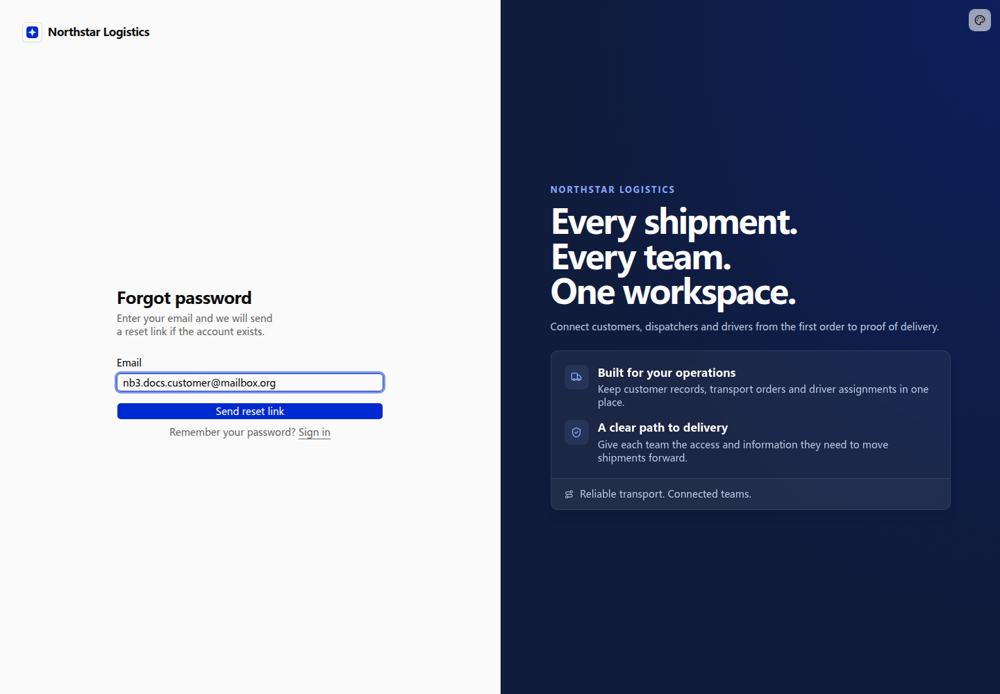

# Password authentication and accounts

Northstar account managers, dispatchers, and drivers sign in with company-managed accounts. Administrators create accounts and disable them when employees leave.

## Sign in and sign out

Enter a username or email and password, then click **Sign in**. This example uses Northstar’s customized sign-in page with NocoBase authentication and sessions. See [Authentication overview](./index.md) for the default page.



After signing in, open the avatar menu in the upper-right corner and choose **Sign out**. You return to the sign-in page. Sign in again when your session expires.


See [Customize sign-in pages](./login-pages.md) for branding and layout changes.

## Company-managed employee accounts

```text
Northstar’s transport system is for company employees only.
Disable self-registration on both the sign-in page and the server.
Build an Employee accounts page for administrators, with name/email search and enabled/disabled filters.
Support creating, disabling, and enabling accounts, and revoking sessions separately.
Keep account creation separate from business permission assignment. Never grant administrator access by default.
```

Open **Employee accounts** to see each employee’s name, email, username, permission sets, and status. Click **New employee** and enter a name, email, and initial password. A username is optional.


An account lets an employee sign in; permission sets determine which business records they can access. Creating an account does not grant access to all orders. See [Roles and permissions](../authorization/index.md).

## Custom password requirements

```text
Require at least 12 characters when setting or resetting a password.
Show the requirement in account creation and password reset forms, with matching server-side validation.
Existing employees can continue signing in with their current passwords without an immediate password change.
```

The account creation form displays the minimum length. Enter a shorter password and click **Create** to see the validation message. The account is not submitted. The server also validates new passwords.


## Recover a password

```text
Add a forgot-password flow for Northstar employees using an email channel.
Let employees choose Forgot password? and enter their email.
Show the same submission message whether or not an account exists.
Use the email link to set a password of at least 12 characters and return to sign-in.
Reuse authentication’s expiring, single-use reset links.
```

Click **Forgot password?** and enter the account email.



A working email delivery channel is required to complete the request → email → reset link → new password flow. The email link must point to an application address the employee can reach.

## Sessions and disabled accounts

```text
Add an employee offboarding action for administrators.
Show the employee name and consequences before confirmation.
After confirmation, prevent sign-in and revoke existing sessions while preserving business records.
Allow re-enabling the account, requiring the employee to sign in again.
```

Open Taylor’s row menu and choose **Disable**. The confirmation explains that sign-in will be blocked and existing sessions revoked, while business records remain available.


After confirmation, Taylor’s status becomes **Disabled**. Existing sessions cannot access internal business resources, and the employee returns to sign-in. Choose **Enable** to restore account availability; revoked sessions are not restored.


Use **Revoke sessions** to require a new sign-in without disabling the account. See [Protect pages and APIs](./protecting-access.md) for public and internal access.
