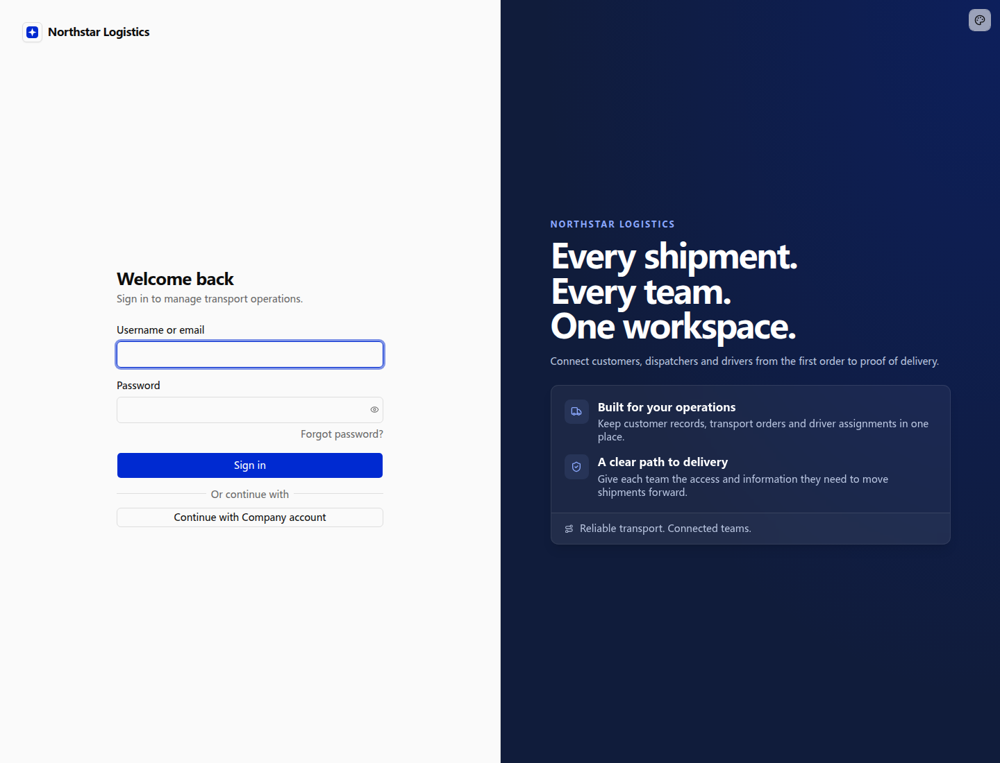

# Protecting pages and APIs

Northstar can publish its transport service information while keeping customer records, orders, and its workspace internal. Authentication establishes whether a caller is signed in; authorization determines access afterward.

## Public information and internal work

Northstar wants prospective customers to learn about its services while keeping orders and customer records for employees. Public service pages stay open; internal entries first require sign-in.

```text
Add a public transport services page for Northstar without requiring registration or sign-in.
Use Northstar’s blue brand style to introduce its Yangtze River Delta network, regional transport, business delivery, and shipment coordination.
Show a contact email and an Employee orders entry. Signed-in employees can visit the public page too.
Its public reading API must not return internal orders or customer records.
Keep authentication and business permissions on the workspace, customer and order pages, and their APIs.
Direct anonymous visitors to sign-in when they open internal pages.
```

### Browse company information without signing in

Open `/main/services` to browse Northstar’s public service page directly. Visitors can see the Shanghai, Hangzhou, and Suzhou service network and the three service areas without registering or signing in. Internal customer and order records are not shown.


The business prompt above produces this page. Branding, layout, and service information can follow the company’s needs.

### Require sign-in for employee orders

Choose **Open employee orders** to visit the internal `/main/orders` address. Anonymous visitors are redirected to sign-in. After signing in, business permissions determine their order access.

Entering the internal order URL directly also leads to sign-in. Knowing the address does not grant business access.



Compare these example addresses:

| Address                                | Anonymous result                              |
| -------------------------------------- | --------------------------------------------- |
| `http://localhost:13200/main/services` | Displays public transport service information |
| `http://localhost:13200/main/orders`   | Redirects to application sign-in              |

### Protect pages and APIs separately

The public page reads company information from `GET /main/api/public/company`. This separate endpoint returns only the company name, service regions, service entries, and contact email. It does not query or return internal customers, employees, or orders.

Internal APIs still require authentication. An anonymous call to `GET /main/api/northstar` returns **401** without order data. Browsers visiting internal pages are redirected to sign-in; scripts calling protected APIs receive an authentication error and must provide valid identity.

Pages and APIs declare their own access requirements. Hidden navigation and browser checks cannot replace server protection.

## Use the current employee identity

The company needs to know who created and handled each order for handover and traceability. Use the actual signed-in employee rather than a manually selected identity.

```text
When creating an order, obtain the acting employee from the server-side session and record them.
Do not ask employees to supply or impersonate another acting user.
Assign an order owner separately under business rules; do not confuse ownership with creation.
```

Order owner, creator, and assigned driver are distinct fields. Authentication provides the current identity; business rules define fields and access scopes.

## Page and API requirements

| Scenario                      | Page behavior                    | API requirement                          |
| ----------------------------- | -------------------------------- | ---------------------------------------- |
| Transport service information | Public and signed-in access      | Public content; optional identity        |
| Workspace, customers, orders  | Anonymous visitors enter sign-in | Authentication plus business permissions |
| Sign-in and password recovery | Guest-facing                     | Corresponding authentication flow        |
| Order-reading scripts         | No browser page required         | API key and owner permissions            |

Missing identity on a protected API returns 401; missing permission after authentication returns 403. API keys do not bypass authorization.

## Account lifecycle and deployment

Disable accounts and revoke sessions when employees leave or access is paused. An HR integration that performs those operations also requires authentication and authorization.

Deployment configuration covers application secrets, public address and path, cookies, and shared storage for multiple instances. Provider callbacks and password reset links must match the actual access address. Reverse proxies must forward protocol, Host, and cookies correctly.

Agents can work from the business requirements above. For middleware, page authentication declarations, and deployment details, see the existing [API and page protection reference](../../capabilities/auth/advanced/protecting-apis.md).
