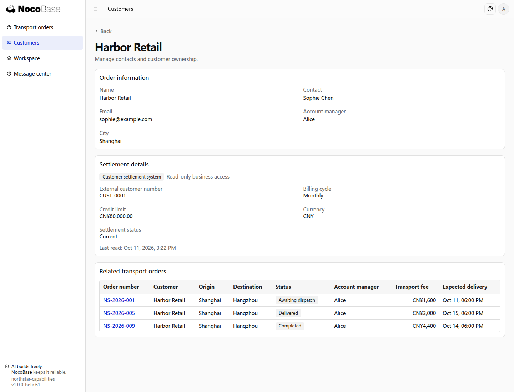

# Data sources

Northstar stores customers, drivers, orders, and runtime data in its transport application. Its existing settlement system holds customer identifiers, settlement periods, and credit limits in another database. Data sources let the application choose its own database and use existing databases in the same business experience.

## Application database types

The application uses the corresponding database driver. The default template uses SQLite; other types require their drivers and connection settings.

| Database             | Configuration dialect |
| -------------------- | --------------------- |
| SQLite               | `sqlite`              |
| PostgreSQL           | `postgres`            |
| MySQL and MariaDB    | `mysql`               |
| Microsoft SQL Server | `mssql`               |
| Oracle Database      | `oracle`              |
| Dameng               | `dameng`              |
| KingbaseES           | `kingbase`            |
| OceanBase            | `oceanbase`           |

Confirm supported server versions, deployment platforms, and connectivity when selecting a driver. This table describes configurable types, not drivers already installed. Changing a connection does not automatically migrate existing business data.

## Main and external databases

| Purpose                   | Northstar data                                                  | Ownership                                                             |
| ------------------------- | --------------------------------------------------------------- | --------------------------------------------------------------------- |
| Main application database | Customers, drivers, transport orders, runtime data              | Transport application manages its schema and records                  |
| External data source      | Settlement customer identifiers, periods, credit limits, status | Existing system retains ownership; transport accesses authorized data |

An external connection does not copy the whole database into the main one, and an arbitrary HTTP API is not a database connection. Define tables, fields, connection permissions, and record matching.

Do not run transport application schema or seed tasks on an external connection. Write access depends on database credentials and business rules; marking a connection external does not make it read-only.

## Example: settlement details on a customer page

Account managers maintain transport customers while finance maintains settlement records. Match them by external customer identifier and add a Settlement details section to the customer page.

Prepare the database address, dialect, account, authorized tables and fields, and identifier mapping. Store credentials in server runtime configuration, not prompts, client code, or screenshots.

```text
Connect Northstar's existing customer settlement database as an external data source.
Keep transport customers, drivers, and orders in the main database; do not copy the whole settlement database or alter its schema.
Read customer identifier, settlement period, credit limit, and settlement status from the supplied schema, matching customers by external identifier.
Add Settlement details to customer detail pages, showing the source and last read time. This integration is read-only.
Allow only finance leads and authorized account managers to read credit limits, enforced on the server.
Explain when settlement data is temporarily unavailable without preventing main-database customer or transport operations.
List the required driver, connection settings, and field mapping. Read credentials from server runtime configuration.
```

The customer page retains transport contact information and displays settlement records from the external system. Distinguish missing matching records from connection failures; a failed read does not mean a customer has no credit limit.

## Define the integration boundaries

- **Matching:** use stable external identifiers rather than names.
- **Reads and writes:** this example is read-only; future write-back needs explicit fields, approval, and conflict rules.
- **Permissions:** a successful database connection does not authorize every employee to access all records.
- **Ownership:** define backup and recovery responsibilities separately for transport and settlement data.

Connecting and synchronizing data are different requirements. Scheduled copying into the main database needs frequency, mapping, and failure handling; adding a connection alone does not create synchronization.

### View settlement details

This example uses a separate SQLite database to represent an existing settlement system, matching transport customers with stable identifiers. Harbor Retail keeps its main-database contact information while showing a monthly billing cycle and a CNY 80,000 credit limit from the settlement system. Data is read when the page opens, without importing it into the main database. This example provides a read endpoint only.


