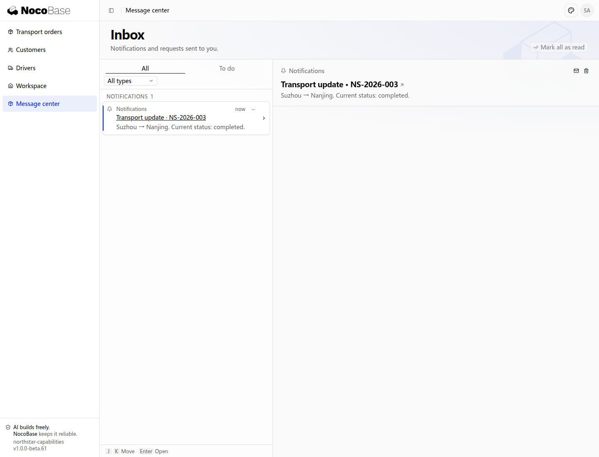

# Notifications

Northstar uses notifications for transport progress, approval results, and awaiting-dispatch digests. In-app messages, SMTP, Resend, Feishu, and DingTalk can be configured as independent delivery channels. Business code selects the trigger, recipients, content, and destination; notification services retain delivery and retry records.

## Transport progress example

Employees want a transport progress reminder in their message center with a direct return to the order. This example notifies the current operator to demonstrate the connection between a message and its business record.

```text
Add Send progress update to Northstar transport orders. Send the current status to the current operator's message center. Include the order number, origin, destination, and status, with a link to the order detail. Notify the same recipient only once for each order version. Do not change the transport state. Add a personal Message center and an administrator-only Notification log.
```

Open NS-2026-003, select **Send progress update**, then open **Message center**. This example sends the message to the demo operator, showing Suzhou → Nanjing and the completed status.



Select the message title to open its order. Messages persist across refreshes and support read, unread, and removal actions. A message does not grant additional access to the referenced order.

## Trigger from business processes

Applicants need approval outcomes without repeatedly opening the application. Notify the actual applicant when a decision is made and link to the request.

Once actual applicants and approval results exist, ask the Agent to notify only the applicant after approval or rejection, include the order and result, and link to the application. Pending applications should produce no result notification, and each result should notify once. A notification failure must not reverse the saved business result. User identities and decisions must come from the business process. See [Approvals](./approval/index.md).

## Review deliveries

Administrators open **Notification log** to review transport updates and dispatch digests, with source, reference, channels, status, attempts, and time.


`completed` describes processing of the notification's deliveries; provider acceptance and a recipient reading a message are different facts. Channels are independent. If no message arrives, first check whether the business generated a record, then inspect its delivery, recipient, and configuration.

Applications can add a **Send test notification** entry using the public test API. It performs a real send and requires an authorized recipient. The progress-update button in this example sends a business message.

## Email and group channels

Employees may not stay in the transport application all day. Deliver important outcomes through their usual email or group channels while tracking each channel’s result independently.

| Channel            | Preparation                                                                  | Configuration                           |
| ------------------ | ---------------------------------------------------------------------------- | --------------------------------------- |
| SMTP               | Server, port, sender account, password or authorization code, sender address | `notification.channels` in `config.yml` |
| Resend             | API key and authorized sender                                                | Same                                    |
| Feishu or DingTalk | Group robot webhook and optional signing secret                              | Same                                    |
| In-app             | Actual application user ID                                                   | Existing in-app channel                 |

Keep credentials on the server. Ask the Agent to add approval-result email alongside in-app notifications, resolve the actual applicant's email, skip email when absent, preserve each channel's independent result, and show delivery logs without exposing credentials. Use a stable identifier per logical notification. Inspect uncertain external delivery before sending again; retry and compensation follow the business scenario.

## Related capabilities

- [Scheduled tasks](./scheduler.md)
- [Workflows](./workflow/index.md)
- [Mail](./mail/index.md)
