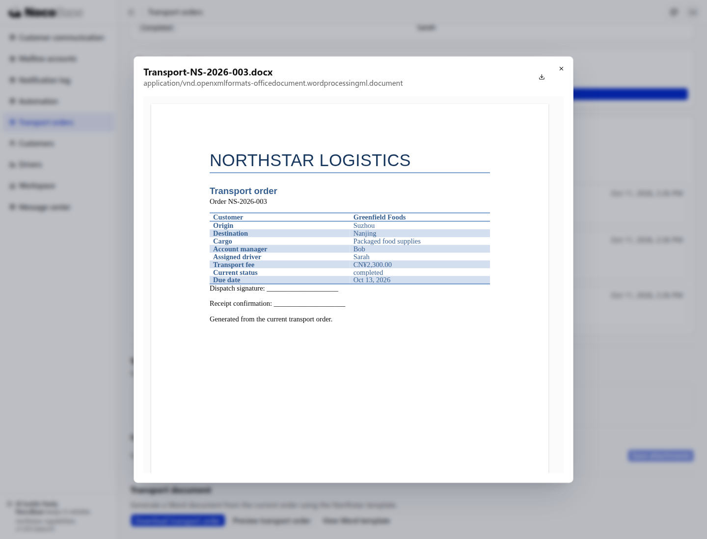

# Template printing

Template printing fills business data into a document with a fixed layout, producing a file that can be downloaded, archived, or printed. Use it for contracts, approval forms, delivery lists, and reports.

Provide an existing template and tell your Agent which information to include, where users should generate the document, and which output format you need. The Agent implements the generation action and file output in your application.

## Before you start

- **Business data**: an existing business page and the records to include in the document.
- **Document template**: such as your company's Word approval form or contract. If you do not have a template, describe the layout and ask the Agent to prepare one for review.
- **Generation requirements**: the information to fill in, the action's location, the file format, and who can use it.

This example uses a Word transport order template to generate a DOCX file for the current order. The template contains a heading, a transport information table, and a sign-off area. The Agent maps the information in the template to the application's fields.

<a href="/downloads/northstar-transport-template.docx" download>Download the example Word template</a>

## Example: generate a transport order from an order

Business administrators need a standard document containing transport order details for their records. Provide the template to the Agent, then describe your requirements:

```text
Add a “Download transport order” action to order details.

Use the Word template I provided to fill in the current order's number, customer, route, cargo, account manager, driver, fee, transport status, and delivery date.
Keep the template's heading, table layout, and sign-off area. Name the output “Transport-order-number” and provide a Word download.
Business administrators can generate its transport document. Use the current order data when generating the file.
```

### See the result

1. Open order details and click **Download transport order** to download the current order's transport order.

2. Click **Preview transport order** to see the result, or open the downloaded file in Word. The order number, customer, route, fee, and transport status are filled in, while the template's heading, table layout, and sign-off area are preserved.

After business data changes, generate the document again to obtain a file with the current information. Previously downloaded files retain their contents from the time of generation.

## Further use

### Batch generation

A shipment handover may include multiple records. Employees need one document for the intended selection without including other batches.

For documents generated from a list, specify whether to include selected records, the current page, or all filtered results. Also specify whether to produce one combined file or a separate file for each record. For example:

```text
Add a “Generate delivery list” action to the delivery list page.
Process only the records I selected, sorted by delivery number.
Use my Excel template to fill in recipients, addresses, and product details, and generate one XLSX file.
```

### PDF output

PDF is useful for printing or sending documents to others. Add PDF download to an existing document generation workflow:

```text
Add PDF download for the transport order, preserving the Word template's fonts, tables, and sign-off area.
```

The application's developer or deployment administrator prepares a server-side document conversion environment and the fonts used by the template. The Agent then connects the conversion step. Images, logos, and QR codes can also be added as required by the template; their implementation depends on the chosen generation solution.

### Multiple templates

Domestic and overseas transport use different document formats. Employees select the appropriate version while administrators maintain consistent templates.

Application developers can maintain fixed templates. If business users need to upload, replace, or select templates, ask the Agent to add the relevant management interface:

```text
Transport forms have domestic and international versions.
Administrators can upload and replace templates. Business administrators select the appropriate version when generating a transport document.
Both templates use the current order data. Regular business administrators can only use templates.
```

## Common questions

### How do I change the information and layout?

Edit the template's headings, tables, fonts, and sign-off area to change the layout. For additional business information, tell the Agent where to read it and map it into the template. Detail tables can be filled row by row from business records.

### Can I print directly to a printer?

After generating a file, users can select a printer in Word or a PDF viewer. To send documents automatically to a specific printer, describe the printer and its operating environment so the Agent can implement the appropriate integration.

### Who can generate and download documents?

In this example, business administrators can generate transport documents for an order. For contracts, customer information, or similar content, specify the access rules. The Agent applies permission checks when reading business data and returning the file. See [Authorization](./authorization/index.md).

## Northstar result

The generated demo document for NS-2026-003 contains Greenfield Foods, Suzhou → Nanjing, driver Sarah, and CNY 2,300. These are application-generated demo data. This endpoint is initially restricted to the business administrator; other roles require record and field checks.


