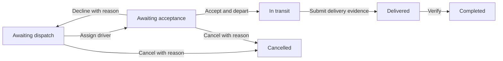

# Workflow

Transport orders wait for dispatch, driver acceptance, transport, and delivery verification. Workflow defines who advances each step, required inputs, destinations, and deadlines.

## Northstar transport process

This example combines acceptance and departure. Add an awaiting-departure stage if the business needs separate actions. Once transport starts, use a separately defined exception process rather than pre-departure cancellation.

## What pages should show

A diagram identifies the current and visited stages. Actions explain why they are unavailable. History records actors, times, stages, and inputs; automatic work identifies the system. Lists filter by stage and personal tasks update after processing. Background processing handles deadlines and post-commit external work, including recovery after restart.

## Boundaries

Orders, tickets, invoicing, exports, and renewals suit workflows. A single operation or a notification alone usually does not need a full process. Simple confirmation can use a guarded action; coordinated human decisions use [Approval](../approval/index.md).

Definitions live in source code, without a drag-and-drop designer. Changes need checks, deployment, and a plan for in-flight records.

## Read this section

- [Quick start](./quick-start.md)
- [Developing with an Agent](./develop.md)
- [Scenario examples](./scenarios.md)
- [Extension reference](./extension.md)
