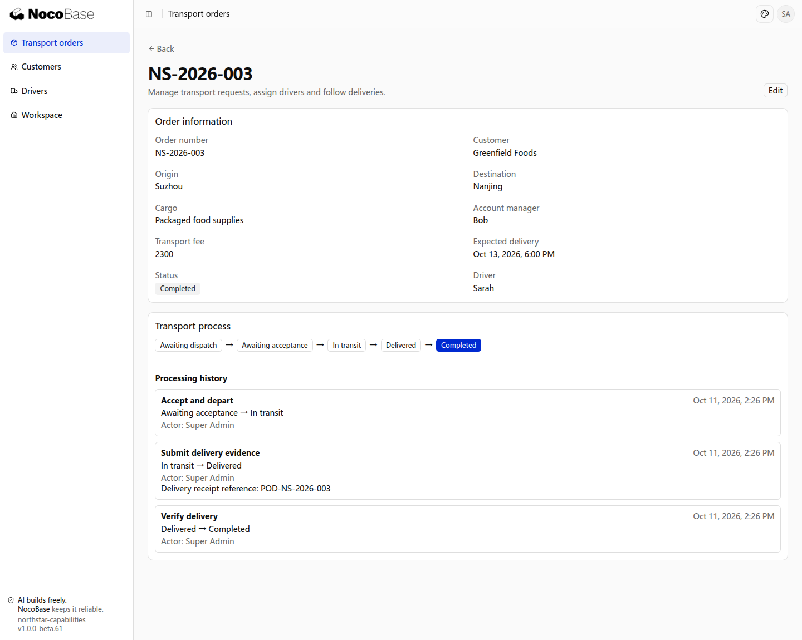

# Workflow overview

Workflows organize business steps, action conditions and processing history. A Northstar transport order moves from driver assignment through acceptance, transport, delivery and confirmation. Employees can see its progress, available actions and previous handling.

## What it provides

| Capability                              | Business outcome                                                                 |
| --------------------------------------- | -------------------------------------------------------------------------------- |
| Stages and actions                      | Move orders through dispatch, acceptance, transport, delivery and completion     |
| Conditions and inputs                   | Check the assigned driver, require rejection reasons and delivery evidence       |
| Branches and returns                    | Return rejected assignments to dispatch                                          |
| Progress and history                    | Preserve actors, timestamps, previous and next stages, and submitted information |
| Time limits                             | Remind responsible employees when orders remain unhandled                        |
| Notifications and external coordination | Notify employees, wait for external results and handle retries                   |

The last two are added for specific requirements; see [Time limits and external coordination](./automation.md).

## What this example builds

The initial example adds a handling flow to existing transport orders. Order details show stages, actions and history together.

[Quick start](./quick-start.md) includes the prompt and before-and-after results for the same order.

## Workflows and approval

Driver acceptance and delivery evidence are business actions. Special transport requiring supervisor and finance decisions uses [Approval](../approval/index.md). Connect subsequent transport, resource reservation or payment according to business rules.

An Agent develops the flow from business requirements. There is currently no drag-and-drop designer. Changes require deployment and a continuation plan for existing unfinished orders.
