# Create your first project

Use the new-project wizard to enter the basic information and prepare a code repository for a freight order management application before arranging initialization and development issues.

::: danger Issues encountered in this walkthrough

1. **Repository preparation was missing before the first task.** The earlier task started without a code location. This walkthrough now prepares the repository during manual project creation.
2. **Local Studio was unreachable from the cloud.** Webhook notifications and cloud CI reports/uploads need access to Studio. Public uploads timed out in this walkthrough. A local supplementary upload completed Preview deployment; see the review notes for the workaround.
3. **Developer lacked NocoBase 3 initialization instructions.** It previously chose an outdated command. Initialization succeeded after explicit instructions were supplied; the default flow's fix remains unverified.
4. **Runner rejected scaffold download and execution by default.** The correct command was also blocked. Initialization succeeded with additional local configuration. The developer reported an upstream fix, but it has not been pulled and verified locally.
5. **A localhost Hook URL blocked GitHub App registration.** A public address allowed registration and repository authorization to complete.

The numbering preserves the accumulated issues and identifies progress; it does not mean all five remain blocked. See [Review notes](./review-notes) for details and suggestions.

:::

## Open the new-project wizard

Open **Projects** and click **New project**.


## Enter the basics

In **Basics**, enter:

- **Project name**: `Northstar Logistics`.
- **Description**: Describe the users and business goals. This example is a freight order management application for dispatchers, drivers, and managers, covering customers, cargo, driver assignments, and delivery progress.
- **Workflow template**: Keep **Software development (default)** for this example.

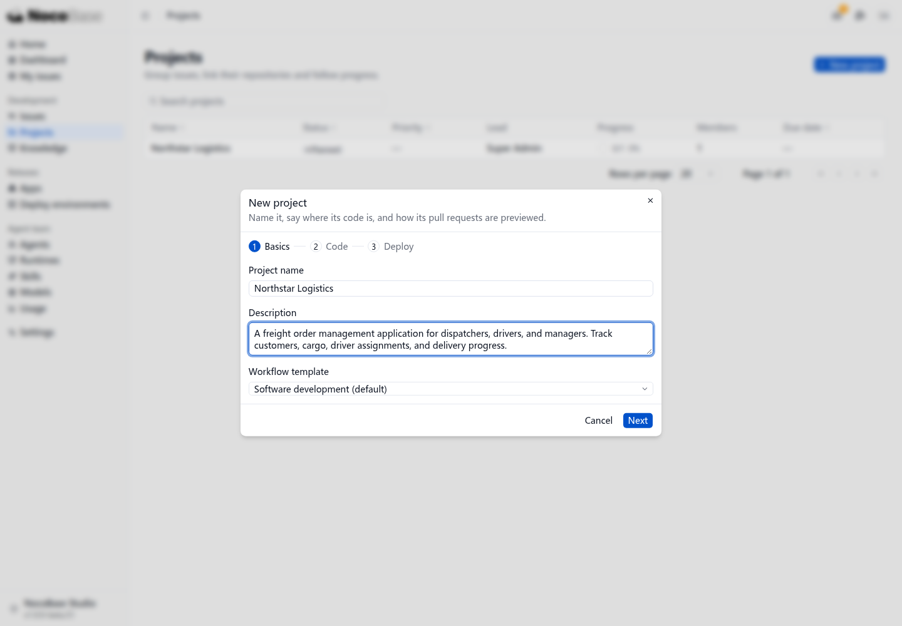

Click **Next** to enter **Code**.

## Connect GitHub in the Code step

The Code step selects the project's code location. It offers **New GitHub repository**, **Existing repository**, **Directory on a runner**, and **No code**.

This walkthrough uses a GitHub repository so the Runner can push code and Studio can handle PRs. The existing repository is **northstar-logistics** in a personal account. Configure the GitHub connection and repository authorization before linking it.

Without a code host connection, **New GitHub repository** displays **No code host connected** and is disabled. Click **Connect** beside it.


:::warning Connect GitHub before continuing repository setup

Entering a Clone URL alone does not establish a GitHub connection. The UI also notes that PRs cannot be opened for the repository without a connection. Complete the connection and authorization from the Code step before continuing project setup and development issues.

:::

**Connect** opens **Settings → Git**. Click **Add connection → GitHub** to open the connection dialog.

Studio supports two GitHub connection methods:

- **GitHub App (used in this walkthrough)**: Install the App on a GitHub account or organization and authorize selected repositories. Once the project links a repository through this connection, Studio can provide the Runner with short-lived push credentials scoped to that repository and handle PRs. Studio guides App registration; no App code is required.
- **Token**: Create a connection with a GitHub token. Currently, this method does not automatically provide push credentials to the Runner. Configure Git credentials on the Runner's machine to enable code pushes.

Select **My account** and use **Create on GitHub** to register the App, with the goal of authorizing only **northstar-logistics**.

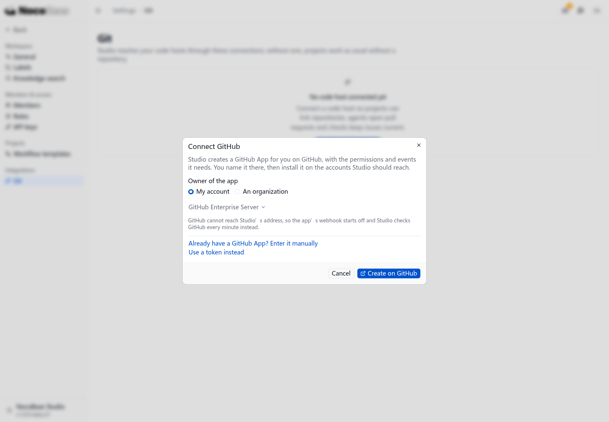

GitHub rejected the App manifest when the local Studio supplied a localhost Hook URL. The next step provides a public address through a temporary tunnel before continuing registration.


## Which steps need an address reachable from the cloud

Being able to reach GitHub from your machine does not mean GitHub or GitHub Actions can reach your local Studio. These three uses can share one entry point but are independent.

| Step                                               | Who reaches Studio                   | What happens without a reachable address                                                                                                                                                                                                                                  |
| -------------------------------------------------- | ------------------------------------ | ------------------------------------------------------------------------------------------------------------------------------------------------------------------------------------------------------------------------------------------------------------------------- |
| GitHub App registration and authorization callback | The browser completing authorization | This example's automatic registration manifest included a localhost Hook URL, which GitHub rejected. The callback must be reachable by the browser. Manual App setup and Token are other connection methods, not solutions to deployment connectivity.                    |
| Webhook event notifications                        | GitHub                               | GitHub cannot notify Studio of PR and check updates. Current Studio can poll GitHub as a fallback, with possible delays. Webhooks do not transfer deployment archives.                                                                                                    |
| CI status reporting and deployment archive upload  | The GitHub Actions machine           | The example's standard workflow cannot sign in to Studio, report build status, or upload the archive, so automatic deployment and Preview cannot complete. A Token changes GitHub authentication; it does not provide a network route from cloud Actions to local Studio. |

Local Studio use, Runner initialization, and pushing code do not inherently require a public Studio address. This example uses cloud Actions to send results back to local Studio, so a reachable entry point is needed. Studio can stay on your machine, and buying a domain is not inherently required. See the [review notes](./review-notes) for upload timeouts through the public relay and the local workaround.

Webhook notifications already work through the temporary HTTPS tunnel, but artifact upload returned HTTP 524 after about 125 seconds. Successful notifications do not guarantee successful archive uploads. Only the CI return path is being replaced; the existing Webhook entry remains. Screenshots will be added after the deployment result is confirmed.

## Continue registration with a temporary tunnel

This walkthrough uses automatic GitHub App registration with a temporary tunnel. Expose local Studio through a public HTTPS tunnel, set Studio's `APP_PUBLIC_ORIGIN` to that address, and restart Studio. Starting a tunnel alone does not ensure that Studio generates registration URLs using the new address.

This example uses a Cloudflare Quick Tunnel. The public entry has been verified as reachable. Reopen **Connect GitHub** after updating the public address; the dialog no longer shows the localhost webhook reachability message.

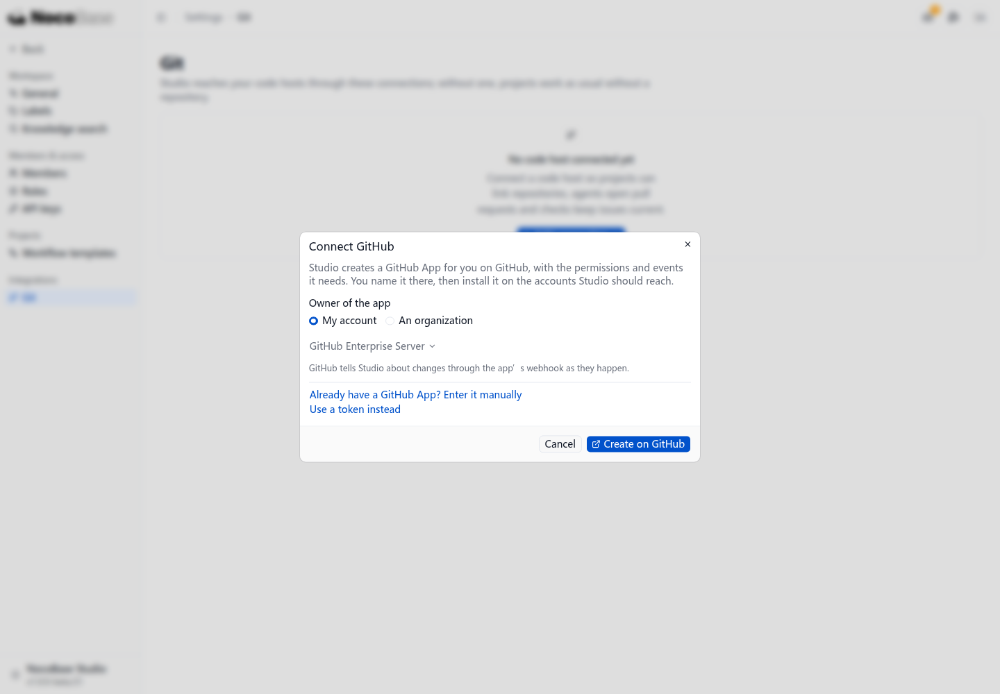

The generated App manifest now uses the public HTTPS address for both its hook URL and authorization callback. Click **Create on GitHub** and complete registration and installation in a browser signed in to GitHub. This example aims to authorize only **northstar-logistics**.

## Check the GitHub connection

After registering and installing the App on GitHub, return to **Settings → Git** in Studio. This example uses **Demo Northstar Studio**; it shows **Connected** with **1** authorized repository.

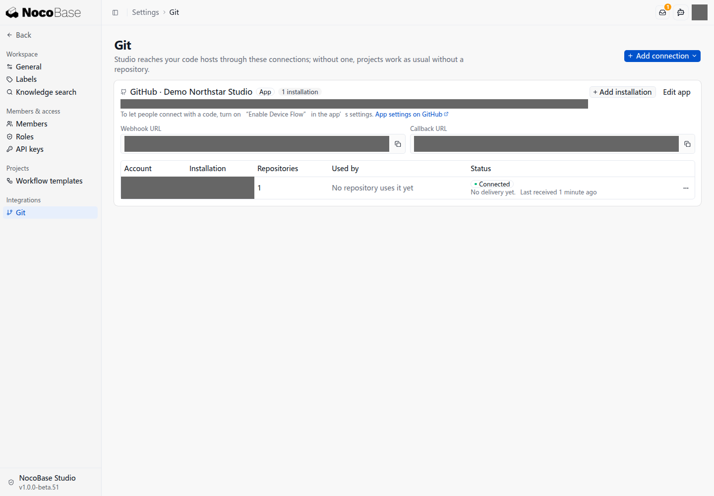

The GitHub connection is available to Studio projects. A successful connection does not automatically link a repository to a project; select the repository in the project's Code step. The temporary tunnel address may change after a restart, requiring updates to Studio's public address and the App's webhook and callback URLs.

## Link the repository to the existing demo project

:::warning How this walkthrough continues

Northstar Logistics was created in the earlier walkthrough. Keep that project and add its repository through project settings. These screenshots show the existing project's settings; they do not establish completion of the new-project wizard.

:::

Open the project's **Settings → Working directories**, click **Add**, and select **Existing repository**. The list comes from the configured GitHub connection and contains repositories authorized for Studio. Select **northstar-logistics** and keep **main** as the default branch.

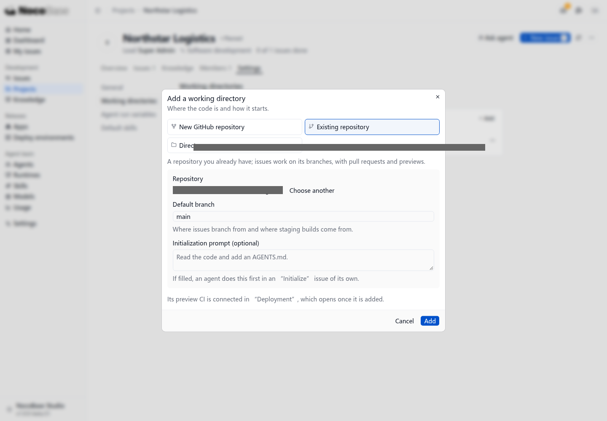

The application was already generated locally, so leave **Initialization prompt (optional)** empty and click **Add**. Return to **Working directories** to see the linked Git repository. The original local directory and its unpushed application code remain available.

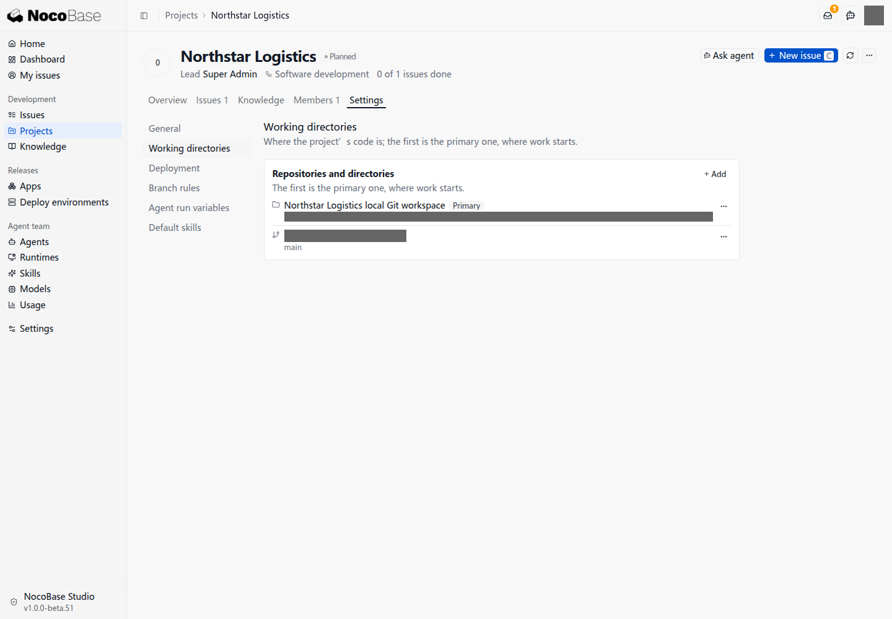

After adding the repository, the UI opens **Deployment**, showing **Waiting for the first report** and **Configure CI**. Repository linking is complete, but CI has not been configured and Runner push and PR creation have not been verified.

## Configure CI and Preview before the first issue

After linking the repository, configure previews before dispatching application initialization or business development. Open the project's **Settings → Deployment** and click **Configure CI**.


This example uses Studio's built-in standard workflow:

- **Trigger**: **Pull request**, with a separate preview App for each application PR.
- **Environment**: **Preview**.
- **Directory**: `.`, because the application lives at the repository root.
- **App ID**: `northstar-logistics`.
- **Method**: **Write the standard workflow**, generated by Studio.

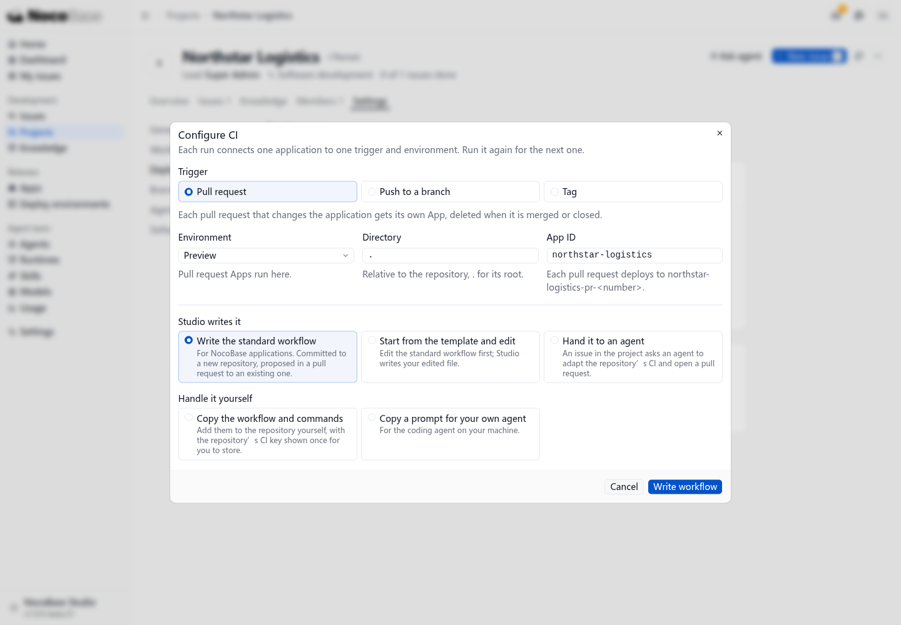

Click **Write workflow**. Studio configures a managed CI API key and stores it as the GitHub Actions secret **NB_STUDIO_API_KEY**; do not put the key in an issue description. For this existing repository, Studio creates an **Add Studio CI workflows** PR containing the preview workflow.

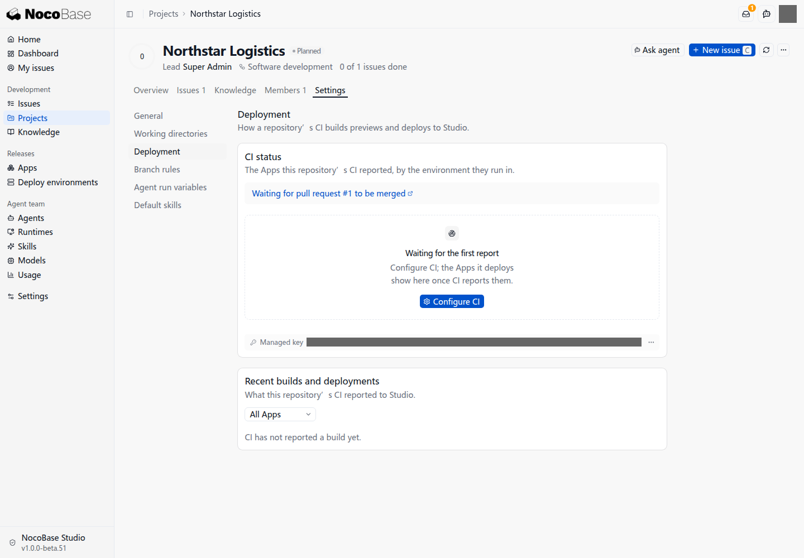

After configuration is generated, the page shows **Waiting for pull request #1 to be merged**. This example then merges the configuration PR so application PRs can use its workflow. Merging the configuration does not mean a preview has deployed.

::: warning The first CI failure is expected at this stage

This walkthrough configures CI before application code is available in the remote repository. The configuration PR therefore triggers a first run that fails during pnpm setup with **No pnpm version is specified**. This is expected at this stage. Next, initialize the application and push its code. This example already has initialized code, so create a push task, then let CI build it and generate Preview.

:::

## Create an application initialization issue

Once the project and code location are ready, open its **Issues** and click **New issue**. This example creates one issue with a clear scope, using **Manual**.

Enter **Prepare the Northstar Logistics application** as the title and describe the expected starting application:

```text
Prepare a runnable NocoBase 3 application for the current Northstar Logistics project.

First inspect the existing code. If the application is already initialized, reuse it and do not scaffold it again. Provide a home page and navigation for Orders, Customers, and Drivers. Confirm that the application starts and report its access URL.

Do not implement business data or business features in this issue.
```

Select **Northstar Logistics** for **Project**, **Straight to development** for **Process**, and **Developer** for **Executor**.


Click **Create**. The **Start now?** dialog shows Developer as the agent to trigger. Review it and click **Start** to dispatch the work.


## Follow the initialization run

The new issue is **PM-2** in this example. Open its detail page and check **Execution log**. Use **View transcript** to follow the agent's work. **Running** describes the agent run, separately from the issue's workflow status.


Developer reused the existing base application, found the home page and Orders, Customers, and Drivers navigation, and did not rerun the scaffold or add business features. The transcript shows that the development server reached HTTP readiness and reported its access URL. The agent run is **Completed**.

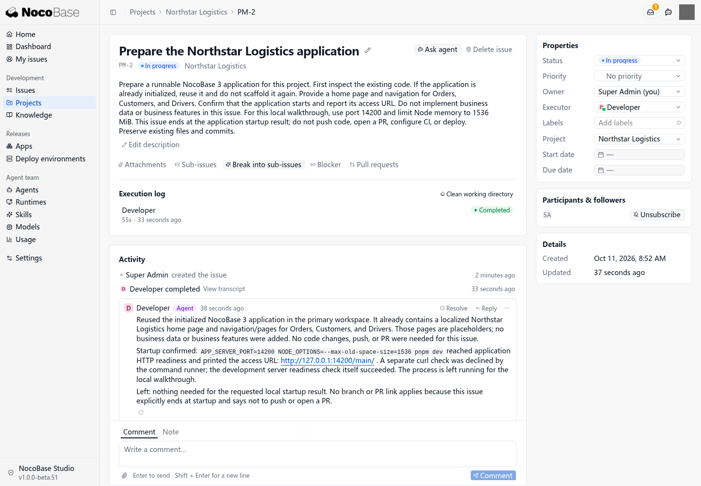

## Push application code and create Preview

GitHub Actions triggers this workflow when a PR is opened, reopened, or receives new commits. Pushing to an open PR branch triggers it; pushing to a branch without a PR does not. Studio provides configuration, records status, receives the archive, and executes deployment. Each build does not require another click in Studio.

Once initialized code is available, create **Push the initialized application and create Preview** and select **Developer**. Ask it to reuse the existing application, preserve commits, push application code to the connected repository, and open a PR. Do not scaffold again, implement business features, or merge the application PR.

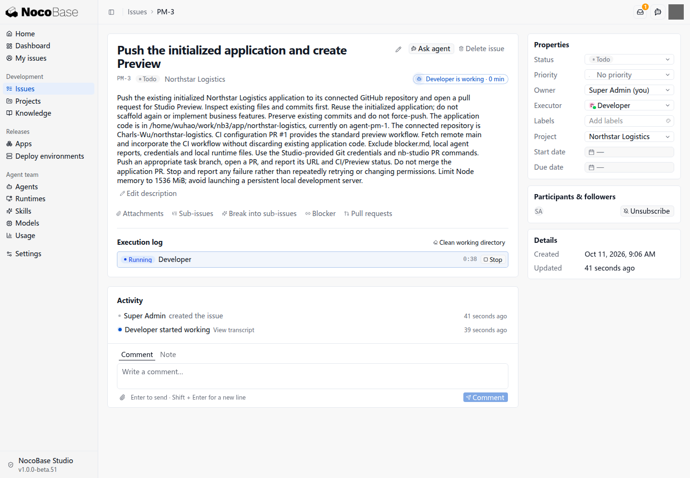

This example dispatches **PM-3** to Runner. Runner pushed the initialized code to the issue branch and opened a linked application PR through Studio. That PR triggered the Preview workflow. In the standard flow, CI builds the application and uploads the archive, and Studio receives it and deploys Preview.

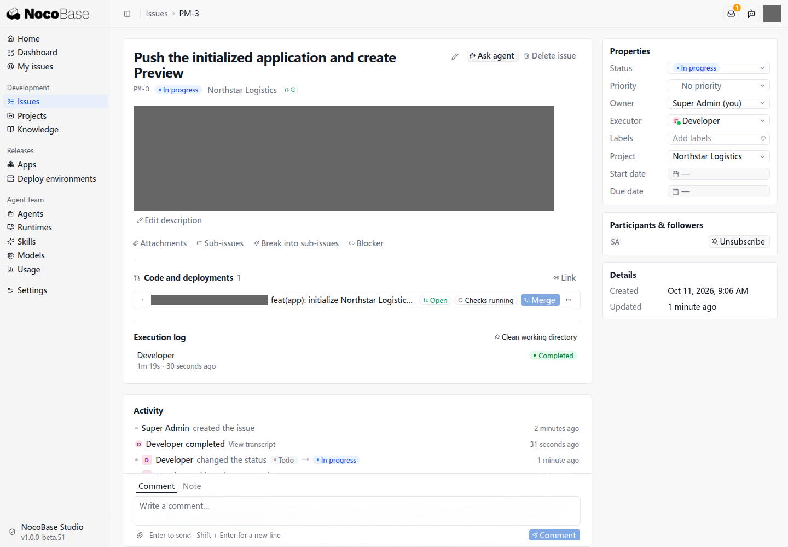

## View Preview

Expand the PR under the issue's **Code and deployments** to check Preview. After the archive is uploaded, Studio expands and initializes the application. Preview shows **Deploying** during deployment and **Ready** when deployment completes.


Open the Preview entry to access the application. Preview is ready in this example, and the application PR remains unmerged.

Public uploads timed out in this walkthrough. The deployment shown above completed after a local supplementary upload. See the [review notes](./review-notes#upload-locally-and-view-preview) for the issue and workaround.
