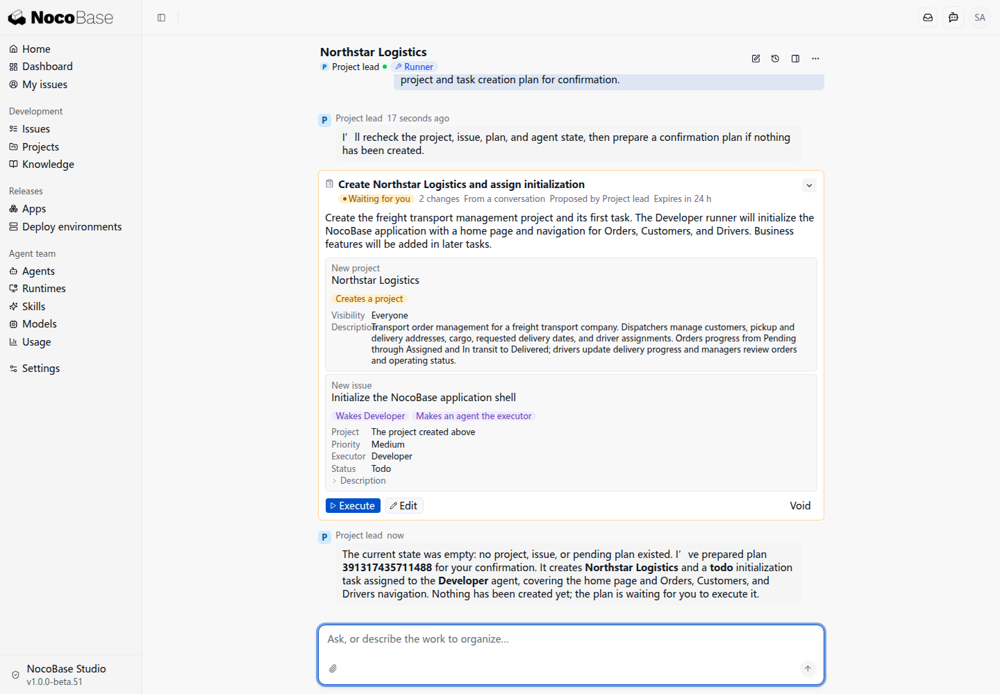
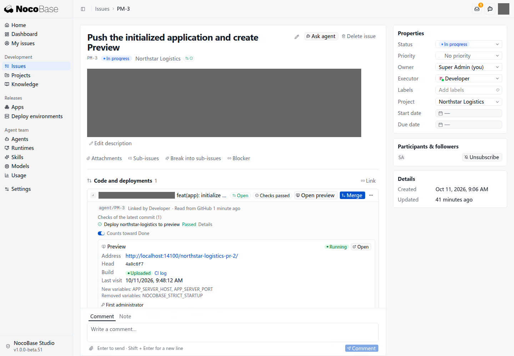

# Review notes

> Local review only. This page is excluded from the intended publication scope.

<details>
<summary>Project lead cannot create a project (fixed)</summary>

**Status: fixed.**

On 2026-10-10, the user confirmed that the missing project creation permission has been fixed online. As requested, the latest code was not pulled and the online behavior was not reverified. The earlier findings are retained below.

The first Northstar Logistics request failed: the signed-in administrator has `pm.projects/create`, but the built-in Project lead does not. The agent's reply attributes the refusal to the user's account. No project or task was created. The demo agent has been given this action locally to continue, without changing upstream source.

The earlier permission question is closed following the reported fix. The fix commit and implementation details have not been checked in this session.

</details>

## Online type and availability

Pending wording review. Project assistant shows its Online type even when its model is unavailable. The guide distinguishes the type from availability.

## Application initialization stops at repository preparation

**Status: workflow discussion pending; setup paused.**

The request was to create Northstar Logistics from scratch, initialize a NocoBase application, and provide home, Orders, Customers, and Drivers navigation. Executing the Project lead plan created the project and issue PM-1, assigned Developer, and started its run.

Developer found no linked repository or application source in its workspace. It requested a repository and moved the issue to Analysis. Solution designer then ran, and the issue ended in Blocked. No application code, branch, or pull request was created.

The plan covered project records and a regular development issue, but not the repository and application preparation needed for a new application. The missing prerequisite appeared only after dispatch, interrupting the onboarding flow. This does not establish that users must always create a repository first.

Discuss whether a dedicated initialization flow should create or select a repository and initialize the application before dispatch; where required Git information should be collected; and whether local initialization before repository linking is a supported product direction. At that discussion point no external repository had been created. The user subsequently authorized creating the private repository `Charls-Wu/northstar-logistics` on 2026-10-10. It has been cloned locally; Studio linking and a development retry remain pending.

### Proposal: choose a code location before application initialization

**Status: proposal only; not implemented.**

The source provides initialization routes for a new remote repository, an existing repository, or a directory on a Runner with an initialization prompt. GitHub is not a mandatory prerequisite for local onboarding; existing repositories may also be supplied by clone URL. The local initialization route has not been exercised in this walkthrough.

Proposed order: business request → distinguish a new application from an existing one → confirm a local directory or remote repository → approve the creation and initialization plan → prepare the code location and initialize the application → dispatch business development. A user should not have to create a GitHub repository before describing the application.

### Improve the Project lead instructions

The current instructions focus on reading, splitting, assigning, and progressing existing issues. Add guidance for starting from a new application request: confirm the code location, discover the dedicated initialization commands, prepare a reviewable plan, and wait for initialization and source availability before dispatching business development. Do not guess paths, repository visibility, or missing permissions; distinguish user permissions, agent capabilities, and Runner availability.

Instructions alone are insufficient. Verify that the agent can discover and invoke the initialization routes, has the required actions, and that dispatch validates the code location. The source declares `project setup create` and `project location add`; their actual availability to Project lead and support in operation plans have not yet been verified. No agent configuration has been changed in this discussion.

## Local Studio has no public address for GitHub CI

**Status: connectivity prerequisites pending; CI not yet tested.**

GitHub Webhooks and GitHub-hosted Actions need to reach Studio. The current local address is unreachable from GitHub, preventing later CI callbacks and deployment API access. Local application initialization can proceed first. The user chose to open a tunnel at the CI stage.

### Configuration proposal

This example created a project and an issue without linking a code location. The developer agent could not obtain application source, leaving initialization **Blocked**. Before executing a plan that wakes a developer agent:

1. **Prepare a repository or local directory.** Choose where the new application's source will live. For GitHub, create a dedicated repository under your account. Local development can use a directory accessible to the Runner. An initial repository commit does not initialize a NocoBase application.
2. **Add the project's code location in Studio.** Link the repository and branch, or select a Runner and local directory. Prepare read and push access for a private repository and confirm the executing Runner can access the location.
3. **Arrange application initialization.** Provide initialization instructions in project setup. Generate the application source, install dependencies, and confirm it starts before assigning home page, navigation, and business feature development.

**Before enabling GitHub CI builds and deployments, also configure:**

- **A public Studio address:** GitHub Webhooks and GitHub-hosted Actions must reach Studio. For local Studio, open a tunnel with a stable HTTPS address at this stage and configure Studio's public address accordingly. Local initialization can proceed before opening the tunnel.
- **The GitHub connection and Webhook:** Configure a GitHub App connection in Studio's Git settings and grant access to the repository. Set the App's Webhook URL to the connection's receiver address and configure the same Webhook secret on both sides. For a repository-level Webhook, use that repository's receiver address and secret. Receiver addresses depend on the actual connection or repository.
- **Actions credentials and workflow:** Use Studio's CI configuration to generate the repository's deployment API key and store it as the GitHub Actions secret **`NB_STUDIO_API_KEY`**. Set **`NB_STUDIO_URL`** in the workflow to the Studio address reachable from Actions (including `/main` in this example). Save the generated workflow under `.github/workflows/`, review its trigger branches and deployment environment, then enable it. Configure the Webhook secret and Actions API key separately.

The local code location is now linked. Application initialization and CI integration remain pending.

## Developer lacks NocoBase 3 initialization guidance

**Status: observed in this run; explicit steps added locally.**

Once the code location was linked, Developer found the repository but only its initial README, without application source or generated application skills. The run loaded only `nb-studio-cli`, which covers Studio operations rather than application scaffolding. The original issue did not specify NocoBase 3 initialization steps. A search of the older documentation returned no content, after which the agent chose `yarn create nocobase-app . -d postgres`. The transcript does not establish that this command came from a skill or a page it actually read.

Studio's dedicated NocoBase initialization implementation already specifies Node.js 24+, pnpm 11, and `pnpm create @nocobase/app northstar-logistics --template default --json`. The generator requires a new empty target directory; generate the application first, then place the source in the existing checkout. This guidance was not supplied to the ordinary development issue.

**Proposal:** Provide version-specific commands, prerequisites, and failure handling through the dedicated initialization flow or an initialization skill. The correct steps were added to PM-1 locally; this does not fix the default workflow.

## Runner blocks downloaded scaffold execution by default

**Status: default policy and refusals verified; a narrow local allowance added.**

Developer originally had a null `toolPolicy`, inheriting `DEFAULT_TOOL_POLICY`. Its command allowlist includes pnpm and yarn, but supplies no `allowedDownloads`. Runner separately checks commands that download and execute external code, including `pnpm create`, `yarn create`, and `pnpm dlx`, and refuses them by default. This restriction was not added during the local Runner installation and does not mean all npm dependency installation is prohibited.

The older command was refused, and the correct NocoBase 3 command was also refused after it was added. The dedicated initialization implementation supplies the command, while run claiming still merges the agent's default policy. No automatic initialization-specific download allowance was found in this version. Not every dedicated initialization entry has been exercised.

**Impact and proposal:** The default Developer cannot directly scaffold a new application this way. Prepare both the correct instructions and a scoped authorization before starting initialization. The local demo now allows only its official scaffold command, retaining other default restrictions. The first narrow rule omitted the `NODE_OPTIONS` memory-limit prefix and caused another refusal; that local configuration mistake has since been corrected and is distinct from the product default-policy gap.

### Local workaround and verification progress

These are adjustments to the demonstration environment, not a fix to the default product flow.

1. Create a dedicated Git repository and link its checkout as the project's Runner directory. Add the location to PM-1 and continue the original issue. The run transcript confirms the Runner used this directory.
2. Provide the official NocoBase 3 initialization command, required Node.js/pnpm versions, empty-directory requirement, and default SQLite setup in the issue. Developer executes them through the Runner.
3. Add a narrow `allowedDownloads` rule for this demonstration's official scaffold command, retaining other default checks. Correct the memory-prefix and regex-escaping errors. Verify with the Runner's actual policy function that the prescribed command is allowed and unrelated scaffolds remain denied. A subsequent run confirms the correct command actually executed.
4. Execution then failed while pnpm attempted to create its dlx cache in the isolated HOME. Add a writable repository-local `XDG_CACHE_HOME` path and allow the exact command with that path and the memory limit, then retry through the Runner.

5. With the repository-local pnpm cache, the official scaffold actually executed but returned `TEMPLATE_DOWNLOAD_FAILED` twice. Template version lookup succeeds. The generator invokes `npm pack --silent`, which did not expose the full underlying error. A repository-local `npm_config_cache` path has been supplied for Runner investigation; the final outcome remains pending.

**Subsequent verification:** Runner run `391364430790660` on 2026-10-10 set both `XDG_CACHE_HOME` and `npm_config_cache` to writable repository-local paths. The default template download and dependency installation succeeded, followed by successful default SQLite configuration through `pnpm nocobase config init --json`. Developer implemented the home page and Orders, Customers, and Drivers navigation and committed `035df70` on local branch `agent-pm-1`. The transcript and issue report confirm successful startup and relevant checks. Initialization succeeded with these local adjustments; the default product flow remains unchanged.

**Remaining blockers:** Runner has no usable GitHub push credentials, and Studio only links a local directory rather than a repository through a Git connection. Push failed and PR creation returned `NO_REPOSITORY`. No application PR exists yet; push credentials and Studio repository linking still need preparation.

## GitHub App registration blocked by a localhost hook URL

**Status: reproduced, unresolved.** On October 10, 2026, choosing Settings → Git → Add connection → GitHub → My account → Create on GitHub in local Studio produced `Invalid GitHub App configuration`. GitHub reported `Hook url is not supported because it isn't reachable over the public Internet (localhost)` and `Hook is invalid`. Registration failed before App installation or repository authorization.


**Source evidence:** In this walkthrough's isolated Studio, `buildAppManifest` in `server/git/github.ts` generates `hook_attributes: { url: input.webhookUrl, active: input.webhookActive }` even when the webhook is disabled, retaining the localhost URL. The UI says polling will be used, but the actual registration still fails GitHub's URL validation. That UI message does not establish that local registration works.

**Impact:** This blocks App registration now and is distinct from the later CI limitation caused by the lack of a public Studio address. The previous plan to defer the tunnel until CI did not account for this registration failure.

**Next steps:** Evaluate correcting the registration manifest or configuring a public address before retrying. No Studio source fix, tunnel, or completed authorization has been applied in this walkthrough; the blocker remains unresolved.

**October 11, 2026 tunnel progress:** The user chose a temporary tunnel. Cloudflare Quick Tunnel is running and isolated Studio now uses its public address as APP_PUBLIC_ORIGIN. The public entry returns 200; the manifest generated by the real UI uses public HTTPS hook, redirect, and callback URLs with webhook active=true. The browser reached GitHub sign-in. Registration acceptance, installation authorization, and Runner push remain unverified; this blocker is not marked resolved.

**October 11, 2026 registration callback authentication failure:** The user chose `Demo Northstar Studio` and received 401 `UNAUTHENTICATED / AUTHENTICATION_REQUIRED` after creating it. The source requires a Studio sign-in for both `/oauth/git/manifest` and `/oauth/git/setup`. Starting on localhost and returning to the tunnel domain does not share a login cookie. This is consistent with the error, but the exact failing browser URL has not been confirmed. Sign in to public Studio in a separate tab of the same browser, then retry the original callback; do not immediately register another App with the same name. Registration state, callback-code validity, and installation authorization remain unconfirmed. The walkthrough stops here.

### Three options for connecting GitHub during local project creation

These are options for discussion, not three verified procedures. Automatic and manual GitHub App registration use the same connection type; they differ in how registration is configured.

| Option                                                    | Setup                                                                                                                                                       | Runner Git push credentials                                                                                                                                      | Current issue and validation status                                                                                                                                                                          |
| --------------------------------------------------------- | ----------------------------------------------------------------------------------------------------------------------------------------------------------- | ---------------------------------------------------------------------------------------------------------------------------------------------------------------- | ------------------------------------------------------------------------------------------------------------------------------------------------------------------------------------------------------------ |
| Automatic GitHub App registration with a temporary tunnel | Configure a tunnel and Studio's public address, then use Create on GitHub to register and install the App with access only to the target repository         | In the current source, Studio provides short-lived repository push credentials once the project links a repository through the App connection                    | Localhost registration failed. A tunnel is expected to avoid that URL problem, but this path has not been verified end to end                                                                                |
| Manual GitHub App registration with webhooks disabled     | Register the App on GitHub, disable its webhook, install it and authorize the repository, then enter its configuration through Studio's existing-App option | Once the App connection and repository link are complete, the current source uses the same credential delivery mechanism as automatic registration               | Does not rely on public webhook delivery, but requires manual permissions and App credentials. The full procedure has not been verified here                                                                 |
| GitHub token connection                                   | Generate a personal access token on GitHub and enter it through Use a token instead in Studio                                                               | The current source does not automatically deliver Runner push credentials through this connection; Runner relies on Git credentials in its execution environment | The Studio token connection has not been exercised. The host has a gh sign-in, but the earlier Runner push failed. Whether and how its isolated environment can reuse host credentials requires confirmation |

**Source of the token conclusion:** The isolated Studio used in this walkthrough is commit `8ab0d2914e6187ceb649cf585f9b0b5944f131ef`; no source update was performed for this record. In `server/git/connections.ts`, `pushCredential` returns `null` for a connection whose type is not `app`. `server/git/run-git.ts` sends only nonempty credentials to the Runner and documents that token connections rely on the host's credentials. This establishes that this local version does not automatically deliver push credentials through token connections. It does not establish that Runner cannot use tokens in every environment or that a configured token connection has failed in practice.

**Limits of the observed failure:** The earlier push failed when the project linked only a local directory and had no GitHub connection. It is not evidence of failure after configuring a token connection. A host gh sign-in does not establish that Runner's isolated environment can access those credentials; the specific cause remains unconfirmed. No dedicated Runner Git credential configuration page has been confirmed.

**Questions for development:** Which option is recommended for local Studio? How should automatic registration with webhooks disabled be corrected? Is withholding Runner credentials for token connections intentional, and where should users configure them? Can Runner reuse the host's gh sign-in, and how should its isolated environment be configured? Keep the walkthrough blocked until these questions are discussed; no connection method or development task has been changed.

<details>
<summary>Earlier Project lead creation walkthrough (historical record)</summary>

# Create your first project

Start a freight order management application by creating its project and arranging application initialization. Add order management, attachments, and notifications in later tasks.

:::danger Current blockers

1. **Repository preparation guidance is missing.** The issue was dispatched before a code location was linked, leaving initialization **Blocked**.
2. **Local Studio has no public address.** GitHub Webhooks and hosted Actions cannot reach it, blocking later CI integration.
3. **Developer lacks NocoBase 3 initialization guidance.** Without an initialization skill or explicit steps, the agent chose an older command.
4. **Runner blocks downloaded scaffold execution by default.** Even the correct command requires additional permission configuration.
5. **Local Studio cannot complete GitHub App registration.** The registration manifest still contains a localhost hook URL, which GitHub rejects, preventing repository authorization.

These gaps interrupt local setup, application initialization, and later CI integration. See [Review notes](./review-notes) for configuration details and workflow proposals.

:::

:::warning Continue after local setup adjustments

For this walkthrough, we created a demo Git repository, linked its local directory to the project's Runner code location, and added the missing information to the original initialization issue. We now continue PM-1 so the developer agent can initialize the application. GitHub CI and Webhooks remain unconfigured; the public tunnel will be set up at the CI stage.

:::

## Choose the Project lead

Choose **Project lead** in the home page's agent picker. It runs through a Runner and can use your local Codex sign-in.


## Describe the business and first task

Explain who will use the application and what they do, then state the first task:

```text
We are a freight transport company and need a transport order management application called Northstar Logistics.

Dispatchers will record customers, pickup and delivery addresses, cargo details, and requested delivery dates. They will assign a driver and track each order from Pending through Assigned and In transit to Delivered. Drivers will update delivery progress, and managers will review orders and operating status.

Please create this project in Studio and arrange the first task: initialize a NocoBase application with a home page and navigation for Orders, Customers, and Drivers. Assign initialization to a developer agent. We will add the business features step by step after the application is ready.
```

Enter the prompt, check that Project lead is selected, and send it.


## Read the reply

The Project lead checks existing projects, issues, and available agents, then prepares an operation plan. This example includes two changes:

- Create the **Northstar Logistics** project.
- Create an application initialization issue assigned to **Developer**, covering a home page and navigation for Orders, Customers, and Drivers.



Review the project, issue, and executor, then click **Execute** to confirm. **Wakes Developer** indicates that executing the plan triggers the developer agent to handle the issue.

The confirmation dialog lists the project creation and agent run. Review it and click **Execute**.


After execution, **Projects** lists Northstar Logistics. Open its **Issues** tab to view initialization issue PM-1 and its status.


</details>

**October 11, 2026 connection and repository linking completed:** CLI verification confirms an installed App connection with no missing permissions. The real UI shows Demo Northstar Studio as Connected with one authorized repository, and the target private repository is accessible. It was added to the existing project through Working directories; the local directory remains Primary and commit035df70 is preserved. No initialization issue was created. The user proceeded to installation after the401 and completed authorization; the exact recovery sequence remains based on their browser. The tunnel enabled this registration and installation, but the default localhost registration defect is not marked fixed. Runner push/PR and CI remain unverified.

## Application access did not persist after the new initialization run

**Observed October 11, 2026:** PM-2 (391445863202816) was created through New issue → Manual → Create → Start now? → Start. Developer ran on the Runner in run391445863202818 from00:52:16 to00:53:11 UTC. It reused the existing application without scaffolding, push, or PR. The development startup used port14200 and a1536MiB Node heap limit and reached HTTP readiness. A separate curl check was denied by command policy. The agent reported leaving the process running.

**Follow-up:** After the run ended, a host request to port14200 failed and no listening socket remained. The specific cause is unconfirmed; the report does not establish continued availability. The issue remains in_progress. Screenshots cover creation, start confirmation, running, and the report, but an application result screenshot is missing. Following the user's instruction to stop on failure, no host service, permission change, next business issue, or push/PR was added.

## First CI run: configuration created, build fails on an empty repository

Observed on 2026-10-11: Write workflow created configuration PR #1 and stored managed credentials. Actions run 38100361767 installed nb-studio, authenticated with Studio, and reported building and failed states. pnpm/action-setup@v4 then failed with No pnpm version is specified. The remote repository has no application package.json, and the workflow does not explicitly specify a pnpm version. Dependency installation, build, and deployment were skipped. This is not evidence of a tunnel or GitHub authentication failure, and Preview is not ready. Work paused as requested; the configuration PR remains unmerged and no version override or rerun was attempted. The workflow needs a clear handoff between advance CI setup and the first application code commit.

Follow-up on 2026-10-11: the user confirmed that the first failure without application code is expected at this stage; the main guide now uses a yellow note. Configuration PR #1 was merged. Runner completed PM-3, pushed initialized code to agent/PM-3, and opened application PR #2 through Studio. Run 391447691919362 completed. Actions run 38100771650 passed pnpm setup and dependency installation and started the application build. Preview deployment has not yet been verified.

Preview deployment on 2026-10-11: Actions run 38100771650 passed application build and app ensure. POST /main/api/builds/391447947771904/uploadArtifact ran from 01:10:44 to 01:12:51 UTC and returned HTTP 524. Preview remains waiting without a URL, releaseId, or deploymentId. The upload request failed; the exact point responsible for the timeout has not been determined. No retry or tunnel change was attempted.

## Upload locally and view Preview

::: warning Local network fallback used in this example

The standard workflow builds and uploads through GitHub Actions automatically. Public uploads timed out in this walkthrough, so CI now saves the archive as an artifact. It is downloaded to the local machine and uploaded to Studio through localhost. This upload is a local supplementary step; the observed walkthrough is not fully automatic deployment. Webhooks do not transfer application archives.

:::

Save `storage/exports/dist.tar.gz` with **actions/upload-artifact**. This example names it `northstar-preview-package`. After CI succeeds, download it with the authenticated local GitHub CLI:

```bash
gh run download <run-id> --repo <owner>/<repository> -n northstar-preview-package -D <download-directory>
```

Upload and request deployment with the CLI connected to local Studio; no additional HTTP server is needed:

```bash
nb-studio deploy --app northstar-logistics-pr-2 --repository <owner>/<repository> --sha <full-built-commit> --file <download-directory>/dist.tar.gz
```

The SHA must match the commit the archive was built from. The approximately 82 MB archive uploaded successfully through localhost. Studio registered a release, expanded and initialized the application, and changed Preview from **Deploying** to **Ready**.



Expand the PR under the issue's **Code and deployments** and open its Preview entry. The preview returned HTTP 200 at `http://localhost:14100/northstar-logistics-pr-2/`. The application PR remains unmerged.

Result update, 2026-10-11: Actions run 38101994173 built successfully through the public IP HTTP relay, but upload returned HTTP 408 after approximately 329 seconds; the specific timeout source remains unconfirmed. After switching to saved artifacts, run 38102660812 succeeded. The local machine downloaded the 82,076,714-byte archive for commit 4a0c6f7c352ed02cf63722cc636cb44587fd9903 and uploaded it through the local CLI. Studio recorded a succeeded build, Preview became Ready, and local access returned HTTP 200. This verifies the build, archive reception, and deployment; it does not establish that automatic cloud uploads are fixed.
