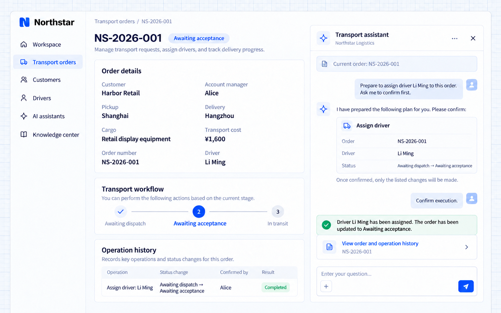

# Thực hiện thao tác nghiệp vụ

AI Employee có thể gọi các thao tác nghiệp vụ mà ứng dụng đã kết nối, biến yêu cầu bằng ngôn ngữ tự nhiên thành công việc cụ thể như phân công tài xế, tạo bản ghi theo dõi hoặc chuẩn bị thông báo. Ứng dụng quy định thao tác nào được phép, dữ liệu đầu vào bắt buộc, bước xác nhận và cách hiển thị kết quả.

Với các thay đổi dữ liệu, AI Employee có thể trình bày kế hoạch thao tác trước khi thực hiện. Thao tác nghiệp vụ vẫn phải qua kiểm tra quyền phía server, và kết quả báo lại phải khớp với bản ghi thực tế.

## Ví dụ: phân công tài xế sau khi xác nhận

Một điều phối viên của Northstar muốn phân công tài xế Li Ming cho đơn **NS-2026-001** ngay trong cuộc hội thoại của đơn hàng. Trợ lý vận tải trước tiên tóm tắt đơn hàng, tài xế và thay đổi trạng thái, giữ nguyên bản ghi cho đến khi được xác nhận. Sau khi xác nhận, trợ lý phân công tài xế và chuyển đơn từ Chờ điều phối sang Chờ nhận đơn.

Mô tả yêu cầu cho Agent phát triển của bạn:

```text
Connect a driver-assignment action to Northstar's transport assistant.
Use the current order context and check user permissions, order status, and driver availability.
Show the order number, driver, and status change before writing; require user confirmation.
After confirmation, execute and show the actual order and operation record. Explain failures without reporting success.
```

## Xem kết quả

Trong cuộc hội thoại của NS-2026-001, nhập:

```text
Prepare to assign driver Li Ming to this order. Ask me to confirm first.
```

Xem lại kế hoạch và trả lời “Xác nhận thực hiện.” Kết quả minh họa cho thấy Li Ming là tài xế, trạng thái là Chờ nhận đơn, và Alice là người đã xác nhận thao tác hoàn tất.



**Lời xác nhận trong hội thoại trở thành thay đổi trên bản ghi nghiệp vụ mà người dùng có thể kiểm tra trong đơn hàng và lịch sử thao tác.**

:::tip Lưu ý quan trọng

Việc phân công tài xế cần một thao tác do ứng dụng cung cấp. Chỉ dẫn hay prompt không cấp quyền ghi, và bước xác nhận không thể bỏ qua kiểm tra quyền, tình trạng sẵn sàng của tài xế hay trạng thái đơn hàng. Phân công không có nghĩa là tài xế đã nhận đơn, và cũng không tự động gửi thông báo.

:::
