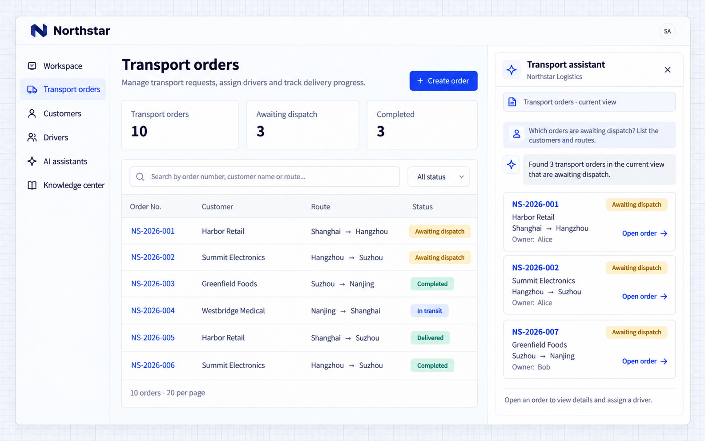

# Truy vấn nghiệp vụ

AI Employee có thể chuyển một câu hỏi bằng ngôn ngữ tự nhiên thành truy vấn nghiệp vụ đã được cấp quyền, sắp xếp các bản ghi và đưa ra liên kết đến trang. Các thao tác đọc đã kết nối cung cấp dữ liệu nghiệp vụ hiện tại, chứ không chỉ là lời khuyên chung chung.

## Ví dụ: tìm các đơn hàng chờ điều phối

```text
Connect order queries to Northstar's Transport assistant.
Let employees ask for orders awaiting dispatch or filter by customer, stage or route.
Respect the current user's data access. Return the order number, customer, route and owner as cards that open order details.
Explain when there are no matching orders in the user's scope. Continue follow-up questions with the selected order's context.
```

## Xem kết quả

Mở trợ lý trên danh sách đơn hàng và hỏi:

```text
Which orders are awaiting dispatch? Show their customers and routes.
```

Các thẻ gom nhóm mã đơn, khách hàng, tuyến đường và người phụ trách. Trong ví dụ này, **NS-2026-001, NS-2026-002 và NS-2026-007** đang chờ điều phối; người dùng có thể chọn một đơn để mở chi tiết.



**Kết quả truy vấn liên kết đến trang đơn hàng để người dùng tiếp tục xử lý bản ghi.**

## Mở rộng từ truy vấn sang thao tác

Yêu cầu Agent phát triển kết nối một thao tác cụ thể, chẳng hạn phân công tài xế, tạo bản ghi theo dõi hoặc chuẩn bị thông báo. Xác định dữ liệu đầu vào, quyền, bước xác nhận và nơi người dùng xem kết quả.

Truy vấn, đưa lời khuyên và ghi dữ liệu là những thao tác khác nhau. Lời khuyên tự nó không thay đổi bản ghi. Một thao tác ghi đã kết nối cần hiển thị kết quả thực tế và bản ghi xử lý của nó.
