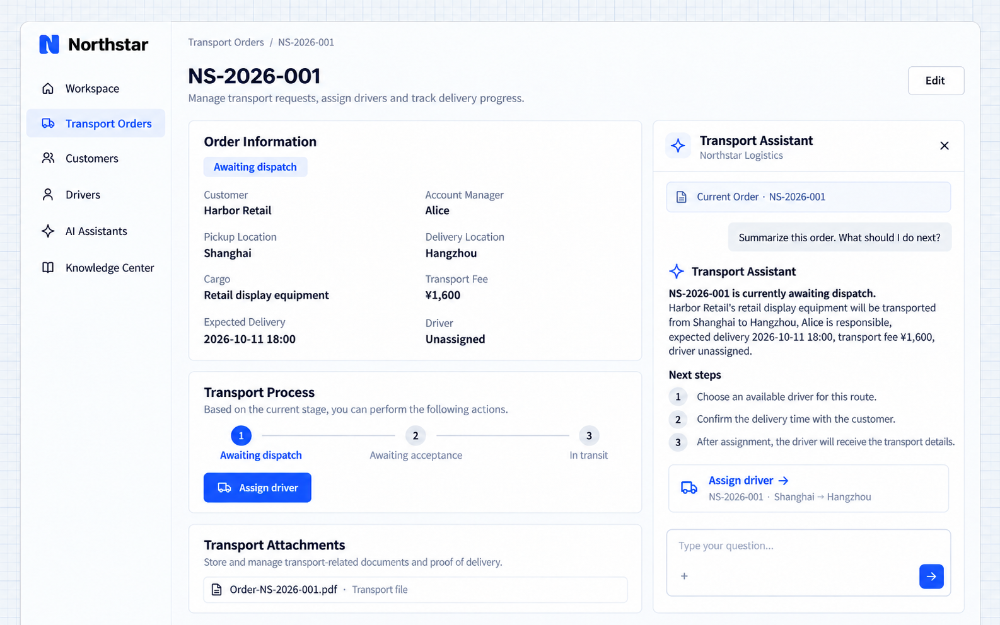

# Ngữ cảnh trang

Người dùng thường đặt câu hỏi về bản ghi họ đang xử lý. Ứng dụng có thể cung cấp mã định danh và ngữ cảnh cần thiết cho AI Employee, để người dùng hỏi bước tiếp theo mà không phải sao chép lại khách hàng, tuyến đường và trạng thái.

## Ví dụ: trợ lý bên cạnh chi tiết đơn hàng

```text
Add a Transport assistant panel beside Northstar order details.
Associate the conversation with the current order and use authorized business actions to read its customer, route, cargo, status, owner and driver.
Summarize the order and explain the next action for its stage. Include the corresponding business entry point.
Update context when the order changes; do not reuse the previous order's information.
Use the existing blue theme and keep the order and conversation visible together.
```

## Xem kết quả

Mở trợ lý bên cạnh **NS-2026-001** và hỏi:

```text
Summarize this order. What should I do next?
```

Chi tiết đơn hàng vẫn ở bên trái. Cuộc hội thoại nhận biết đơn hàng liên quan và giải thích bước tiếp theo cho trạng thái Chờ điều phối, kèm lối vào để phân công tài xế.



**Cuộc hội thoại bám theo đơn hàng hiện tại và kết nối với các thao tác nghiệp vụ của đơn đó.**

:::tip Lưu ý quan trọng

Ngữ cảnh giúp hiểu câu hỏi; còn quyền truy cập do server kiểm soát. Mã định danh đơn hàng không cấp quyền đọc đơn hàng đó. Hãy xác định các thao tác được phép và yêu cầu xác nhận trước khi kết nối các thao tác ghi, gửi tin nhắn hoặc phê duyệt.

:::
