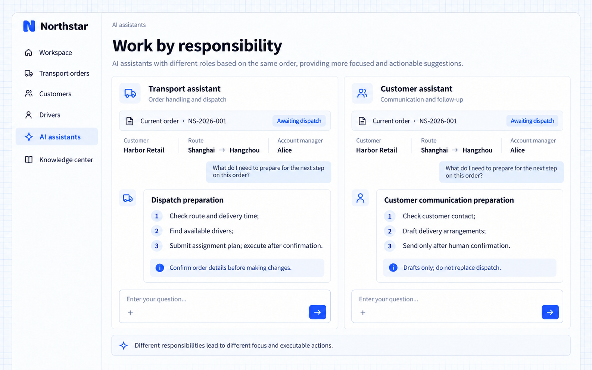

# Trách nhiệm và quy tắc làm việc

Chỉ dẫn của AI Employee có thể xác định nó phục vụ ai, nhiệm vụ, thứ tự ưu tiên khi phản hồi và quy tắc làm việc. Phương pháp làm việc có thể đưa vào các chỉ dẫn này. Các chế độ chạy hỗ trợ skill cũng có thể tái sử dụng chúng, giúp các trợ lý khác nhau tiếp cận cùng một câu hỏi nghiệp vụ theo đúng trách nhiệm của mình.

Chỉ dẫn và skill định hướng cách làm việc. Thao tác và quyền của ứng dụng quyết định những gì được thực thi. Chỉ dẫn bổ sung của AI Employee không thể ghi đè quy tắc của ứng dụng hay tác vụ hiện tại.

## Ví dụ: trợ lý vận tải và trợ lý khách hàng

Northstar muốn trợ lý vận tải tập trung vào đơn hàng và điều phối, còn trợ lý khách hàng tập trung vào giao tiếp và theo dõi. Khi được hỏi cần chuẩn bị gì tiếp theo cho **NS-2026-001**, một trợ lý sắp xếp công việc điều phối, trợ lý kia chuẩn bị nội dung liên hệ khách hàng. Thay đổi đơn hàng và gửi tin nhắn cần được xác nhận theo quy tắc của ứng dụng.

Mô tả yêu cầu cho Agent phát triển của bạn:

```text
Prepare transport and customer assistants for Northstar using an existing available model service.
The transport assistant handles orders and dispatch, checking the route, delivery time, and drivers first. Require confirmation before changing orders.
The customer assistant handles communication and follow-up, preparing a delivery-message draft without taking over dispatch or sending automatically.
Connect reads and actions appropriate to each responsibility. Explain missing information rather than inventing conclusions.
Show the active assistant and associated order in conversations so their priorities are clear.
```

## Xem kết quả

Hỏi từng trợ lý:

```text
What should we prepare next for this order?
```

Trợ lý vận tải liệt kê việc kiểm tra tuyến đường, tìm tài xế và kế hoạch phân công. Trợ lý khách hàng liệt kê việc kiểm tra thông tin liên hệ, soạn tin nhắn và chờ xác nhận trước khi gửi.



**Cùng một câu hỏi tạo ra phần chuẩn bị khác nhau theo từng trách nhiệm, cho nhân viên thấy ai xử lý việc gì và chỗ nào cần xác nhận.**

:::tip Lưu ý quan trọng

Chỉ dẫn không thay thế kiểm soát truy cập. Trợ lý chỉ được phép soạn bản nháp thì không nên được cấp thao tác gửi. Với các thao tác thực tế, hãy xác định đầu vào, quyền, bước xác nhận và bản ghi kết quả cùng lúc. Phương pháp trong skill cũng phải tuân theo các quy tắc này.

:::
