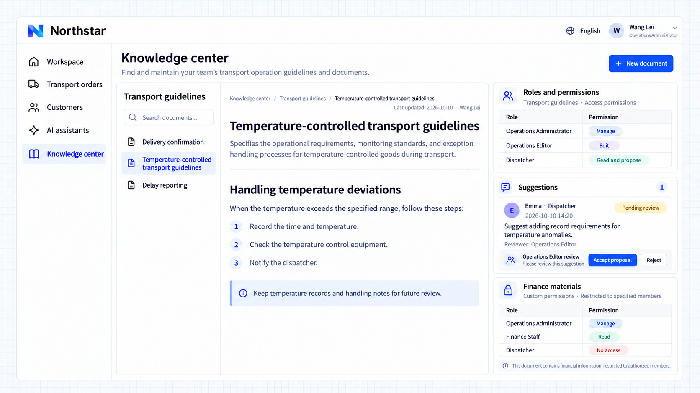

# Quyền truy cập và cộng tác

Không gian tri thức, thư mục và tài liệu có thể cấp quyền đọc, đề xuất, chỉnh sửa và quản lý. Người đọc tra cứu nội dung, người đóng góp đề xuất thay đổi, biên tập viên duy trì nội dung và duyệt đề xuất, còn người quản lý có thể thay đổi cả quyền truy cập. Tài liệu có thể kế thừa quyền từ không gian hoặc thư mục cha, hoặc chỉ cho phép những thành viên được chỉ định.

## Ví dụ: cùng duy trì hướng dẫn vận tải

Quản trị viên vận hành của Northstar quản lý không gian hướng dẫn vận tải, còn biên tập viên vận hành duy trì nội dung. Điều phối viên cần đọc hướng dẫn và đề xuất thay đổi để biên tập viên duyệt. Tài liệu tài chính chỉ dành cho các thành viên được cấp quyền.

```text
Assign access and collaboration permissions by responsibility in Northstar's knowledge center.
Operations administrators can manage transport guidelines, operations editors can edit and review proposals, and dispatchers can read and propose changes.
Show permissions and proposals beside documents. Allow only specified members to access financial materials; exclude dispatchers.
```

## Xem kết quả

Mở **Hướng dẫn vận tải hàng kiểm soát nhiệt độ** để xem quyền truy cập của từng vai trò. Điều phối viên Emma đề xuất bổ sung yêu cầu ghi nhận sai lệch nhiệt độ. Biên tập viên vận hành có thể chấp nhận hoặc từ chối đề xuất; đề xuất đang chờ không trực tiếp thay đổi tài liệu. Tài liệu tài chính chỉ giới hạn cho các thành viên được chỉ định, nên điều phối viên không thể xem nội dung.



**Nhân viên đọc và cộng tác trong phạm vi trách nhiệm của mình, thay đổi phải qua bước duyệt, và nội dung bị giới hạn chỉ dành cho đúng đối tượng được cấp quyền.**

:::tip Lưu ý quan trọng

Người quản lý không gian vẫn giữ quyền quản lý ngay cả khi tài liệu chỉ giới hạn cho các thành viên được chỉ định. Việc AI sử dụng tri thức cũng phải tuân theo quyền truy cập. Quyền đề xuất thay đổi không bao gồm quyền chỉnh sửa trực tiếp hay duyệt đề xuất.

:::
