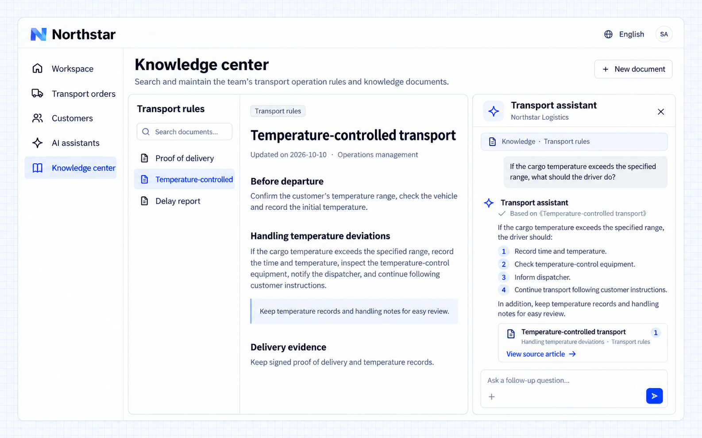

# Trả lời dựa trên tri thức

Quy định của công ty thường nằm trong tài liệu. AI Employee có thể tìm tài liệu mà người dùng có quyền truy cập, sắp xếp câu trả lời theo câu hỏi và cung cấp nguồn để người dùng kiểm tra và đọc thêm.

## Ví dụ: tìm quy trình xử lý sự cố vận tải

```text
Let Northstar's Transport assistant use the transport procedures space.
Retrieve relevant material before answering procedural questions. Include document and passage links.
Say when no supporting material was found; do not invent company rules.
Provide a conversation panel in the knowledge center with the original text visible beside the answer.
Respect the knowledge scopes available to the current user and assistant, including restricted finance material.
```

## Xem kết quả

Mở **Vận tải hàng kiểm soát nhiệt độ** trong trung tâm tri thức và hỏi:

```text
What should the driver do if the shipment temperature is outside the agreed range?
```

Tài liệu vẫn hiển thị bên trái. Câu trả lời sắp xếp các bước: ghi lại thời gian và nhiệt độ, kiểm tra thiết bị, báo cho bộ phận điều phối và làm theo chỉ dẫn của khách hàng. Một thẻ nguồn liên kết đến **Xử lý sai lệch nhiệt độ**.



**Câu trả lời gắn với tài liệu của công ty để người dùng kiểm tra các yêu cầu áp dụng.**

:::tip Lưu ý quan trọng

Tri thức giải thích cách xử lý một tình huống; truy vấn nghiệp vụ cung cấp dữ kiện hiện tại. Hãy duy trì tài liệu luôn cập nhật cùng quy tắc truy cập của nó. Lời khuyên từ tài liệu không tự động trở thành thao tác nghiệp vụ được thực thi.

:::
