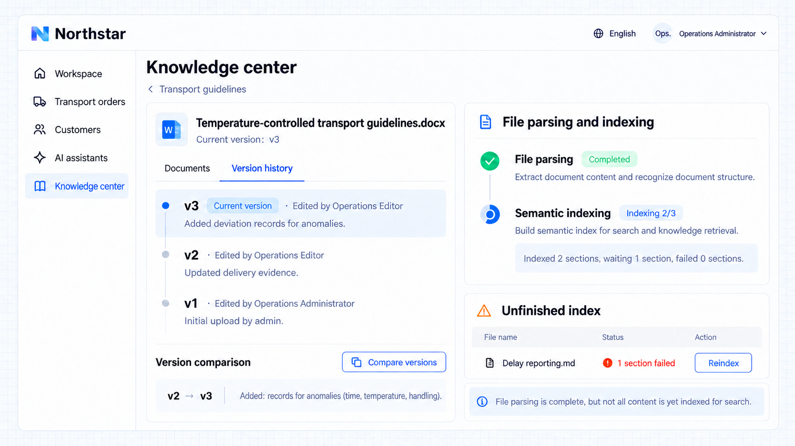

# Phiên bản và trạng thái xử lý

Khi cập nhật bài viết và tệp, lịch sử phiên bản được giữ lại để bạn xem nội dung trước đó và so sánh thay đổi. Trích xuất văn bản từ tệp tải lên và xây dựng chỉ mục cho truy xuất ngữ nghĩa là hai giai đoạn riêng: phân tích hoàn tất nghĩa là văn bản đã được trích xuất, còn trạng thái lập chỉ mục mô tả tiến độ xử lý các phần của tài liệu hiện tại.

## Ví dụ: cập nhật hướng dẫn vận tải hàng kiểm soát nhiệt độ

Biên tập viên vận hành của Northstar bổ sung yêu cầu ghi nhận sai lệch vào hướng dẫn. Quản trị viên vận hành cần so sánh các phiên bản, kiểm tra tiến độ phân tích tệp và lập chỉ mục ngữ nghĩa, đồng thời xác định tài liệu nào chưa lập chỉ mục xong.

```text
Show version history and comparisons for the temperature-controlled transport guidelines in Northstar's knowledge center.
In the transport guidelines space with semantic retrieval enabled, show file parsing status, section indexing progress, and materials with unfinished indexing separately.
Show reasons and a reindex action for indexing failures. Do not display one parsed file as proof that the entire knowledge base is searchable.
```

## Xem kết quả

Mở lịch sử phiên bản của **Hướng dẫn vận tải hàng kiểm soát nhiệt độ.docx** và so sánh v2 với v3 hiện tại. Bản cập nhật bổ sung yêu cầu ghi lại thời gian, nhiệt độ và cách xử lý sai lệch. Việc phân tích tệp đã hoàn tất, nhưng mới chỉ **2 trên 3 phần** được lập chỉ mục, một phần vẫn đang chờ. Danh sách lập chỉ mục chưa hoàn tất cũng cho thấy một phần bị lỗi trong **Báo cáo chậm trễ.md** kèm thao tác lập chỉ mục lại.



**Thay đổi nội dung luôn truy vết được, tiến độ phân tích và lập chỉ mục được hiển thị riêng, và người duy trì có thể tiếp tục xử lý các tài liệu chưa hoàn tất.**

:::tip Lưu ý quan trọng

Trạng thái lập chỉ mục ngữ nghĩa chỉ có khi ứng dụng tích hợp năng lực truy xuất tương ứng. Phân tích xong một tệp hay lập chỉ mục xong một tài liệu không có nghĩa toàn bộ tri thức đã sẵn sàng để trả lời câu hỏi. Câu trả lời vẫn cần nội dung truy xuất phù hợp và quyền truy cập thích hợp. Lịch sử phiên bản không có nghĩa là các nguồn bên ngoài được tự động đồng bộ.

:::
