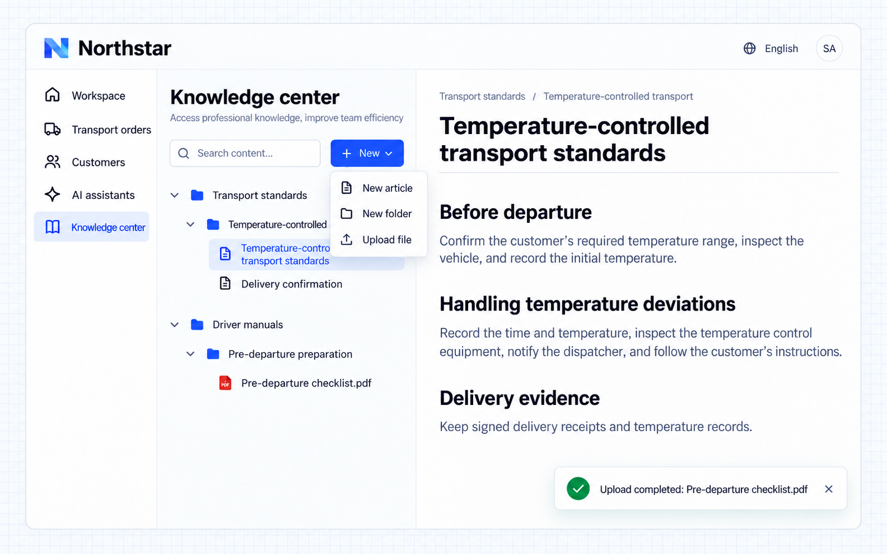

# Sắp xếp và nhập tài liệu

Cơ sở tri thức tách tài liệu theo không gian và sắp xếp bài viết, tệp trong các thư mục. Bài viết phù hợp với hướng dẫn nghiệp vụ cần duy trì thường xuyên; tệp giúp bạn nhập tài liệu có sẵn. Tệp tải lên có bản xem trước tệp gốc và văn bản được trích xuất để đọc và tìm kiếm.

## Ví dụ: tiêu chuẩn vận tải và sổ tay tài xế

Đội vận hành của Northstar duy trì yêu cầu vận tải hàng kiểm soát nhiệt độ và yêu cầu giao hàng, đồng thời cần đưa danh sách kiểm tra trước khi xuất phát có sẵn đến tài xế. Các không gian riêng biệt giúp nhân viên tìm tài liệu theo mục đích.

Giao yêu cầu cho Agent:

```text
Organize two knowledge spaces in Northstar's knowledge center:
Transport standards and Driver manuals.
Under Transport standards, create a Temperature-controlled transport folder
with Temperature-controlled transport standards and Delivery confirmation articles.
The standards article should cover Before departure, Handling temperature deviations,
and Delivery evidence.
Under Driver manuals, create a Pre-departure preparation folder with a file upload entry.
I will upload the existing Pre-departure checklist.pdf; do not invent its contents.
Employees can open articles or files from the tree.
Editors can create articles and folders and upload files.
```



**Tiêu chuẩn vận tải và sổ tay tài xế tạo thành một cây thư mục rõ ràng. Bài viết có thể được duy trì trực tiếp, còn các tệp PDF có sẵn có thể đặt vào thư mục phù hợp để nhân viên đọc.**

:::tip Lưu ý quan trọng

Duy trì tài liệu cần quyền chỉnh sửa. Tải lên thành công và trích xuất văn bản hoàn tất là hai trạng thái riêng; hãy xác nhận việc trích xuất đã xong trước khi tìm kiếm nội dung tệp. Việc sắp xếp và đọc văn bản gốc hoạt động độc lập; tìm kiếm ngữ nghĩa cần mô hình và chỉ mục.

:::
