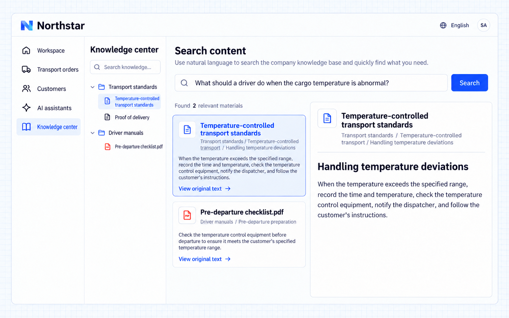

# Đọc và tìm kiếm

Nhân viên có thể mở bài viết hoặc tệp từ cây tri thức để đọc hướng dẫn nghiệp vụ gốc, hoặc nhập từ khóa để tìm tài liệu liên quan. Kết quả tìm kiếm hiển thị tiêu đề tài liệu, phần và trích đoạn để người dùng đánh giá mức độ liên quan và quay lại ngữ cảnh gốc.

Khi ứng dụng kết nối tìm kiếm ngữ nghĩa, nhân viên có thể mô tả câu hỏi bằng ngôn ngữ tự nhiên và tìm các đoạn liên quan theo ý nghĩa mà không cần biết chính xác từ ngữ.

## Ví dụ: tìm yêu cầu xử lý sai lệch nhiệt độ

Một tài xế của Northstar cần tìm yêu cầu xử lý khi nhiệt độ bị sai lệch và đối chiếu với văn bản gốc. Họ có thể tìm “sai lệch nhiệt độ” nếu biết thuật ngữ, hoặc hỏi “Tài xế cần làm gì khi nhiệt độ hàng hóa bất thường?” nếu không biết.

Giao yêu cầu cho Agent:

```text
Provide reading and search entries in Northstar's knowledge center.
Employees can search for "temperature deviation", see documents, sections
and excerpts, and open the original text.
Connect semantic search so "What should a driver do when the cargo temperature
is abnormal?" also finds Handling temperature deviations in the transport standards.
Show the source of each result and open the original text when selected.
Keep the current user's readable materials as the search scope.
Confirm the required model and index are available;
do not treat keyword search as enabled semantic search.
```



**Khi đã kết nối tìm kiếm ngữ nghĩa, một câu hỏi bằng ngôn ngữ tự nhiên sẽ tìm ra hướng dẫn liên quan. Tài liệu, phần và đoạn gốc là bằng chứng để nhân viên kiểm tra.**

:::tip Lưu ý quan trọng

Có thể tra cứu theo từ khóa ngay. Tìm kiếm ngữ nghĩa cần ứng dụng kết nối một mô hình phù hợp và chỉ mục tài liệu dùng được. Tìm thấy tài liệu liên quan không có nghĩa là AI đã soạn câu trả lời. Để có câu trả lời dựa trên các tài liệu đó, xem [Trả lời câu hỏi bằng tri thức](./answers.md).

:::
