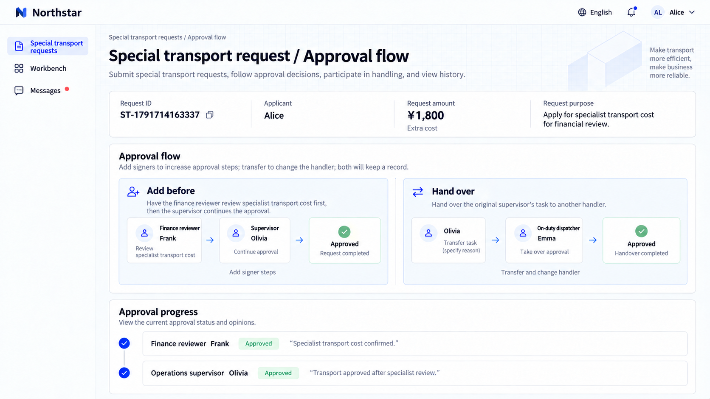
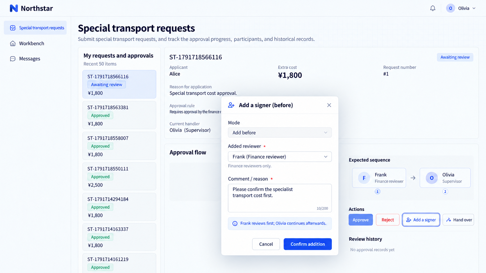
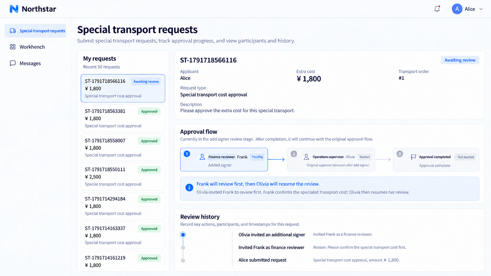
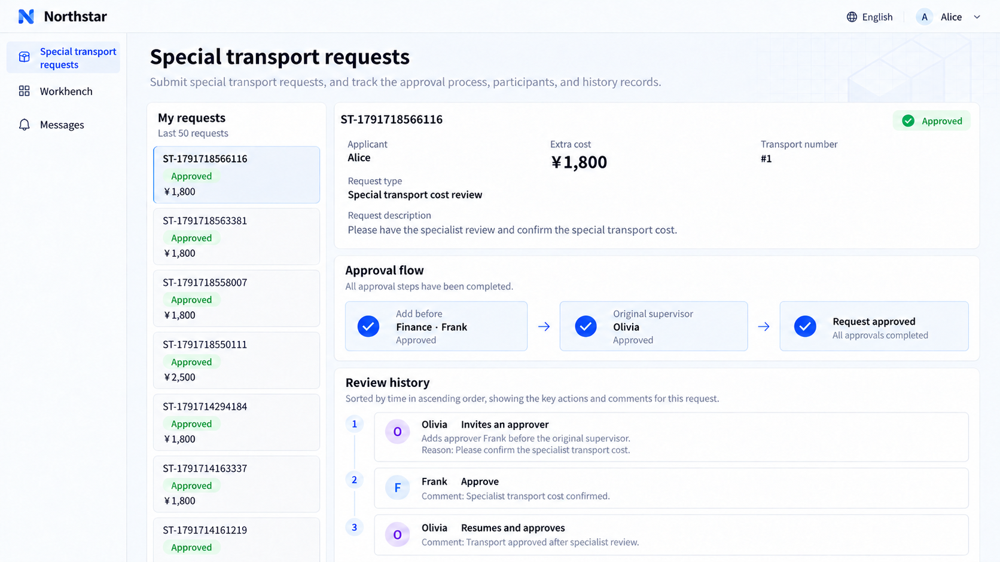
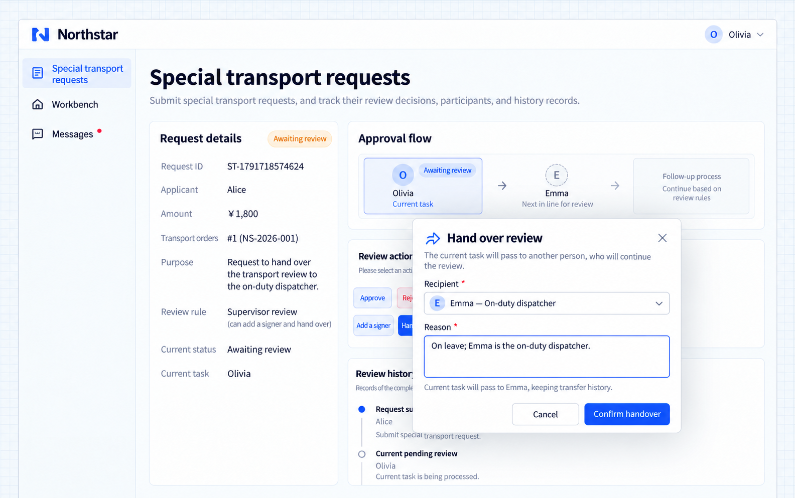
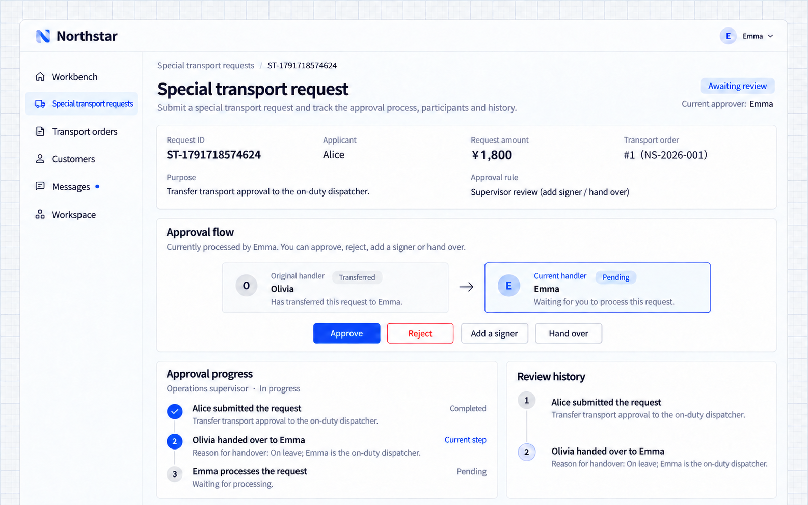
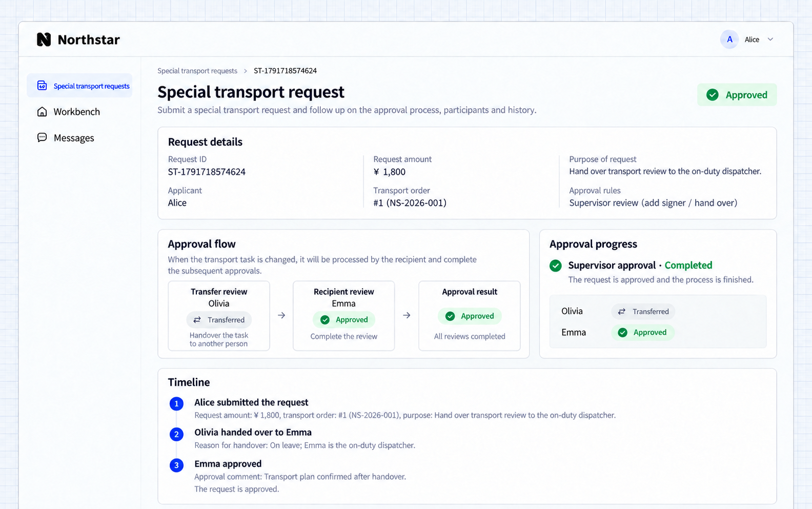

# Thêm người duyệt và chuyển giao

Thêm một người khác vào lượt duyệt đang diễn ra hoặc chuyển tác vụ hiện tại cho một người đủ điều kiện. Cả hai thao tác đều lưu lại người duyệt ban đầu, người tham gia mới, lý do và các ý kiến sau đó.

| Thao tác | Cách tham gia                                                                           |
| --------- | --------------------------------------------------------------------------------------- |
| Trước    | Người được thêm duyệt trước; người duyệt ban đầu chờ rồi tiếp tục.         |
| Sau     | Người duyệt ban đầu đồng ý, sau đó người được thêm duyệt trước khi hoàn tất.        |
| Song song | Người được thêm cùng tham gia với những người duyệt hiện tại theo chính sách quyết định của giai đoạn. |
| Chuyển giao  | Một người duyệt mới tiếp nhận tác vụ hiện tại; lịch sử chuyển giao vẫn được giữ.               |

## Ví dụ: mời chuyên viên duyệt hoặc chuyển cho trưởng ca trực

Một giám sát viên đề nghị bộ phận tài chính duyệt trước hàng đặc biệt, hoặc chuyển tác vụ cho điều phối viên đang trực khi không thể tự xử lý.

```text
Allow adding a reviewer before the supervisor and transferring tasks in Northstar special transport review.
Added reviewers must be finance reviewers. The original supervisor continues afterwards.
Transfers must select the on-duty dispatcher and include a reason.
Retain original tasks, added or replacement reviewers, reasons and opinions.
Show the added-signer and handover paths with their reviewers in a flow diagram on request details.
```

## Xem luồng phê duyệt trong ứng dụng

Chi tiết yêu cầu hiển thị cả hai luồng: với thêm người duyệt, Frank duyệt trước rồi Olivia tiếp tục; với bàn giao, Emma tiếp nhận. Tiến độ phê duyệt thực tế và lịch sử xử lý nằm bên dưới.



**Thêm người duyệt làm tăng số người tham gia; chuyển giao thay đổi người xử lý. Cả hai đều giữ lại lịch sử trách nhiệm.**

## Xem kết quả trong ứng dụng

### 1. Thêm trước: chuyên viên duyệt trước

Nộp một yêu cầu vận chuyển đặc biệt với quy tắc cho phép thêm người duyệt hoặc chuyển giao. Olivia chọn **Thêm người ký** và mời người duyệt tài chính Frank đánh giá chi phí xử lý chuyên biệt trước. Frank nhận một tác vụ chờ xử lý, còn tác vụ của Olivia chuyển sang **Bị chặn**. Lịch sử ghi lại lời mời, chế độ và ghi chú.





**Thêm người duyệt trước sẽ chèn một bước duyệt và chặn người duyệt ban đầu cho đến khi bước đó xong.**

Sau khi Frank đồng ý, Olivia có thể tiếp tục. Khi Olivia đồng ý, yêu cầu hoàn tất với trạng thái **Đã phê duyệt**, giữ nguyên cả hai ý kiến và thứ tự của chúng.



**Ý kiến đồng ý của chuyên viên cho phép người duyệt ban đầu tiếp tục; người duyệt ban đầu vẫn tự đưa ra quyết định của mình.**

### 2. Chuyển giao: người nhận hoàn tất việc duyệt

Không thể xử lý thêm một yêu cầu nữa, Olivia chọn **Bàn giao**, chọn điều phối viên đang trực Emma và nhập lý do. Tác vụ ban đầu hiển thị **Đã chuyển giao**. Emma nhận tác vụ kế tiếp cùng các thao tác của nó, còn lịch sử lưu lại người gửi, người nhận và lý do.





**Người nhận tiếp quản tác vụ hiện tại; người duyệt ban đầu không còn xử lý tác vụ đó.**

Sau khi Emma đồng ý, yêu cầu chuyển sang **Đã phê duyệt**. Lý do bàn giao của Olivia và ý kiến cuối cùng của Emma vẫn còn trong lịch sử.



**Người nhận hoàn tất việc duyệt, thay đổi trách nhiệm và các quyết định đều được lưu lại.**

:::tip Lưu ý quan trọng

Hãy chỉ định các chế độ thêm người duyệt được phép và những người có thể nhận chuyển giao. Xác định người tham gia được thêm ảnh hưởng thế nào đến chính sách quyết định ban đầu, thay vì cho phép bất kỳ người dùng nào trở thành người duyệt.

:::

## Thay đổi trách nhiệm từ phía quản trị

Yêu cầu Agent xây dựng một trang quản lý riêng cho nghiệp vụ để xử lý nhân viên đã nghỉ, thiếu người duyệt hoặc lỗi thực thi. Xác định phạm vi bản ghi, quyền và các thao tác phân công, phân công lại, điều phối lại hoặc đặt lại. Giữ lại lý do, tác vụ ban đầu và lịch sử.

Xác định việc điều phối lại hoặc đặt lại là thay người xử lý hay kết thúc vòng hiện tại rồi nộp lại. Chỉ rõ các trạng thái đủ điều kiện, giai đoạn bắt đầu lại và cách xử lý ý kiến, thời hạn, ngân sách và công việc đã hoàn tất trước đó.

```text
Build a Northstar approval management page. Authorized administrators can view only requests, tasks, history and execution results within their business responsibility, and handle inactive staff, missing reviewers and execution failures.
Allow assignment and reassignment with a reason. Before adding redispatch or reset, confirm when it is allowed, where review restarts, whether opinions and deadlines remain, and what happens to reserved budgets and completed work. Never delete the original records. Show me the page and permission plan first.
```

Kiểm tra thứ tự thêm người duyệt, giới hạn ứng viên và quyền quản trị. Tác vụ đã vô hiệu không thể xử lý, và các thay đổi trách nhiệm vẫn truy vết được.
