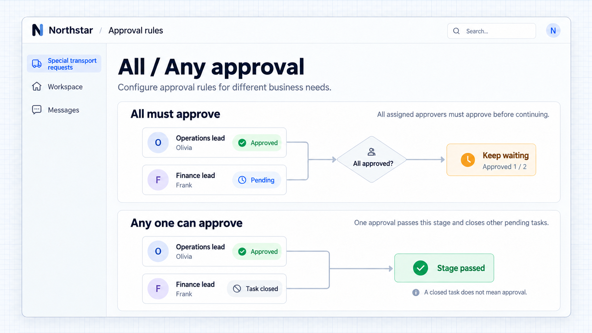
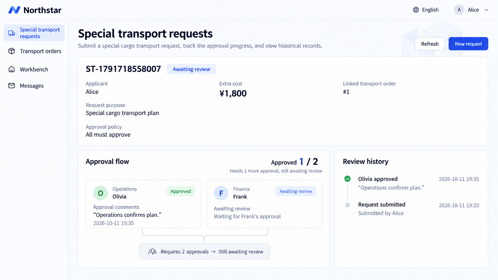
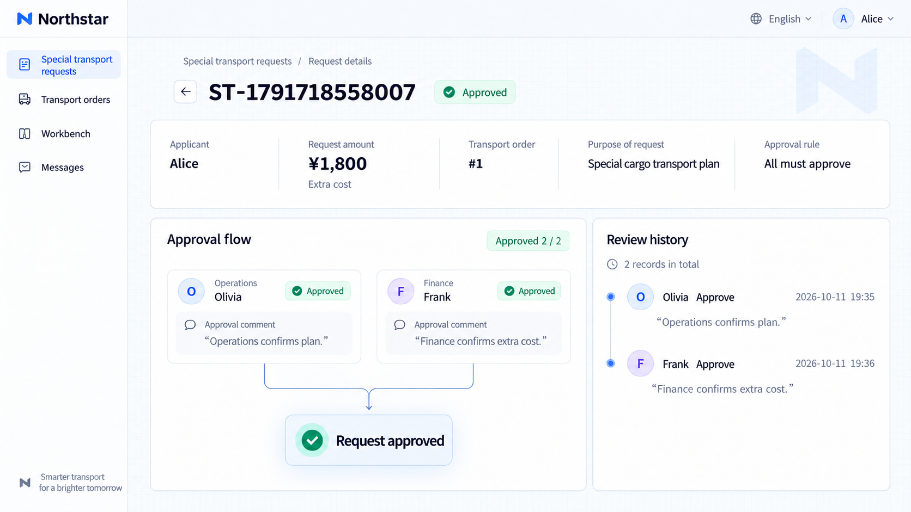
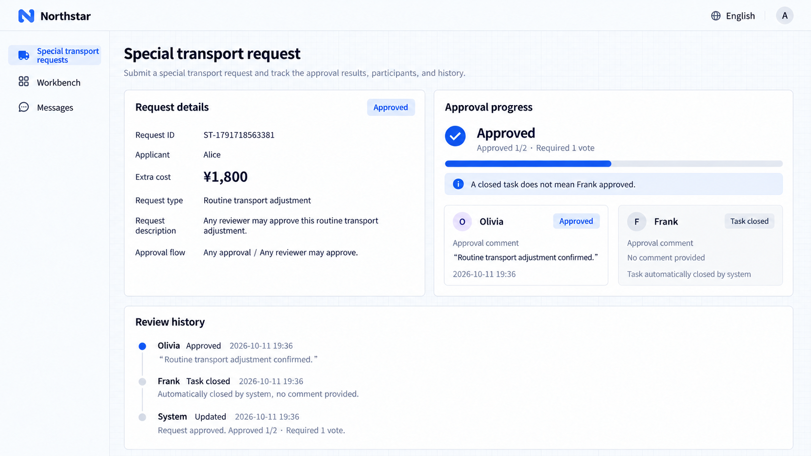

# Duyệt đồng thuận và quy tắc thông qua

Nhiều người có thể cùng quyết định trong một giai đoạn. Chính sách đã cấu hình sẽ tổng hợp ý kiến của họ để xác định phê duyệt, từ chối hay tiếp tục chờ.

| Chính sách            | Kết quả                                                                                              |
| ----------------- | --------------------------------------------------------------------------------------------------- |
| Tất cả đồng ý      | Mọi người đều phải đồng ý. Một ý kiến từ chối có thể kết thúc giai đoạn ngay lập tức hoặc sau khi thu đủ ý kiến. |
| Bất kỳ ai đồng ý      | Một người đồng ý là đủ; chỉ từ chối khi không ai đồng ý.                                 |
| Trả lời đầu tiên      | Câu trả lời hợp lệ đầu tiên quyết định kết quả.                                                       |
| Ngưỡng phiếu    | Phê duyệt cần một số phiếu nhất định, có thể tính theo tỷ lệ khi cần.            |
| Duyệt tuần tự | Những người tham gia trong giai đoạn lần lượt xử lý tác vụ theo thứ tự.                                                |

Nhiều giai đoạn đi qua các bước duyệt khác nhau; duyệt đồng thuận tổng hợp ý kiến trong cùng một bước.

## Ví dụ: hai trưởng bộ phận cùng duyệt hàng đặc biệt

Hàng đặc biệt cần cả bộ phận vận hành và tài chính đồng ý. Điều phối thông thường chỉ cần một người duyệt có thẩm quyền của vận hành hoặc tài chính phê duyệt.

```text
Add joint review to Northstar special cargo requests. Both operations and finance leads must approve.
Reject immediately when either rejects, requiring a reason. After one approval, keep waiting for the other.
Use any-approval for routine dispatch: one on-duty supervisor’s approval is sufficient.
Show individual opinions and whom the request is still waiting for.
```

## Xem sơ đồ quy tắc



**Tất cả đồng ý thì chờ mọi người; bất kỳ ai đồng ý thì thông qua ngay khi một người đồng ý.**

## Xem kết quả trong ứng dụng

### 1. Tất cả đồng ý: tiếp tục chờ sau quyết định đầu tiên

Tạo và nộp một yêu cầu trong **Yêu cầu vận chuyển đặc biệt**, chọn **Duyệt đồng thuận — tất cả đồng ý**. Sau khi người duyệt vận hành Olivia đồng ý, yêu cầu vẫn ở trạng thái **Chờ duyệt**. Trang hiển thị **1 trên 2** ý kiến đồng ý và cho biết đang chờ Frank.



**Ý kiến đồng ý đầu tiên hoàn tất phần duyệt của một người; yêu cầu vẫn chờ người còn lại.**

Sau khi người duyệt tài chính Frank đồng ý, yêu cầu chuyển sang **Đã phê duyệt**. Cả hai ý kiến và lịch sử xử lý vẫn nằm trong trang chi tiết.



**Tất cả đồng ý được thông qua khi cả hai người duyệt đều đồng ý.**

### 2. Bất kỳ ai đồng ý: một quyết định là đủ

Tạo một điều chỉnh vận chuyển thông thường với **Bất kỳ người duyệt nào cũng có thể phê duyệt**. Sau khi Olivia đồng ý, yêu cầu chuyển sang **Đã phê duyệt**. Tác vụ còn lại của Frank đóng cùng với giai đoạn, không cần thêm ý kiến.



**Một ý kiến đồng ý là thông qua giai đoạn. Tác vụ bị đóng không có nghĩa là người kia đã đồng ý.**

:::tip Lưu ý quan trọng

Hãy xác định cả chính sách phê duyệt lẫn chính sách từ chối. Quyết định theo tỷ lệ còn cần số người tham gia, quy tắc làm tròn và một ngưỡng phiếu cụ thể. Có một số ý kiến đồng ý chưa chắc đã hoàn tất giai đoạn.

:::

## Làm rõ quy tắc tổng hợp

Với bỏ phiếu, hãy xác định số người tham gia, số phiếu cần thiết, phiếu trắng, vị trí có quyền phủ quyết và có cần đủ tất cả ý kiến hay không. Quyết định theo từng mục, phê duyệt một phần và quy đổi tỷ lệ là các quy tắc riêng của nghiệp vụ để Agent triển khai; chỉ nói "hai phần ba đồng ý" là chưa đủ.

Nhận việc theo nhóm khác với duyệt đồng thuận: một thành viên có thể đại diện cho cả nhóm, còn duyệt đồng thuận cần ý kiến của từng cá nhân. Hãy chọn mô hình trước khi định nghĩa quy tắc nhận việc, trả việc và hết thời gian.

```text
Assign finance review for ordinary Northstar dispatch requests to qualified finance staff as a team. A member claims the task and acts for the team; others cannot handle it until it is released. Explain how this differs from requiring two finance reviewers to agree, then implement the option I confirm.
```

Với duyệt đồng thuận, ý kiến đồng ý đầu tiên không được đẩy yêu cầu đi tiếp quá sớm. Khi phê duyệt kiểu bất kỳ ai đồng ý đóng các tác vụ khác, điều đó không có nghĩa những người duyệt kia đã đồng ý. Các lần nộp lặp lại hoặc đồng thời không được đếm trùng phiếu hay ghi đè ý kiến.
