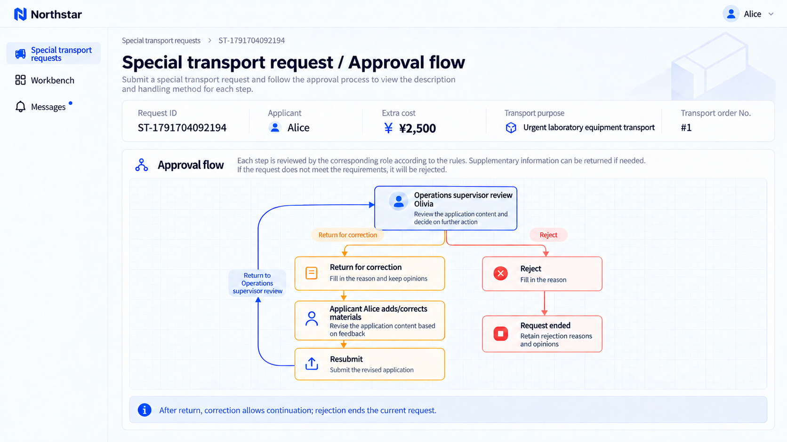
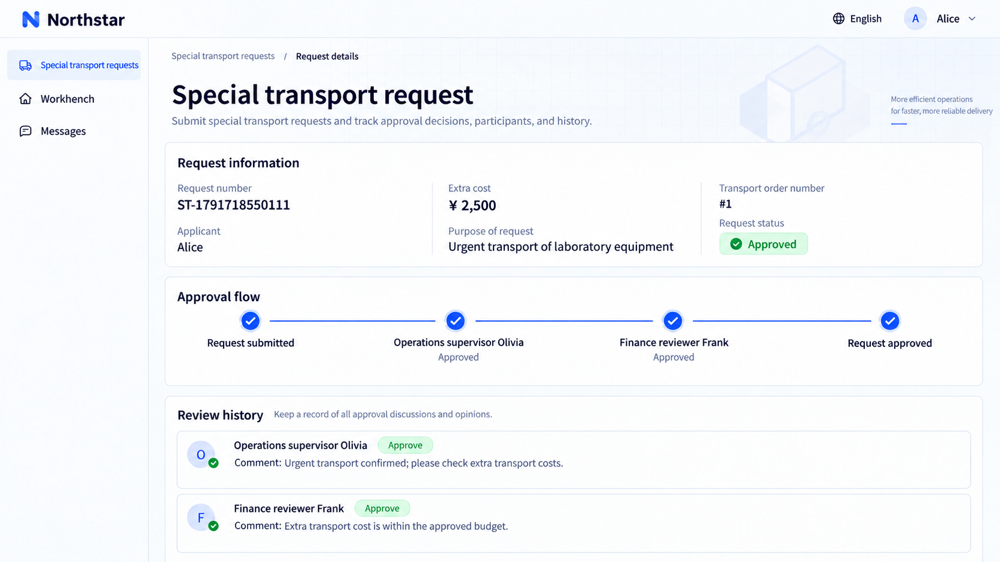

# Xử lý yêu cầu và tiến độ

Phê duyệt có thể bao quát việc nộp, duyệt, chỉnh sửa, nộp lại và hoàn tất. Người nộp đơn theo dõi tiến độ, người duyệt xử lý tác vụ, còn người được sao gửi đọc tài liệu và ý kiến. Mỗi vai trò có các thao tác tương ứng.

## Trả lại, từ chối và rút lại

| Thao tác         | Tác dụng                                                                        |
| ----------------- | ----------------------------------------------------------------------------- |
| Trả lại            | Quay về một giai đoạn chỉ định để chỉnh sửa trong phạm vi cho phép và nộp lại.           |
| Từ chối            | Kết thúc yêu cầu hiện tại, giữ lại lý do và ý kiến.                      |
| Rút lại          | Người nộp đơn rút lại ở các giai đoạn cho phép, đóng các tác vụ duyệt hiện tại.    |
| Yêu cầu bổ sung tài liệu | Người duyệt chờ tài liệu bổ sung, sau đó tiếp tục tác vụ ban đầu. |

### Ví dụ: trả lại hồ sơ chưa đầy đủ

```text
Allow Northstar supervisors to return requests with missing materials to applicants, with a reason.
Allow correction and resubmission, retain earlier opinions and determine reviewers again on review entry.
Allow applicants to withdraw before completion; reviewers cannot handle closed tasks.
Distinguish return, rejection and withdrawal, and show who should act next.
Show the return/correction/resubmission and rejection paths as a flow diagram in request details.
```

Chi tiết yêu cầu hiển thị luồng phê duyệt cùng với thông tin yêu cầu và tiến độ phê duyệt thực tế.



**Yêu cầu bị trả lại có thể tiếp tục sau khi chỉnh sửa; từ chối thì kết thúc yêu cầu và giữ lại lý do.**

## Sao gửi và xác nhận đã xem

Sao gửi yêu cầu cho những người cần biết tiến độ và kết quả. Người nhận có thể đọc tài liệu, ý kiến và xác nhận đã đọc; xác nhận đã xem không được tính là phiếu phê duyệt.

```text
Copy Northstar special transport requests to the responsible account manager.
Provide Copied to me and read confirmation. Recipients can view progress and opinions without deciding approval.
```

## Thời hạn và phân công tác vụ

Phê duyệt hỗ trợ nhắc nhở, chuyển cấp và nhận việc theo nhóm. Việc nhận đã hết hạn có thể được trả lại để người khác xử lý, với thời gian tính theo lịch làm việc khi cần.

```text
Remind Northstar supervisors after one working day and escalate to their manager after two.
Allow eligible team members to claim tasks; release claims left unhandled past their deadline.
Show the current handler, deadline and assignment history.
```

## Xem kết quả phê duyệt

Sau khi trưởng vận hành Olivia và trưởng tài chính Frank đồng ý yêu cầu vận chuyển đặc biệt, yêu cầu hiển thị **Đã phê duyệt**. Trang chi tiết giữ lại cả hai người duyệt và ý kiến của họ.



**Người nộp đơn có thể xem quyết định cuối cùng, người duyệt và ý kiến ở từng giai đoạn.**

:::tip Lưu ý quan trọng

Hãy chỉ rõ các giai đoạn cho phép rút lại, nơi trả lại về và có tái sử dụng ý kiến cũ khi nộp lại hay không. Tách biệt xác nhận đã xem của người được sao gửi với việc bỏ phiếu, và xác định các hành động khi đến hạn như nhắc nhở, chuyển cấp hoặc chuyển giao.

:::

## Bằng chứng sau khi nộp lại

Giữ lịch sử không có nghĩa là tái sử dụng các lần phê duyệt trước. Mặc định phải duyệt lại; nếu có thể tái sử dụng ý kiến, hãy xác định nội dung nào phải giữ nguyên. Có thể chờ tài liệu bổ sung ngay trong một tác vụ mà không cần trả lại cả yêu cầu. Trang đã cũ và tác vụ đã vô hiệu không thể phê duyệt nội dung mới.

## Thực thi sau phê duyệt và quyền trên trang

Hiển thị riêng biệt các trạng thái phê duyệt, lên lịch thực thi, thành công và thất bại. Xác định cách từ chối, rút lại, chấm dứt và trả lại giải phóng ngân sách đã giữ. Đối soát các kết quả thanh toán không xác định trước khi thử lại để tránh thanh toán trùng. Người được sao gửi xác nhận đã nắm thông tin mà không bỏ phiếu.

```text
Review resubmitted Northstar special transport requests again, retaining previous opinions and edits while invalidating old tasks. Applicants see their own requests; reviewers and copy recipients see only authorized content. Explain unavailable actions and show updated progress after others act.
Notify the applicant and account manager after approval, without paying automatically for now. If payment is added later, show approval, scheduling and payment results separately. Only authorized people may retry; do not pay again while the previous result is unknown. Confirm budget reservation and release rules for each exit first.
```

## Nghiệm thu, phát hành và xử lý sự cố

Kiểm tra quyền xem, thao tác, tuyến theo số tiền, quyết định chung, nộp lại, thời hạn và thực thi đối với người nộp đơn, người duyệt, người được sao gửi và quản trị viên. Chỉ rõ thời gian theo lịch hay theo giờ làm việc, ngày lễ và việc nộp lại có tính lại thời hạn hay không. Các xử lý đã thống nhất phải vẫn đúng sau khi khởi động lại.

```text
Give me trial steps and verification results for Northstar approvals: amount routes, joint review, returns, added reviewers and transfers match the rules; old tasks and stale pages cannot approve, and unrelated people cannot view or act; repeated clicks and concurrent actions cannot duplicate approvals or payments. Explain unverified areas and the people, permissions and notifications I must confirm before release.
Before changing rules, list requests still under review and ask whether they should continue under the original rules or be resubmitted. Explain how tasks, opinions and deadlines are handled. For a stuck request, investigate its stage, waiting participants, tasks, history and execution results before an authorized person acts with a recorded reason.
```

Báo lại yêu cầu, danh tính của bạn, thao tác, kết quả mong đợi và kết quả thực tế. Gửi cho Agent đúng thông báo lỗi trên trang thay vì đoán là thiếu gói nào. Xem [Tài liệu tham khảo cho lập trình viên](./extension.md) để biết ranh giới tích hợp và quy tắc tùy chỉnh.
