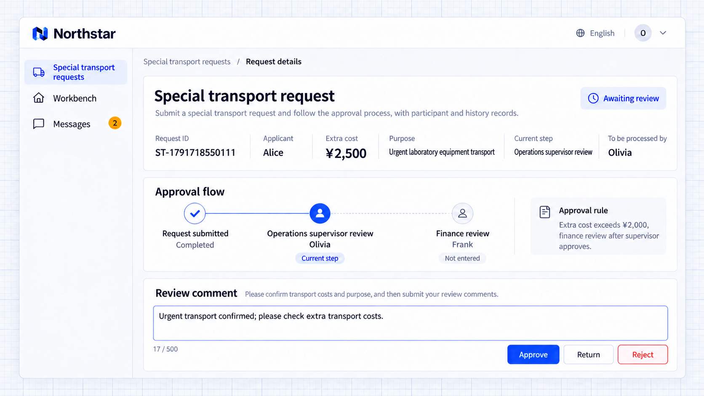
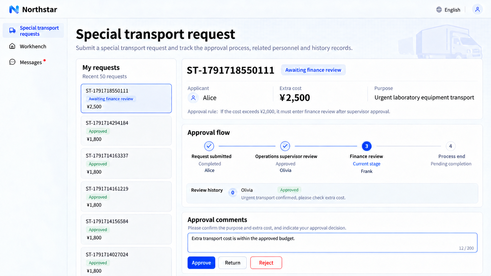

# Nhiều giai đoạn và định tuyến theo điều kiện

Yêu cầu có thể lần lượt đi qua nhiều giai đoạn duyệt, mỗi giai đoạn có trách nhiệm khác nhau. Các điều kiện như số tiền hoặc loại yêu cầu quyết định có thêm một giai đoạn nữa hay không.

Người duyệt có thể là người được chỉ định, vai trò, phòng ban hoặc theo quan hệ cấp trên. Hiển thị tuyến dự kiến trước khi nộp và xác định người duyệt thực tế khi bước vào giai đoạn.

## Ví dụ: định tuyến theo phí vận chuyển

Phí vận chuyển đặc biệt của Northstar từ 2.000 CNY trở xuống cần bộ phận vận hành duyệt. Phí cao hơn sẽ tiếp tục chuyển sang tài chính sau khi vận hành đồng ý.

```text
Add approval to Northstar special transport requests with cargo details, reasons, extra fees and attachments.
Fees of CNY 2,000 or less need operations approval; higher fees continue to finance afterwards.
Preview the route and reviewers before submission; show the current stage, offered actions and opinions in details.
Retain the approval decision without automatically paying fees.
```

## Xem kết quả

Alice nộp yêu cầu 2.500 CNY cho chuyến vận chuyển gấp. Yêu cầu đến người duyệt vận hành Olivia trước, người có thể xem mục đích, chi phí, tài liệu và đưa ra nhận xét.



**Yêu cầu đến bước duyệt của vận hành trước.**

Sau khi vận hành đồng ý, điều kiện về số tiền chuyển yêu cầu đến người duyệt tài chính Frank, giữ nguyên nhận xét trước đó.



**Yêu cầu trên 2.000 CNY tiếp tục đến bước duyệt của tài chính.**

:::tip Lưu ý quan trọng

Hãy chỉ rõ điều kiện đưa vào và nguồn người duyệt của từng giai đoạn. Thiếu người duyệt thì nên yêu cầu phân công hoặc chặn việc nộp; thiếu người và cố ý bỏ qua một giai đoạn là hai trường hợp khác nhau.

:::

## Nội dung đã nộp và phân công người duyệt

Hãy quyết định yêu cầu liên hệ thế nào với dữ liệu nghiệp vụ đang có hiệu lực: nội dung nào được cố định khi nộp và việc phê duyệt có cập nhật hợp đồng, giá hay bản ghi chính thức khác hay không. Nếu ai đó đã thay đổi bản ghi đó, hãy yêu cầu đối chiếu thay vì ghi đè. Xem trước tuyến giải thích trình tự dự kiến; người duyệt được xác định khi giai đoạn bắt đầu.

Người duyệt có thể đến từ quan hệ cấp trên, vai trò, phòng ban hoặc một nhóm ứng viên. Hãy chỉ rõ việc loại trừ người nộp đơn, nhân viên đã nghỉ, ủy quyền và một người có thể giữ nhiều trách nhiệm hay không. Thiếu người duyệt thì nên chặn việc nộp hoặc chờ phân công, tuyệt đối không được coi là đã phê duyệt.

```text
After a Northstar special transport request is submitted, its cargo, fees and reason cannot be edited directly; return it before changing and resubmitting. Resolve operations reviewers from the applicant's reporting line. Only qualified finance staff can review, applicants cannot review their own requests, and inactive staff cannot act.
Block submission with a reason if no suitable manager exists; wait for an authorized administrator to assign finance if nobody is available. Exactly 2,000 requires only the manager; more than 2,000 also requires finance. Show me the route and assignment plan and ask about unresolved decisions first.
```

Kiểm tra ranh giới số tiền, trường hợp thiếu người duyệt, loại trừ người nộp đơn và việc từ chối thay đổi nội dung đã nộp.
