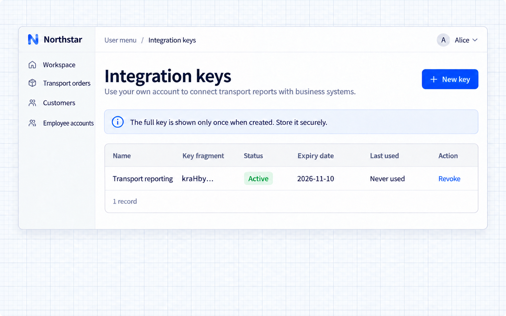
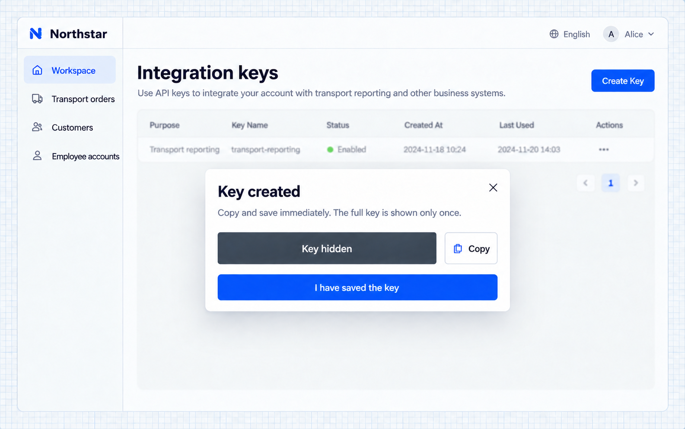

# API Key

[← Tổng quan xác thực](./index.md) · [Mở kịch bản liên quan](./index.md#api)

API Key cho phép script, tác vụ định kỳ và hệ thống bên ngoài gọi API của ứng dụng mà không cần đăng nhập qua trình duyệt. Mặc định, API Key đại diện cho người tạo ra nó và dùng các quyền hiện có của người dùng đó.

Một nhân viên quản lý khách hàng của Northstar có thể dùng Key để gửi các đơn vận chuyển mà mình có quyền truy cập sang hệ thống báo cáo, trong khi vẫn dùng ứng dụng bằng cách đăng nhập qua trình duyệt.

> API Key cung cấp thông tin xác thực dành cho chương trình. Màn hình khóa tích hợp và API đơn hàng dưới đây thuộc ví dụ Northstar; hãy kiểm tra endpoint, các trường phản hồi và quyền người dùng thực tế trong ứng dụng của bạn.

[Cung cấp lối vào khóa tích hợp](#cung-cấp-lối-vào-khóa-tích-hợp) · [Tạo, lưu và thu hồi](#tạo-lưu-và-thu-hồi) · [Đọc đơn vận chuyển bằng script](#đọc-đơn-vận-chuyển-bằng-script) · [Kết quả](#kết-quả)

## Cung cấp lối vào khóa tích hợp

Script và hệ thống bên ngoài có thể dùng thông tin xác thực API riêng thay vì lưu mật khẩu người dùng. Hãy đặt thời hạn cho khóa và thu hồi thông tin xác thực khi kết thúc tích hợp.

Trang quản lý có thể bố trí theo nhu cầu nghiệp vụ, không cần một lối vào Cài đặt dùng chung:

```text
Add an Integration keys entry to the Northstar user menu using the existing API keys capability.
Employees manage only their own Keys.
Creation accepts a purpose name, such as Transport reporting, and an expiry.
Show the full Key only once after creation and ask the employee to copy it immediately.
List names, identifying fragments, status, expiry, and last use. Support revocation with confirmation.
Never expose full Keys in lists, logs, or later detail views.
```

Năng lực này xử lý Key, thời hạn và thu hồi; ứng dụng quyết định vị trí và bố cục trang. Nhân viên cần có quyền để truy cập lối vào này.

## Tạo, lưu và thu hồi

Mở Khóa tích hợp, nhập mục đích và thời hạn, rồi lưu toàn bộ giá trị vào môi trường chạy của chương trình gọi API. Giá trị chỉ hiển thị một lần; đoạn ký tự nhận diện không thể dùng để khôi phục nó.

Thu hồi Key khi không còn cần nữa. Key đã thu hồi hoặc hết hạn không thể tiếp tục gọi API; hãy tạo Key khác cho tích hợp mới. Key của tài khoản đã bị vô hiệu hóa không thể tiếp tục đại diện cho tài khoản đó.

## Đọc đơn vận chuyển bằng script

Dùng request API để xử lý dữ liệu ứng dụng bằng script thay vì xuất hoặc sao chép thủ công. Quyền truy cập vẫn giữ nguyên phạm vi quyền của chủ sở hữu khóa.

Lưu Key vào biến môi trường `NOCOBASE_API_KEY` của chương trình:

```text
Write a script to read Northstar transport orders.
Read the API key from NOCOBASE_API_KEY, never source code or logs.
Use the application's actual API documentation to select the order list endpoint and send the Key in the x-api-key header.
The example app is http://localhost:13200/main. GET /api/northstar returns workspace data; data.orders contains accessible orders.
Read orders, resolve customer names using data.customers, and output order number, customer, origin, destination, and status.
Handle API failures instead of treating them as an empty order list.
Explain how to configure the application address and run the script.
```

Ví dụ này dùng Key do Alice, một nhân viên quản lý khách hàng, tạo ra. Script gọi `GET /main/api/northstar` với header `x-api-key`, lấy danh sách đơn hàng từ phản hồi của workspace và tra cứu tên khách hàng. Endpoint này trả về các bản ghi workspace mà người dùng có quyền truy cập trong một phản hồi duy nhất, không phân trang.

> Script này nhắm đến API ví dụ của Northstar, không phải một endpoint đơn hàng chung của NocoBase. Hãy kiểm tra đường dẫn, cấu trúc phản hồi và phân trang trước khi dùng với ứng dụng khác.

### Chạy script

Lưu đoạn mã thành `fetch_orders.py`. Script chỉ dùng thư viện chuẩn của Python.

```python
import json
import os
import sys
from urllib.error import HTTPError, URLError
from urllib.request import Request, urlopen

base_url = os.environ["NOCOBASE_APP_URL"].rstrip("/")
request = Request(
    base_url + "/api/northstar",
    headers={"x-api-key": os.environ["NOCOBASE_API_KEY"]},
)
try:
    with urlopen(request, timeout=20) as response:
        result = json.load(response)
    data = result["data"]
    customers = {str(item["id"]): item["name"] for item in data["customers"]}
    orders = [
        {
            "number": order["number"],
            "customer": customers.get(str(order["customerId"]), ""),
            "origin": order["origin"],
            "destination": order["destination"],
            "status": order["status"],
        }
        for order in data["orders"]
    ]
except HTTPError as error:
    sys.exit(f"API request failed: HTTP {error.code}")
except URLError:
    sys.exit("Cannot reach the application API.")
except (KeyError, TypeError, ValueError):
    sys.exit("Unexpected API response format.")

print(json.dumps({"count": len(orders), "orders": orders}, ensure_ascii=False, indent=2))
```

Đặt địa chỉ ứng dụng, nhập Key đã sao chép và chạy:

```bash
export NOCOBASE_APP_URL='http://localhost:13200/main'
read -rs -p 'API key: ' NOCOBASE_API_KEY
export NOCOBASE_API_KEY
python3 fetch_orders.py
```

Lệnh `read -rs` ẩn Key khi bạn nhập. Hãy thay địa chỉ ứng dụng và endpoint khi dùng với ứng dụng khác.

### Đọc các đơn hàng trả về

Lần chạy thực tế trả về 6 đơn hàng mà Alice có quyền truy cập. Hai bản ghi đầu tiên được hiển thị dưới đây:

```json
{
  "count": 6,
  "orders": [
    {
      "number": "NS-2026-001",
      "customer": "Harbor Retail",
      "origin": "Shanghai",
      "destination": "Hangzhou",
      "status": "awaitingDispatch"
    },
    {
      "number": "NS-2026-002",
      "customer": "Summit Electronics",
      "origin": "Hangzhou",
      "destination": "Suzhou",
      "status": "awaitingDispatch"
    }
  ]
}
```

Các đơn hàng thuộc Harbor Retail và Summit Electronics; `awaitingDispatch` nghĩa là đang chờ điều phối. Chương trình báo cáo hoặc đồng bộ có thể dùng các bản ghi này mà không cần đăng nhập qua trình duyệt.

Key không mở rộng quyền truy cập dữ liệu của chủ sở hữu. Hãy cấp quyền phù hợp cho một tài khoản tích hợp khi cần báo cáo liên nhóm. Key đã thu hồi hoặc hết hạn, hay tài khoản bị vô hiệu hóa, không thể tiếp tục gọi API. Request thất bại sẽ báo mã trạng thái HTTP chứ không hiển thị như một danh sách đơn hàng rỗng.

Xem [Phân quyền](../authorization/index.md) để biết về quyền nghiệp vụ và phạm vi dữ liệu.

## Kết quả

Trang khóa tích hợp liệt kê mục đích, đoạn ký tự nhận diện, trạng thái, thời hạn và lần dùng gần nhất. Ví dụ này dùng thời hạn 30 ngày.



Màn hình tạo khóa hiển thị toàn bộ khóa một lần. Giá trị đã được che trong ảnh chụp màn hình này.



## Kiểm tra kết quả

- Script trả về các trường đơn hàng như mong đợi, trong phạm vi quyền của người dùng.
- Key được lấy từ biến môi trường và không bao giờ xuất hiện trong mã hoặc log.
- Thông tin xác thực đã thu hồi hoặc hết hạn sẽ gây lỗi chứ không trả về kết quả thành công rỗng.

Quay lại [kịch bản tổng quan liên quan](./index.md#api) để điều chỉnh prompt và tiếp tục với Agent của bạn.
