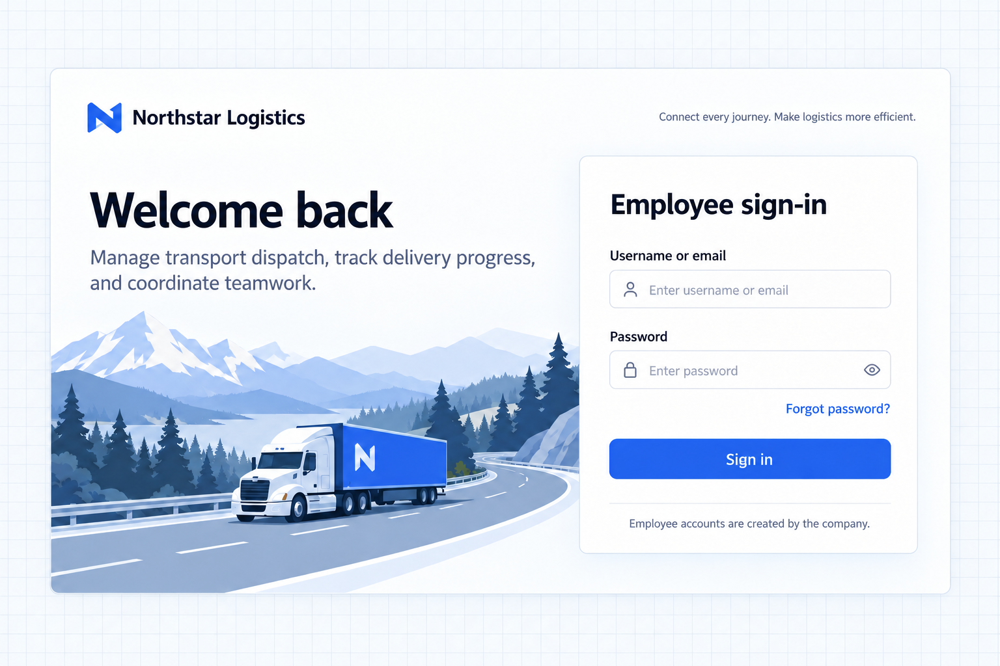

# Tùy chỉnh trang đăng nhập

[← Tổng quan xác thực](./index.md) · [Mở kịch bản liên quan](./index.md#brand)

Sau khi thiết lập tài khoản và các phương thức xác thực cần thiết, hãy tùy chỉnh trang đăng nhập cho công ty của bạn.

Trang đăng nhập thuộc mã nguồn của ứng dụng. Tên, logo, nội dung chữ, hình ảnh, bố cục và màu sắc có thể theo thương hiệu công ty, trong khi vẫn giữ nguyên xác thực, phản hồi lỗi và khôi phục mật khẩu.

> Tùy chỉnh thương hiệu, bố cục và nội dung chữ thuộc về ứng dụng, đồng thời giữ nguyên các thao tác xác thực, xử lý lỗi, quy tắc tài khoản và luồng khôi phục hiện có.

[Ví dụ: trang đăng nhập cho nhân viên Northstar](#ví-dụ-trang-đăng-nhập-cho-nhân-viên-northstar) · [Xem kết quả](#xem-kết-quả) · [Tùy chỉnh thêm](#tùy-chỉnh-thêm)

## Ví dụ: trang đăng nhập cho nhân viên Northstar

Northstar muốn nhân viên nhận ra công ty và mục đích của không gian làm việc vận tải. Tài khoản được quản lý tập trung, không cho đăng ký công khai.

```text
Customize the existing transport application's sign-in page for Northstar Logistics.

Use a pale-blue truck and mountain-road illustration, a white page panel, and a pale blue-gray grid backdrop for readable text.
Show the company name and icon at the top. Place a welcome message and transport dispatch, delivery tracking, and team collaboration copy on the left.
Place a white sign-in form on the right, with dark text, white inputs, and a blue sign-in button.
Preserve username or email and password sign-in, password visibility, error feedback, and password recovery.
Disable public registration on both the page and the server while retaining the registration page and components for future use.
Use consistent branding on sign-in and password recovery pages, with Chinese and English copy.
```

## Xem kết quả

Trang đăng nhập dùng hình minh họa đường núi và xe tải màu xanh nhạt, kèm thương hiệu công ty và nội dung về nghiệp vụ vận tải. Lời chào hiển thị bên trái, biểu mẫu đăng nhập màu trắng nằm bên phải. Chữ tối màu và nút xanh giúp biểu mẫu dễ phân biệt. Ảnh nền, màu sắc và bố cục có thể thay đổi theo nhu cầu của công ty.



Việc tùy chỉnh trang tái sử dụng các biểu mẫu và thao tác xác thực có sẵn. Ẩn liên kết đăng ký thì phải đồng thời tắt đăng ký ở phía server.

## Tùy chỉnh thêm

Mô tả ảnh nền, vị trí biểu mẫu, màu thương hiệu, phông chữ hoặc trang đích theo từng vai trò. Hãy tính đến màn hình hẹp và chế độ tối, và kiểm soát quyền truy cập nghiệp vụ ở phía server.

Khôi phục mật khẩu cần một dịch vụ email đặt lại mật khẩu đã được cấu hình thực sự. Liên kết hiển thị trên trang không có nghĩa là dịch vụ đó đã sẵn sàng.

## Kiểm tra kết quả

- Thương hiệu vận tải và biểu mẫu hoạt động trên cả máy tính và điện thoại.
- Hiện/ẩn mật khẩu, thông báo lỗi và khôi phục mật khẩu vẫn dùng được.
- Tự đăng ký đã bị tắt ở phía server, các component đăng ký có thể tái sử dụng vẫn được giữ lại.

Quay lại [kịch bản tổng quan liên quan](./index.md#brand) để điều chỉnh prompt và tiếp tục với Agent của bạn.
