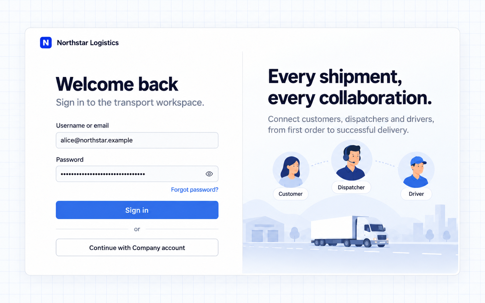
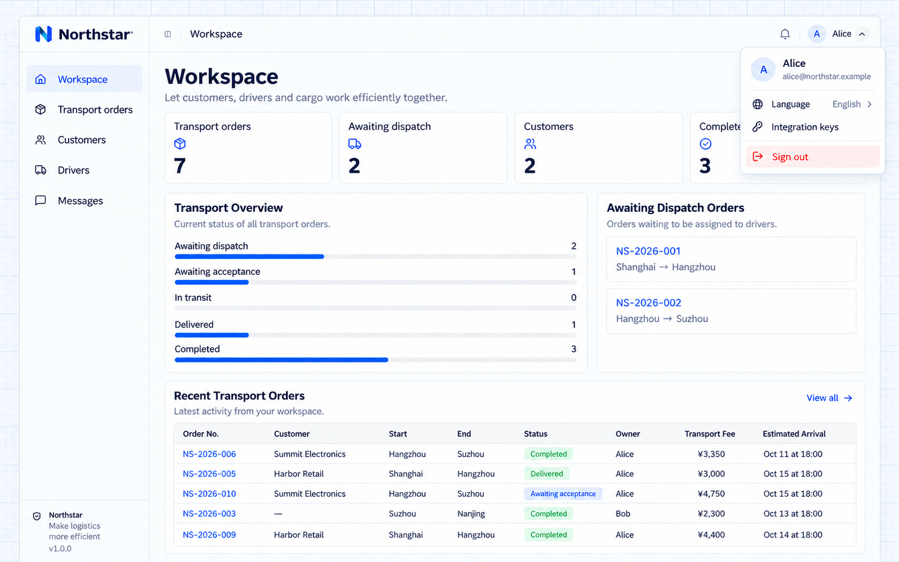
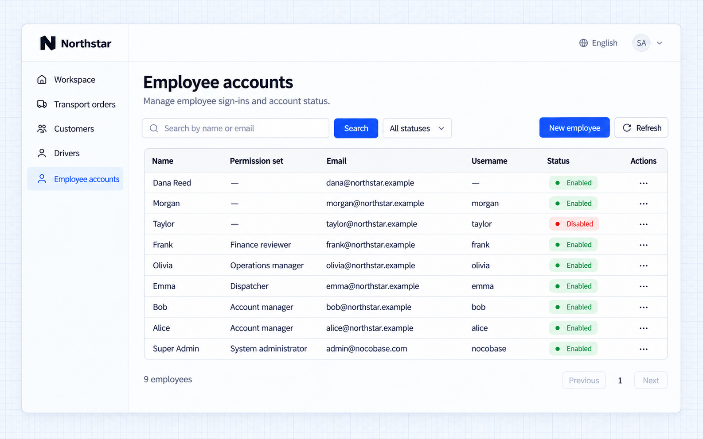
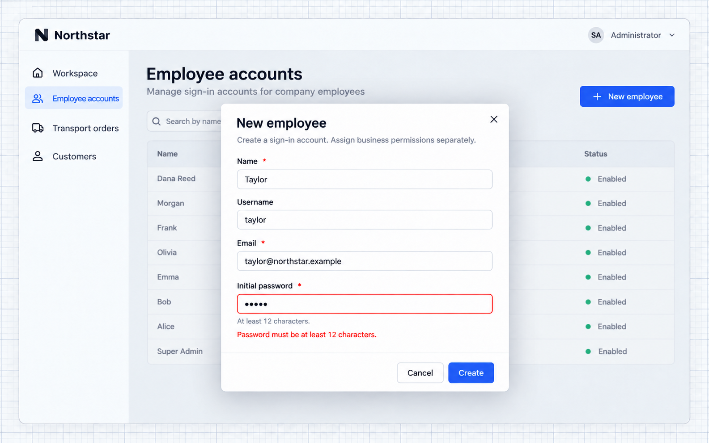
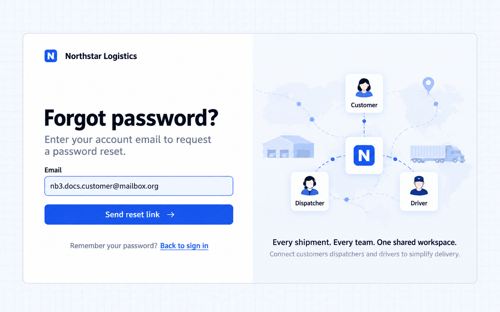
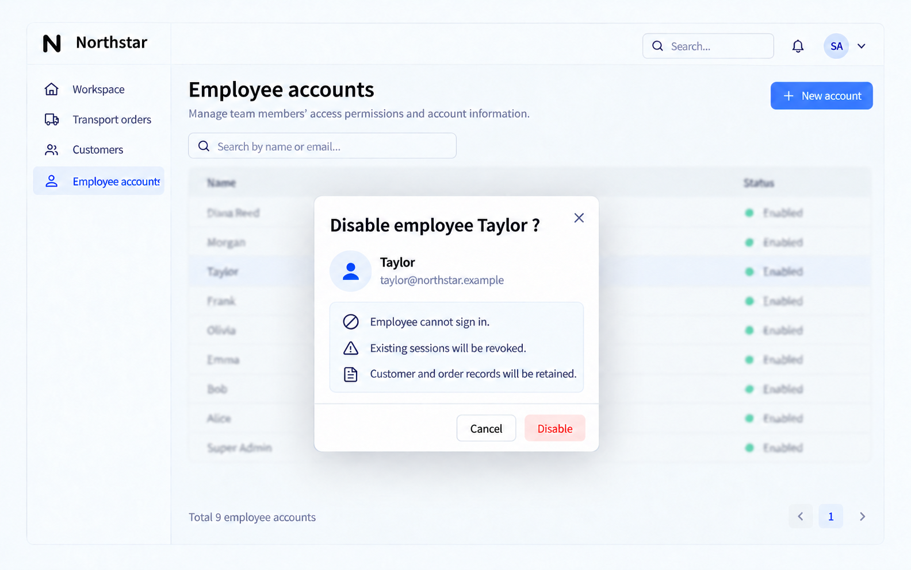
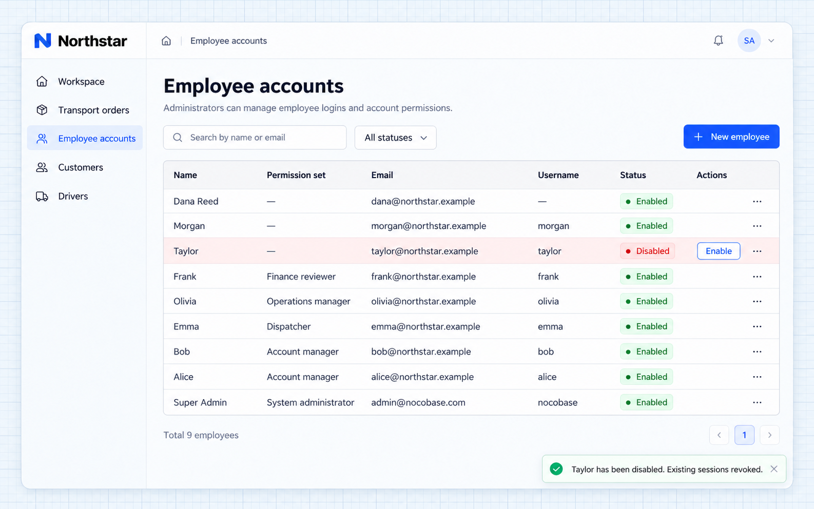

# Xác thực bằng mật khẩu và tài khoản

[← Tổng quan xác thực](./index.md) · [Mở kịch bản liên quan](./index.md#staff)

Nhân viên quản lý khách hàng, điều phối viên và tài xế của Northstar đăng nhập bằng tài khoản do công ty quản lý. Quản trị viên tạo tài khoản và vô hiệu hóa khi nhân viên nghỉ việc.

> Hướng dẫn này minh họa một ứng dụng Northstar đã được tùy chỉnh. Năng lực xác thực cung cấp đăng nhập bằng mật khẩu và phiên đăng nhập; các màn hình quản lý nhân viên được xây dựng riêng cho nghiệp vụ, còn khôi phục mật khẩu cần một kênh email hoạt động.

[Đăng nhập và đăng xuất](#đăng-nhập-và-đăng-xuất) · [Tài khoản nhân viên do công ty quản lý](#tài-khoản-nhân-viên-do-công-ty-quản-lý) · [Tùy chỉnh yêu cầu mật khẩu](#tùy-chỉnh-yêu-cầu-mật-khẩu) · [Khôi phục mật khẩu](#khôi-phục-mật-khẩu)

## Đăng nhập và đăng xuất

Nhập tên người dùng hoặc email và mật khẩu, rồi nhấn **Đăng nhập**. Ví dụ này dùng trang đăng nhập Northstar màu xanh với cơ chế xác thực và phiên đăng nhập của NocoBase.



Sau khi đăng nhập, mở menu ảnh đại diện ở góc trên bên phải và chọn **Đăng xuất**. Bạn sẽ quay về trang đăng nhập. Hãy đăng nhập lại khi phiên đăng nhập hết hạn.



Xem [Tùy chỉnh trang đăng nhập](./login-pages.md) để thay đổi thương hiệu và bố cục.

## Tài khoản nhân viên do công ty quản lý

Ứng dụng nội bộ có thể tắt tự đăng ký công khai và để quản trị viên tạo, quản lý tài khoản. Hãy giới hạn việc tạo tài khoản ở cả trang và phía server.

```text
Northstar’s transport system is for company employees only.
Disable self-registration on both the sign-in page and the server.
Build an Employee accounts page for administrators, with name/email search and enabled/disabled filters.
Support creating, disabling, and enabling accounts, and revoking sessions separately.
Keep account creation separate from business permission assignment. Never grant administrator access by default.
```

Mở **Tài khoản nhân viên** để xem tên, email, tên người dùng, bộ quyền và trạng thái của từng nhân viên. Nhấn **Nhân viên mới** rồi nhập tên, email và mật khẩu ban đầu. Tên người dùng là không bắt buộc.



Tài khoản cho phép nhân viên đăng nhập; bộ quyền quyết định họ được truy cập những bản ghi nghiệp vụ nào. Tạo tài khoản không đồng nghĩa với cấp quyền truy cập mọi đơn hàng. Xem [Vai trò và quyền](../authorization/index.md).

## Tùy chỉnh yêu cầu mật khẩu

Ứng dụng có thể tùy chỉnh yêu cầu mật khẩu và kiểm tra thống nhất khi tạo tài khoản và đặt lại mật khẩu. Hãy giải thích yêu cầu ngay trong biểu mẫu; ví dụ này yêu cầu tối thiểu 12 ký tự.

```text
Require at least 12 characters when setting or resetting a password.
Show the requirement in account creation and password reset forms, with matching server-side validation.
Existing employees can continue signing in with their current passwords without an immediate password change.
```

Biểu mẫu tạo tài khoản hiển thị độ dài tối thiểu. Nhập mật khẩu ngắn hơn rồi nhấn **Tạo** để xem thông báo kiểm tra. Tài khoản sẽ không được gửi đi. Server cũng kiểm tra mật khẩu mới.



## Khôi phục mật khẩu

Người dùng quên mật khẩu có thể đặt lại qua email đã đăng ký mà không cần quản trị viên can thiệp. Hãy xác nhận quyền sở hữu email và cung cấp liên kết đặt lại có thời hạn.

```text
Add a forgot-password flow for Northstar employees using an email channel.
Let employees choose Forgot password? and enter their email.
Show the same submission message whether or not an account exists.
Use the email link to set a password of at least 12 characters and return to sign-in.
Reuse authentication’s expiring, single-use reset links.
```

Nhấn **Quên mật khẩu?** và nhập email của tài khoản.



Cần có kênh gửi email hoạt động để hoàn tất luồng yêu cầu → email → liên kết đặt lại → mật khẩu mới. Liên kết trong email phải trỏ đến địa chỉ ứng dụng mà nhân viên truy cập được.

## Phiên đăng nhập và tài khoản bị vô hiệu hóa

Khi nhân viên nghỉ việc, tài khoản bị tạm ngưng hoặc quyền truy cập bị thu hồi, cần chặn các lần đăng nhập sau này và vô hiệu hóa các phiên hiện có. Vô hiệu hóa tài khoản trong khi vẫn giữ các bản ghi nghiệp vụ liên quan, và có thể kích hoạt lại khi cần.

```text
Add an employee offboarding action for administrators.
Show the employee name and consequences before confirmation.
After confirmation, prevent sign-in and revoke existing sessions while preserving business records.
Allow re-enabling the account, requiring the employee to sign in again.
```

Mở menu ở dòng của Taylor và chọn **Vô hiệu hóa**. Hộp xác nhận giải thích rằng việc đăng nhập sẽ bị chặn và các phiên hiện có bị thu hồi, còn bản ghi nghiệp vụ vẫn được giữ.



Sau khi xác nhận, trạng thái của Taylor chuyển thành **Đã vô hiệu hóa**. Các phiên hiện có không thể truy cập tài nguyên nghiệp vụ nội bộ, và nhân viên bị đưa về trang đăng nhập. Chọn **Kích hoạt** để khôi phục tài khoản; các phiên đã thu hồi sẽ không được khôi phục.



Dùng **Thu hồi phiên** để yêu cầu đăng nhập lại mà không cần vô hiệu hóa tài khoản. Xem [Bảo vệ trang và API](./protecting-access.md) để biết về truy cập công khai và nội bộ.

## Kiểm tra kết quả

- Tìm kiếm, lọc và tạo tài khoản nhân viên.
- Tự đăng ký đã bị tắt ở cả giao diện và server.
- Vô hiệu hóa tài khoản sẽ thu hồi các phiên hiện có nhưng vẫn giữ bản ghi nghiệp vụ.
- Biểu mẫu giải thích độ dài tối thiểu là 12 ký tự.
- Cả client và server đều từ chối mật khẩu mới không đáp ứng quy tắc.
- Nhân viên hiện có vẫn đăng nhập được bằng mật khẩu hiện tại.
- Một hộp thư thật nhận được liên kết đặt lại với đúng URL của ứng dụng.
- Mật khẩu mới dùng được và mật khẩu cũ không còn đăng nhập được.
- Liên kết đã hết hạn hoặc đã dùng không thể dùng lại, và email không tồn tại không làm lộ việc tài khoản có tồn tại hay không.

Quay lại [kịch bản tổng quan liên quan](./index.md#staff) để điều chỉnh prompt và tiếp tục với Agent của bạn.
