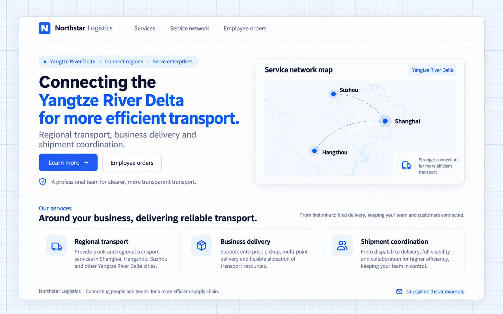
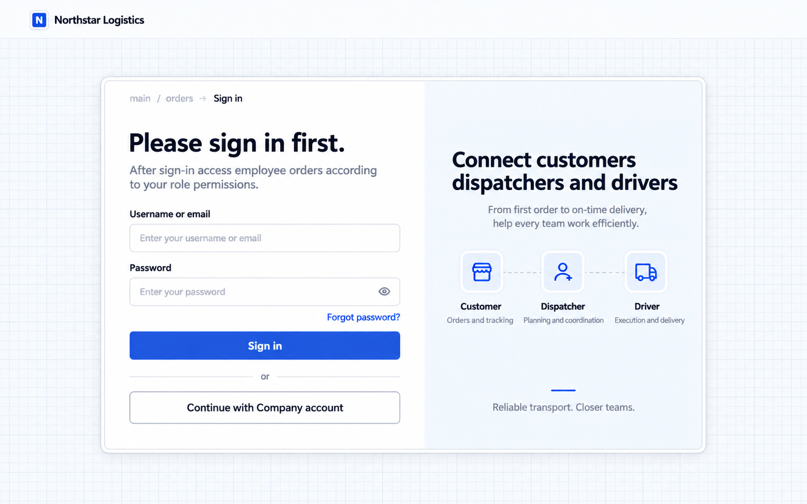

# Bảo vệ trang và API

[← Tổng quan xác thực](./index.md) · [Mở kịch bản liên quan](./index.md#protect)

Northstar có thể công khai thông tin dịch vụ vận tải trong khi vẫn giữ hồ sơ khách hàng, đơn hàng và không gian làm việc ở chế độ nội bộ. Xác thực xác định bên gọi đã đăng nhập hay chưa; phân quyền quyết định quyền truy cập sau đó.

> Các đường dẫn /main/services, /main/orders và /main/api/northstar thuộc ví dụ này. Hãy yêu cầu Agent dùng route, API và đường dẫn gốc thực tế của ứng dụng bạn.

[Thông tin công khai và công việc nội bộ](#thông-tin-công-khai-và-công-việc-nội-bộ) · [Dùng danh tính nhân viên hiện tại](#dùng-danh-tính-nhân-viên-hiện-tại) · [Yêu cầu đối với trang và API](#yêu-cầu-đối-với-trang-và-api) · [Vòng đời tài khoản và triển khai](#vòng-đời-tài-khoản-và-triển-khai)

## Thông tin công khai và công việc nội bộ

Một ứng dụng có thể gồm cả trang công khai và công việc nội bộ. Khách truy cập có thể xem nội dung công khai mà không cần đăng nhập; các bản ghi được bảo vệ cần xác thực và phân quyền.

```text
Add a public transport services page for Northstar without requiring registration or sign-in.
Use Northstar’s blue brand style to introduce its Yangtze River Delta network, regional transport, business delivery, and shipment coordination.
Show a contact email and an Employee orders entry. Signed-in employees can visit the public page too.
Its public reading API must not return internal orders or customer records.
Keep authentication and business permissions on the workspace, customer and order pages, and their APIs.
Direct anonymous visitors to sign-in when they open internal pages.
```

### Xem thông tin công ty mà không cần đăng nhập

Mở `/main/services` để xem trực tiếp trang dịch vụ công khai của Northstar. Khách truy cập có thể thấy mạng lưới dịch vụ tại Thượng Hải, Hàng Châu, Tô Châu và ba khu vực dịch vụ mà không cần đăng ký hay đăng nhập. Hồ sơ khách hàng và đơn hàng nội bộ không được hiển thị.



Prompt nghiệp vụ ở trên tạo ra trang này. Thương hiệu, bố cục và thông tin dịch vụ có thể thay đổi theo nhu cầu của công ty.

### Yêu cầu đăng nhập để xem đơn hàng của nhân viên

Chọn **Mở đơn hàng nhân viên** để truy cập địa chỉ nội bộ `/main/orders`. Khách truy cập ẩn danh sẽ được chuyển hướng đến trang đăng nhập. Sau khi đăng nhập, quyền nghiệp vụ quyết định họ được xem đơn hàng nào.

Nhập trực tiếp URL đơn hàng nội bộ cũng dẫn đến trang đăng nhập. Biết địa chỉ không có nghĩa là có quyền truy cập nghiệp vụ.



So sánh các địa chỉ ví dụ sau:

| Địa chỉ                                | Kết quả khi truy cập ẩn danh                              |
| -------------------------------------- | --------------------------------------------- |
| `http://localhost:13200/main/services` | Hiển thị thông tin dịch vụ vận tải công khai |
| `http://localhost:13200/main/orders`   | Chuyển hướng đến trang đăng nhập của ứng dụng              |

### Bảo vệ trang và API riêng biệt

Trang công khai đọc thông tin công ty từ `GET /main/api/public/company`. Endpoint riêng này chỉ trả về tên công ty, khu vực dịch vụ, các mục dịch vụ và email liên hệ. Nó không truy vấn hay trả về khách hàng, nhân viên hoặc đơn hàng nội bộ.

API nội bộ vẫn yêu cầu xác thực. Lời gọi ẩn danh đến `GET /main/api/northstar` trả về **401** và không có dữ liệu đơn hàng. Trình duyệt truy cập trang nội bộ được chuyển hướng đến trang đăng nhập; script gọi API được bảo vệ sẽ nhận lỗi xác thực và phải cung cấp danh tính hợp lệ.

Trang và API tự khai báo yêu cầu truy cập của mình. Ẩn mục điều hướng hay kiểm tra ở trình duyệt không thể thay thế việc bảo vệ ở phía server.

## Dùng danh tính nhân viên hiện tại

Dùng danh tính đã xác thực hiện tại khi bản ghi cần truy vết người thực hiện. Ghi nhận danh tính ở phía server thay vì dựa vào danh tính do người dùng tự nhập.

```text
When creating an order, obtain the acting employee from the server-side session and record them.
Do not ask employees to supply or impersonate another acting user.
Assign an order owner separately under business rules; do not confuse ownership with creation.
```

Người phụ trách đơn hàng, người tạo và tài xế được phân công là các trường riêng biệt. Xác thực cung cấp danh tính hiện tại; quy tắc nghiệp vụ định nghĩa các trường và phạm vi truy cập.

## Yêu cầu đối với trang và API

| Tình huống                      | Hành vi của trang                    | Yêu cầu đối với API                          |
| ----------------------------- | -------------------------------- | ---------------------------------------- |
| Thông tin dịch vụ vận tải | Truy cập công khai và khi đã đăng nhập      | Nội dung công khai; danh tính tùy chọn        |
| Không gian làm việc, khách hàng, đơn hàng  | Khách ẩn danh được đưa đến trang đăng nhập | Xác thực cộng với quyền nghiệp vụ |
| Đăng nhập và khôi phục mật khẩu | Dành cho khách                     | Luồng xác thực tương ứng        |
| Script đọc đơn hàng         | Không cần trang trên trình duyệt         | API Key và quyền của chủ sở hữu            |

API được bảo vệ mà thiếu danh tính sẽ trả về 401; đã xác thực nhưng thiếu quyền sẽ trả về 403. API Key không bỏ qua được phân quyền.

## Vòng đời tài khoản và triển khai

Vô hiệu hóa tài khoản và thu hồi phiên khi nhân viên nghỉ việc hoặc tạm ngưng quyền truy cập. Một tích hợp với hệ thống nhân sự thực hiện các thao tác này cũng cần xác thực và phân quyền.

Cấu hình triển khai bao gồm khóa bí mật của ứng dụng, địa chỉ và đường dẫn công khai, cookie và kho lưu trữ dùng chung cho nhiều instance. Callback của nhà cung cấp và liên kết đặt lại mật khẩu phải khớp với địa chỉ truy cập thực tế. Reverse proxy phải chuyển tiếp đúng giao thức, Host và cookie.

Giao các yêu cầu truy cập này cho Agent để triển khai bảo vệ trang và API bằng năng lực xác thực và phân quyền của ứng dụng.

## Kiểm tra kết quả

- Khách truy cập đọc được thông tin công khai mà không nhận được bản ghi nội bộ.
- Trang nội bộ chuyển hướng khách chưa xác thực đến trang đăng nhập.
- API nội bộ kiểm tra danh tính và phân quyền nghiệp vụ ở phía server.

Quay lại [kịch bản tổng quan liên quan](./index.md#protect) để điều chỉnh prompt và tiếp tục với Agent của bạn.
