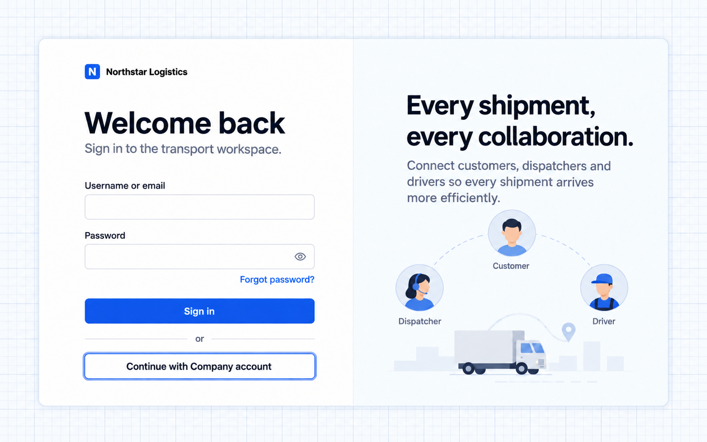
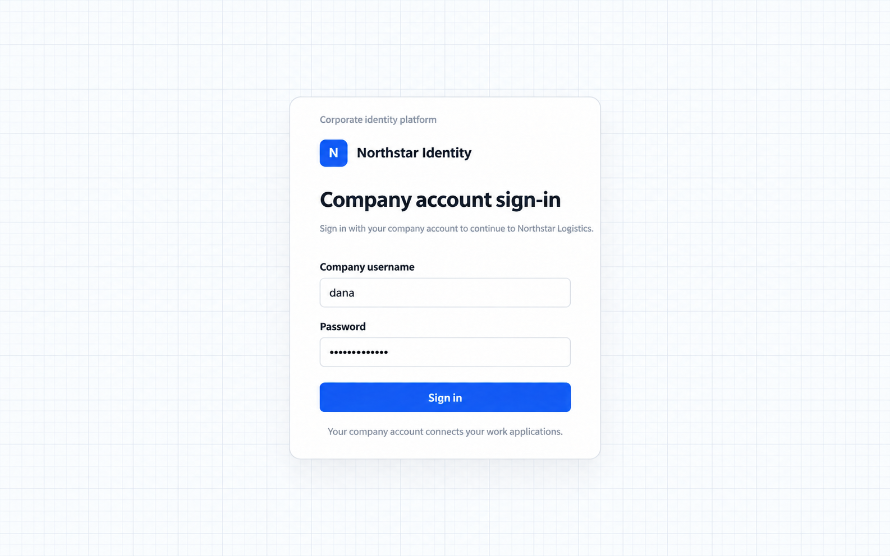
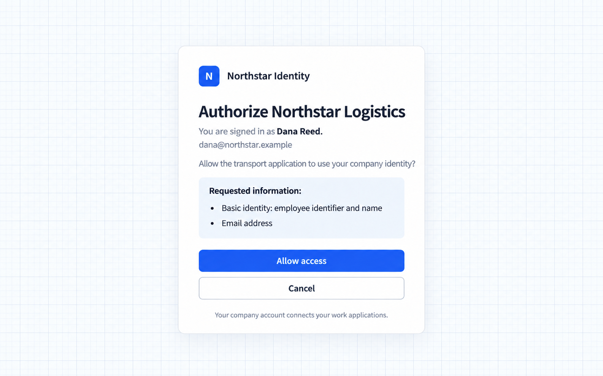
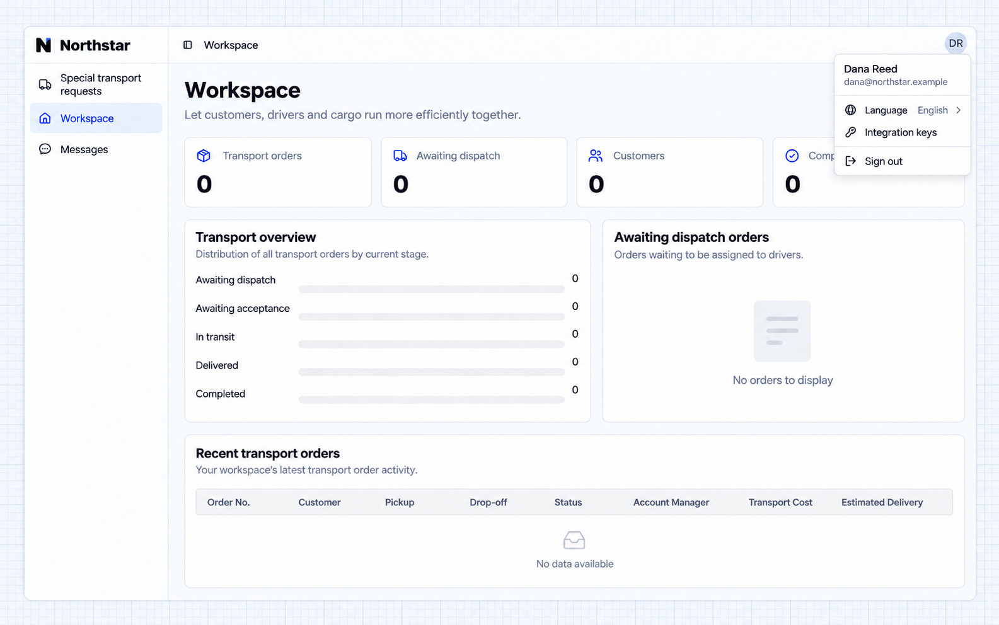

# Thêm phương thức đăng nhập

[← Tổng quan xác thực](./index.md) · [Mở kịch bản liên quan](./index.md#sso)

Nhân viên Northstar có thể dùng nhà cung cấp danh tính của công ty để vào ứng dụng vận tải. Nhà cung cấp xác minh danh tính; sau đó ứng dụng tạo phiên đăng nhập riêng và áp dụng quyền nghiệp vụ.

> Hướng dẫn này lấy OIDC làm ví dụ. Hãy chuẩn bị trước một nhà cung cấp danh tính độc lập và quy tắc liên kết tài khoản. Ứng dụng mặc định chưa bật đăng nhập bằng tài khoản công ty.

[Các cách tích hợp được hỗ trợ](#các-cách-tích-hợp-được-hỗ-trợ) · [Chuẩn bị tích hợp](#chuẩn-bị-tích-hợp) · [Ví dụ đăng nhập bằng tài khoản doanh nghiệp](#ví-dụ-đăng-nhập-bằng-tài-khoản-doanh-nghiệp) · [Nhu cầu tích hợp khác](#nhu-cầu-tích-hợp-khác)

## Các cách tích hợp được hỗ trợ

Xác thực được xây dựng trên Better Auth và có thể dùng cấu hình nhà cung cấp hoặc các phần mở rộng xác thực. Các cách này đều cần cấu hình; không phải tất cả đều được bật sẵn trong ứng dụng mới.

| Nhu cầu                                  | Cách làm                                         | Cần chuẩn bị                                               |
| ------------------------------------- | ------------------------------------------------ | --------------------------------------------------------- |
| Tài khoản GitHub hoặc Google             | Cấu hình đăng nhập qua nhà cung cấp                   | Ứng dụng trên nhà cung cấp, thông tin xác thực, callback               |
| Danh tính doanh nghiệp                    | OAuth 2.0 hoặc OpenID Connect (OIDC)               | Nhà cung cấp danh tính, thông tin ứng dụng, quy tắc tài khoản |
| Tài khoản Feishu hoặc DingTalk           | API ủy quyền nền tảng và API thông tin người dùng | Ứng dụng trên nền tảng, quyền, callback               |
| Mã xác minh qua email hoặc liên kết đăng nhập          | Phần mở rộng xác thực                         | Dịch vụ email, trang, lưu trữ                              |
| Passkey hoặc xác thực hai yếu tố | Phần mở rộng xác thực                         | Trang, cấu hình, cấu trúc dữ liệu                     |
| Ticket hoặc chữ ký nội bộ        | Phần mở rộng xác thực tùy chỉnh                  | Giao thức, API xác minh, danh tính ổn định               |

## Chuẩn bị tích hợp

Quản trị viên danh tính đăng ký ứng dụng vận tải, cung cấp thông tin nhà cung cấp và thông tin xác thực, đồng thời đăng ký callback. Agent triển khai phần tích hợp phía ứng dụng; thông tin xác thực nằm trong cấu hình runtime của server.

Hãy quyết định lần đăng nhập đầu tiên có tạo tài khoản hay không và có cho liên kết với tài khoản hiện có hay không. Nhận diện người dùng bằng danh tính ổn định từ nhà cung cấp, không chỉ dựa vào việc trùng tên hoặc email. Tích hợp danh tính và phân quyền nghiệp vụ vẫn là hai việc riêng biệt.

## Ví dụ đăng nhập bằng tài khoản doanh nghiệp

Tổ chức có nền tảng danh tính tập trung có thể tái sử dụng tài khoản công ty để giảm tài khoản và mật khẩu trùng lặp. Sau khi kết nối danh tính, hãy cấu hình quyền nghiệp vụ riêng.

```text
Connect Northstar's existing corporate identity provider using OIDC.
Keep password sign-in and add a Corporate sign-in button to the branded page.
Employees visit the company identity provider and sign in with their company account.
Show consent explaining the basic identity and email requested by the transport application.
Return to the workspace after consent; canceling must not sign the employee into the application.
Allow account creation at first sign-in, identified by the provider's stable user identity.
Do not merge accounts by matching names or emails, or grant new accounts administrator access.
List the information the provider administrator must supply, the callback to register, and application configuration.
```

### 1. Mở đăng nhập bằng tài khoản công ty

Chọn **Tiếp tục với tài khoản công ty** trên trang đăng nhập của ứng dụng vận tải. Đăng nhập bằng mật khẩu vẫn khả dụng.



### 2. Xác thực với nhà cung cấp danh tính của công ty

Trình duyệt chuyển hướng đến dịch vụ độc lập **Northstar Identity**. Nhập tên người dùng và mật khẩu công ty, rồi nhấn **Đăng nhập**. Ứng dụng vận tải không thu thập mật khẩu công ty trên trang của chính nó.



### 3. Ủy quyền cho ứng dụng vận tải

Sau khi xác thực, trang **Ủy quyền cho Northstar Logistics** hiển thị nhân viên đang đăng nhập, Dana Reed, và các thông tin được yêu cầu: mã nhân viên, tên và email.

Chọn **Cho phép truy cập** để tiếp tục, hoặc **Hủy** để dừng ủy quyền.



### 4. Quay lại không gian làm việc

Sau khi ủy quyền, trình duyệt chuyển hướng về ứng dụng vận tải. Mở menu ảnh đại diện để thấy **Dana Reed** và email công ty. Ứng dụng đã thiết lập phiên đăng nhập của riêng mình.



Việc tạo tài khoản ở lần đăng nhập đầu tiên không cấp quyền xem đơn hàng hay quyền quản trị. Tài khoản mới này chưa có quyền dữ liệu nghiệp vụ nào, nên không gian làm việc không hiển thị đơn hàng. Quản trị viên có thể gán [Bộ quyền](../authorization/permission-sets.md) phù hợp.

Đăng nhập bằng tài khoản công ty xác lập danh tính; quyền nghiệp vụ của ứng dụng chi phối trang, đơn hàng và thao tác. Việc trang đồng ý có hiển thị hay được ghi nhớ hay không phụ thuộc vào cấu hình của nhà cung cấp danh tính công ty.

## Nhu cầu tích hợp khác

Với GitHub hoặc Google, hãy chỉ rõ có giữ đăng nhập bằng mật khẩu không, cách tạo và liên kết tài khoản, và yêu cầu Agent hướng dẫn chuẩn bị ứng dụng trên nhà cung cấp cùng callback.

Với giao thức ticket nội bộ:

```text
The company portal redirects to Northstar with a single-use ticket.
Follow the supplied protocol to verify it and use the returned stable identity to locate an existing application account.
Do not automatically create accounts; explain how to request access when none is found.
Keep password sign-in and enter the transport workspace after success.
```

Đồng thời chỉ rõ việc đăng xuất có đăng xuất khỏi nhà cung cấp danh tính không, cách nhân viên hiện có liên kết tài khoản và trang đích theo từng vai trò. Phần tích hợp bao gồm các trang liên kết cần thiết, phần mở rộng xác thực và cấu trúc dữ liệu.

## Kiểm tra kết quả

- Đăng nhập bằng mật khẩu vẫn khả dụng và đăng nhập bằng tài khoản công ty chuyển hướng đến nhà cung cấp danh tính.
- Cho phép truy cập trả về đúng danh tính; hủy thì không đăng nhập.
- Đăng nhập nhiều lần không tạo trùng hay gộp nhầm tài khoản; tài khoản mới không tự động nhận quyền quản trị.

Quay lại [kịch bản tổng quan liên quan](./index.md#sso) để điều chỉnh prompt và tiếp tục với Agent của bạn.
