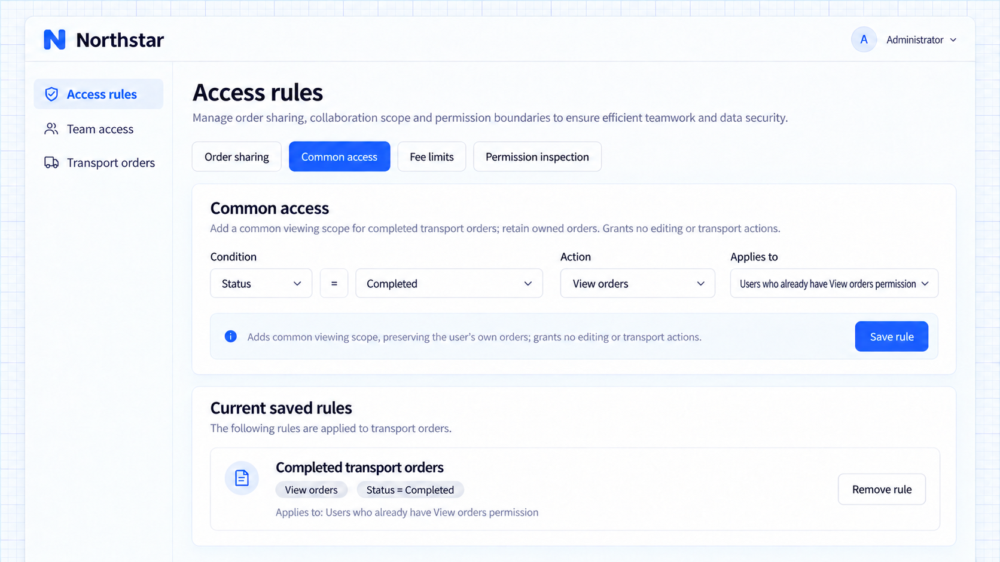
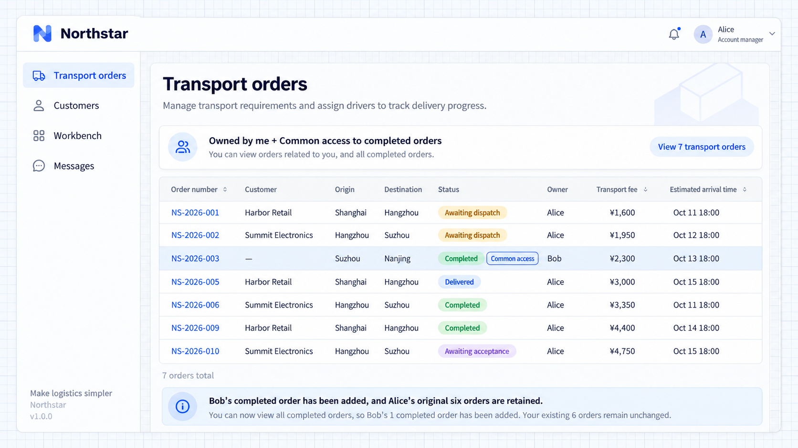

# Quyền truy cập dữ liệu mặc định

Quyền truy cập dữ liệu mặc định bổ sung một phạm vi bản ghi dùng chung cho những người đã có thao tác đó. Nhân viên quản lý khách hàng của Northstar có thể dùng các đơn đã hoàn tất làm tham khảo vận hành bên cạnh công việc của mình.

## Đơn hàng tham khảo chung

Người dùng đã có quyền xem có thể cần một nền tham khảo dùng chung. Quyền truy cập mặc định bổ sung các bản ghi chung vào phạm vi hiện có của họ, chẳng hạn bản ghi đã hoàn tất hoặc bản ghi tham khảo.

```text
Keep account managers' owned-order viewing scope.
Add completed orders as a default viewing scope for everyone who already has View orders permission.
Let administrators save or remove the completed-order viewing rule in Access rules.
Add viewing only, not editing or transport actions on other people's orders.
```

Alice có thể xem cả đơn mình phụ trách lẫn các đơn tham khảo đủ điều kiện. Phạm vi mặc định được hợp nhất với phạm vi hiện có chứ không thay thế nó.

## Không cấp thêm thao tác

Người không có quyền Xem đơn hàng sẽ không có được quyền đó từ phạm vi mặc định. Xem được bản ghi đã hoàn tất không có nghĩa là được sửa.

Cấu hình từng thao tác riêng trong quy tắc mặc định của tài nguyên. Dùng [chia sẻ](./sharing-rules.md) cho các cộng tác viên được chọn và [hạn chế](./restriction-rules.md) cho các ranh giới áp dụng trên mọi nguồn.

## Cấu hình quyền truy cập chung

Mở **Quy tắc truy cập → Truy cập chung** và lưu quy tắc xem đơn đã hoàn tất. Ví dụ này dùng trạng thái **Đã hoàn tất** của đơn hàng; muốn loại trừ bản ghi nhạy cảm thì cần thêm một trường nghiệp vụ và điều kiện.



**Quy tắc xem chung đã lưu bao gồm các đơn vận chuyển đã hoàn tất.**

Giờ Alice thấy bảy đơn thay vì sáu. **NS-2026-003** vẫn thuộc về Bob và được đưa vào vì đã hoàn tất. Các đơn hiện có của Alice vẫn hiển thị.



**Alice thấy bảy đơn, trong đó có đơn đã hoàn tất của Bob.**
