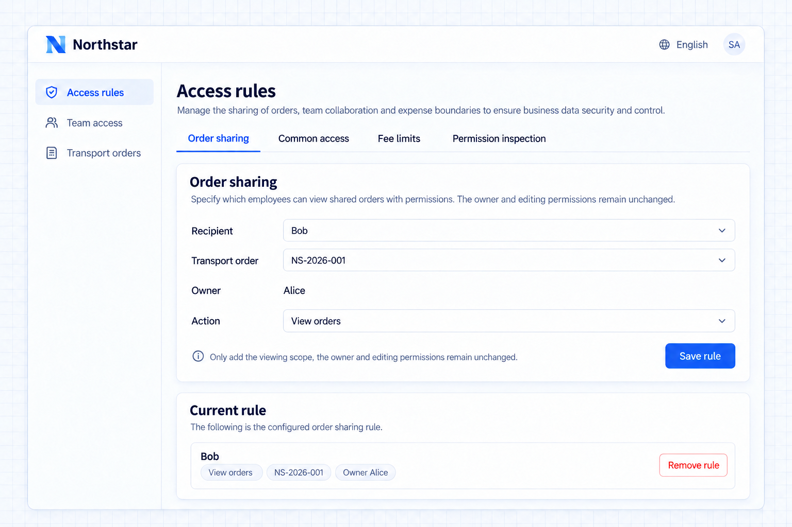

# Phân quyền

Phân quyền quyết định nhân viên vào được trang nào, thực hiện được thao tác nào và truy cập được bản ghi nào. Trong cùng một ứng dụng, nhân viên quản lý khách hàng của Northstar duy trì nhu cầu vận tải, điều phối viên phân công tài xế, còn tài xế xử lý các chuyến của mình.

[Xác thực](../auth/index.mdx) xác lập danh tính. Yêu cầu đăng nhập để xem đơn hàng là xác thực; chỉ cho tài xế xử lý các chuyến được giao là phân quyền.

## Bắt đầu từ trách nhiệm

| Công việc                       | Trang và thao tác                               | Phạm vi bản ghi                               |
| ------------------------- | ----------------------------------------------- | ------------------------------------------ |
| Quản lý khách hàng           | Khách hàng, tạo và sửa đơn hàng           | Khách hàng và đơn hàng do nhân viên phụ trách |
| Điều phối viên                | Không gian điều phối và phân công tài xế        | Các đơn cần thiết cho việc phối hợp             |
| Tài xế                    | Chuyến, nhận chuyến, xuất phát, bằng chứng giao hàng | Các chuyến được giao                             |
| Trưởng vận hành           | Giám sát vận tải và vận chuyển đặc biệt      | Đơn hàng và yêu cầu trong phạm vi trách nhiệm  |
| Trưởng tài chính              | Chi tiết quyết toán và duyệt chi phí phát sinh         | Bản ghi tài chính được cấp quyền               |
| Quản trị viên ứng dụng | Phân công và quy tắc truy cập                    | Trách nhiệm quản trị              |

Ứng dụng khai báo trang, thao tác và phạm vi; phân quyền tính toán quyền truy cập. Trạng thái bản ghi vẫn là một yêu cầu riêng: có quyền phân công tài xế không làm cho một đơn đã hoàn tất có thể phân công được.

## Trong phần này

| Năng lực                                              | Mục đích                                           |
| ------------------------------------------------------- | ------------------------------------------------- |
| [Bộ quyền và phân công](./permission-sets.md) | Trách nhiệm công việc có thể tái sử dụng                     |
| [Phạm vi dữ liệu và quy tắc](./data-scopes.md)               | Bản ghi do mình phụ trách, được giao, tất cả và theo điều kiện     |
| [Quyền truy cập dữ liệu mặc định](./default-access.md)              | Phạm vi nền dùng chung cho những người đã có thao tác |
| [Quy tắc chia sẻ](./sharing-rules.md)                     | Bản ghi bổ sung cho các cộng tác viên được chọn     |
| [Quy tắc hạn chế](./restriction-rules.md)             | Thu hẹp quyền truy cập hiện có                            |
| [Kiểm tra quyền](./inspector.md)                | Kết quả, điều kiện và nguồn                  |

## Quản trị theo hướng nghiệp vụ

Quản trị viên cần cập nhật công việc và quy tắc truy cập khi có người mới, thay đổi trách nhiệm hoặc cần cộng tác. Hãy cung cấp một lối vào theo hướng nghiệp vụ để duy trì các cấu hình được hỗ trợ.

Northstar có thể cung cấp lối vào Quyền truy cập của nhóm bằng các năng lực phân quyền mà không cần giữ một trang Cài đặt dùng chung.

```text
Provide Team access for authorized Northstar administrators.
Define jobs for account managers, dispatchers, drivers, operations leads, and finance leads.
Specify pages, actions, and record scopes, enforced on the server.
Support assignments, default scope, temporary sharing, restrictions, and permission source inspection.
Use business names; do not merely display role labels without enforcing access.
```

## Xem kết quả

Alice và Bob có công việc quản lý khách hàng, giới hạn trong các đơn của chính mình. Điều phối viên Emma có thể xem tất cả đơn hàng. Quản trị viên cấu hình truy cập chung, chia sẻ và giới hạn chi phí trong Quy tắc truy cập; nhân viên thấy kết quả ngay trên trang đơn hàng hiện có. Nhân viên quản lý khách hàng thông thường không thấy lối vào quản trị.



**Quy tắc chia sẻ cho Bob quyền xem đơn hàng được chọn.**
