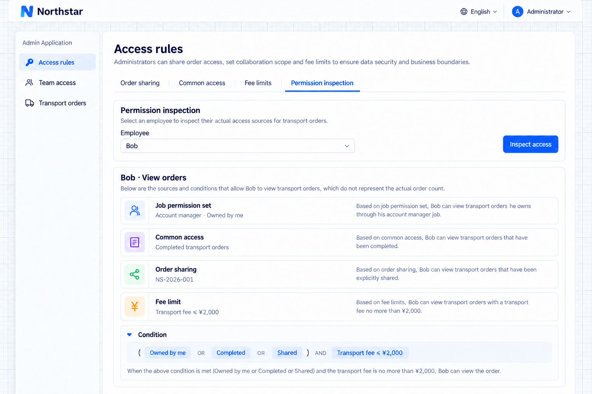

# Kiểm tra quyền

Kiểm tra quyền giải thích thao tác, điều kiện và nguồn quyền. Nó không phải là số lượng bản ghi thực tế có thể truy cập.

## Vì sao Bob thấy được đơn hàng này?

Khi người dùng có thêm quyền truy cập hoặc không thấy một bản ghi, hãy kiểm tra nguồn và điều kiện. Xác định công việc, quy tắc chia sẻ hay quy tắc hạn chế nào cần điều chỉnh.

```text
Provide permission inspection in Northstar Team access for authorized administrators only.
Select an employee and inspect pages, actions, record conditions, and sources from sets, assignments, default access, sharing, and restrictions.
Explain Bob's owned-order scope and temporary sharing of NS-2026-001 separately.
Do not present the inspection as an order count or let ordinary employees inspect other people's details.
```

Kết quả của Bob có thể kết hợp các đơn do anh phụ trách, các đơn tham khảo đã hoàn tất và một bản ghi được chia sẻ, rồi bị thu hẹp bởi các quy tắc hạn chế áp dụng.

| Thay đổi mong muốn           | Cấu hình                     |
| ------------------------ | --------------------------------- |
| Trách nhiệm công việc     | Bộ quyền                    |
| Ai đảm nhận công việc          | Phân công cho người dùng hoặc tổ chức |
| Tham khảo chung        | Phạm vi mặc định                     |
| Cộng tác tạm thời  | Chia sẻ                           |
| Ranh giới truy cập chung | Hạn chế                      |

Kiểm tra giải thích kết quả; muốn thay đổi thì sửa cấu hình tương ứng. Chọn một người dùng để xem quyền của người đó. Chế độ xem theo nhóm mô tả các phân công cho nhóm, không phải toàn bộ quyền thực tế của từng thành viên.

Siêu quản trị viên có quyền truy cập không giới hạn. Hãy dùng tài khoản nhân viên nghiệp vụ để minh họa sự khác biệt giữa các công việc và dùng trang thực tế để xem bản ghi; số điều kiện không phải là số bản ghi.

## Kiểm tra nguồn thực tế

Mở **Quy tắc truy cập → Kiểm tra quyền**, chọn Bob rồi nhấn **Kiểm tra quyền**. Kết quả hiển thị công việc quản lý khách hàng của Bob và các quy tắc truy cập chung, chia sẻ đơn hàng và giới hạn chi phí đang áp dụng. Mở rộng **Xem điều kiện quyết định** để xem các điều kiện của server.



**Kết quả kiểm tra liệt kê công việc và các nguồn truy cập chung, chia sẻ và hạn chế đang áp dụng.**

Phạm vi của chính Bob, nền đơn đã hoàn tất và đơn NS-2026-001 được chia sẻ được kết hợp trước. Sau đó giới hạn phí vận chuyển 2.000 CNY thu hẹp kết quả. Xem danh sách đơn hàng thực tế trong [Quy tắc hạn chế](./restriction-rules.md); công cụ kiểm tra này không đếm số bản ghi đủ điều kiện.
