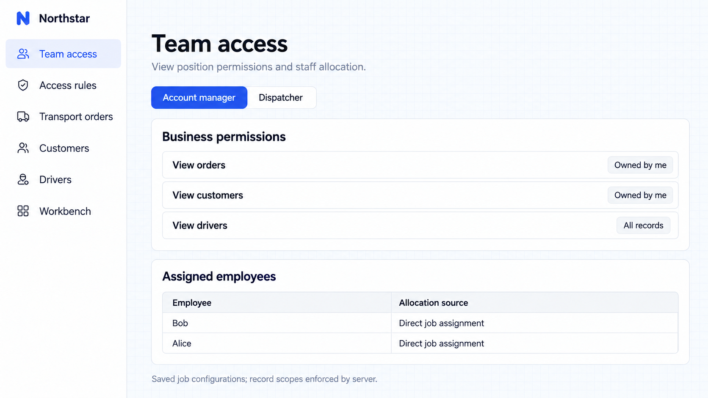
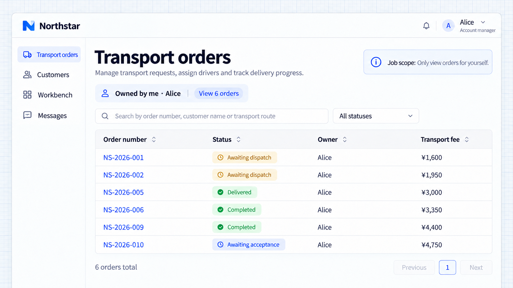
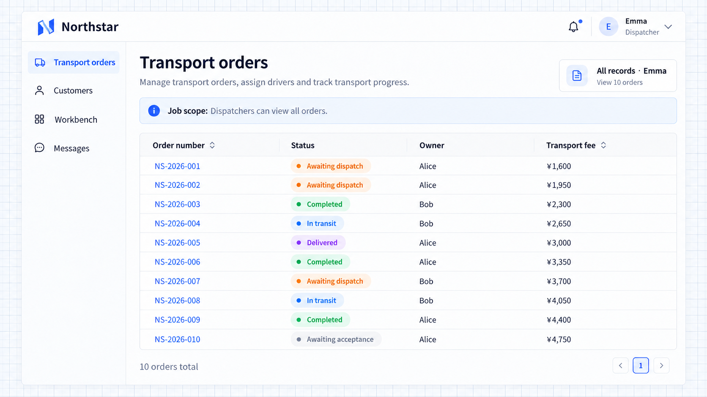

# Bộ quyền và phân công

Bộ quyền kết hợp trang, thao tác và phạm vi dữ liệu thành các công việc có thể tái sử dụng. Nhiều nhân viên quản lý khách hàng có thể dùng chung một bộ, và một nhân viên có thể giữ nhiều bộ.

## Các công việc trong vận tải

Gom trang, thao tác và phạm vi bản ghi thành bộ quyền cho những người có cùng trách nhiệm. Tái sử dụng cấu hình công việc khi có nhân viên mới hoặc nhân viên chuyển công việc.

```text
Create Northstar permission sets for account managers, dispatchers, and drivers.
Account managers enter customers and orders, create orders, and view or edit records they own.
Dispatchers enter the dispatch workspace, view transport orders, and assign drivers, but cannot maintain permissions.
Drivers view assigned tasks and accept, depart, and submit delivery evidence; they cannot change prices or reassign drivers.
Only authorized administrators maintain permission sets and assignments.
Provide job editing and assignments in Team access. Initially assign Alice and Bob as account managers, Emma as dispatcher, and Daniel as driver.
```

Tổ chức việc chỉnh sửa theo trang, thao tác và phạm vi. Xem và sửa đơn hàng là hai thao tác riêng; vào được một trang không có nghĩa là có mọi thao tác trong trang đó.

## Phân công và tái sử dụng

Quản trị viên xem lại một công việc và phân công nhân viên. Alice và Bob có cùng trách nhiệm nhưng truy cập bản ghi của riêng mình. Emma phối hợp điều phối; Daniel xử lý các chuyến được giao.

Một nhân viên có thể đảm nhận nhiều trách nhiệm. Gỡ một phân công có thể vẫn còn nguồn khác, trực tiếp hoặc từ tổ chức.

Bộ quyền thành viên mặc định áp dụng cho người dùng đã đăng nhập và phù hợp với các năng lực cơ bản chung. Siêu quản trị viên có quyền truy cập không giới hạn và không nên dùng thay nhân viên nghiệp vụ khi minh họa.

Phân công theo nhóm và phòng ban cần tư cách thành viên thực tế trong tổ chức. Chỉ một trường tên phòng ban thì không tạo ra việc kế thừa quyền.

## Quyền theo công việc trong ví dụ này

Quyền truy cập của nhóm hiển thị các quyền công việc đã lưu và phân công nhân viên. Công việc quản lý khách hàng được giao cho Alice và Bob; server áp dụng ID sở hữu thực tế của từng người khi đọc bản ghi.



**Quản trị viên có thể xem các quyền công việc đã lưu và phân công nhân viên.**

Alice thấy sáu đơn hàng của mình, còn điều phối viên Emma xem được cả mười. Các ảnh chụp màn hình này dùng tài khoản nghiệp vụ thông thường. Tạo, sửa và điều phối cần các quyền thao tác riêng như mô tả trong yêu cầu đầy đủ ở trên.



**Chỉ với phạm vi theo công việc, Alice thấy sáu đơn hàng của mình.**



**Điều phối viên Emma thấy cả mười đơn hàng.**
