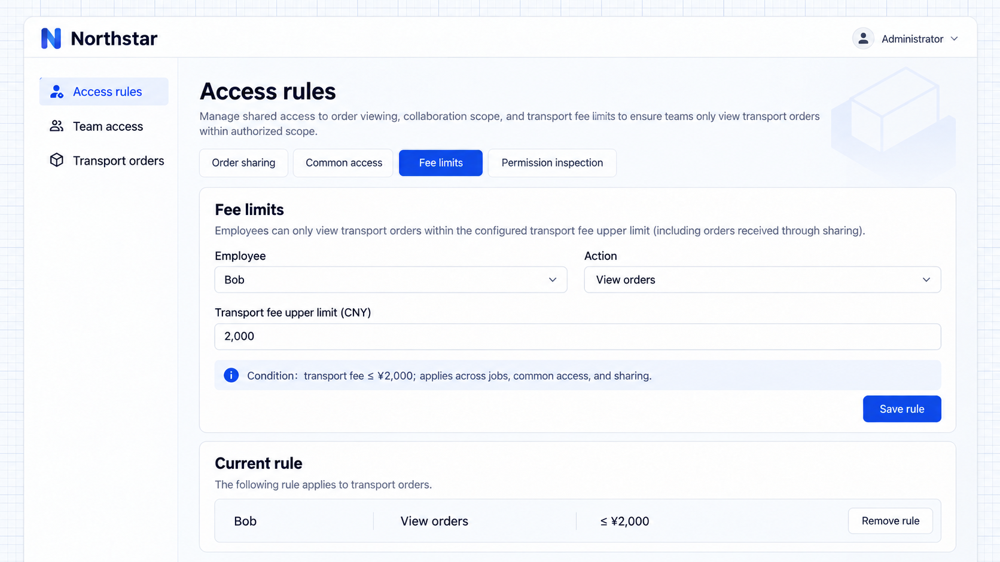
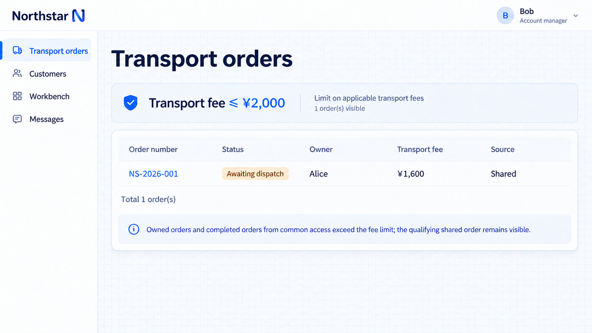

# Quy tắc hạn chế

Quy tắc hạn chế thu hẹp quyền truy cập hiện có từ công việc, truy cập chung và chia sẻ. Bản thân chúng không cấp thao tác hay bản ghi nào.

## Ví dụ: cộng tác theo phí vận chuyển

Quy tắc hạn chế thu hẹp quyền truy cập hiện có xuống các bản ghi đáp ứng điều kiện như số tiền hoặc khu vực. Áp dụng ranh giới này cho quyền truy cập có được qua công việc, truy cập mặc định và chia sẻ.

```text
Bob temporarily helps review transport fees and may view only orders with a transport fee of 2,000 CNY or less.
Add a fee limit to his View transport orders action, preserving his job and order ownership.
Apply it to his own orders, the completed-order baseline and shared orders.
Let administrators adjust or remove it in Access rules; explain that removing it may expand visible records.
```

Ví dụ này dùng phí của đơn vận chuyển, không phải đơn đề nghị phê duyệt chi phí phát sinh. Đúng 2.000 CNY vẫn nằm trong giới hạn.

## Cấu hình giới hạn

Mở **Quy tắc truy cập → Giới hạn chi phí**, chọn Bob, nhập **2,000** rồi lưu.



**Phạm vi xem đơn hàng của Bob có giới hạn phí 2.000 CNY.**

## Xem kết quả đã thu hẹp

Các đơn của chính Bob và các đơn đã hoàn tất vượt giới hạn nên biến mất khỏi danh sách. Đơn được chia sẻ **NS-2026-001**, với phí **1.600 CNY**, vẫn hiển thị và vẫn thuộc về Alice.



**Sau khi hạn chế, chỉ còn đơn được chia sẻ nằm trong giới hạn phí là hiển thị.**

Gỡ quy tắc hạn chế thì các nguồn khác vẫn giữ nguyên. Gỡ chia sẻ chỉ gỡ nguồn cộng tác đó. [Kiểm tra quyền](./inspector.md) để xem các nguồn.

## Xác định từng thao tác

Ví dụ này giới hạn việc xem. Nếu cùng ranh giới áp dụng cho sửa hoặc phê duyệt thì cần quy tắc riêng. Nhiều quy tắc hạn chế phải được thỏa mãn đồng thời; hãy cấu hình điều kiện cho những bản ghi vẫn được phép.
