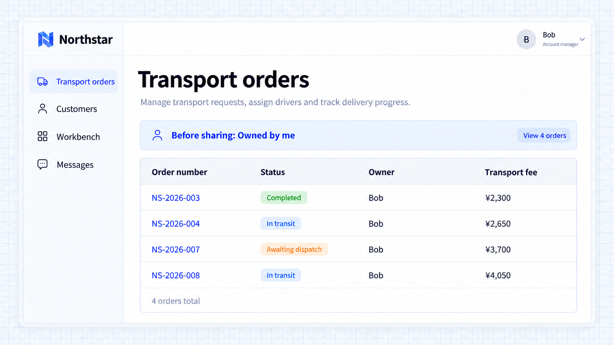
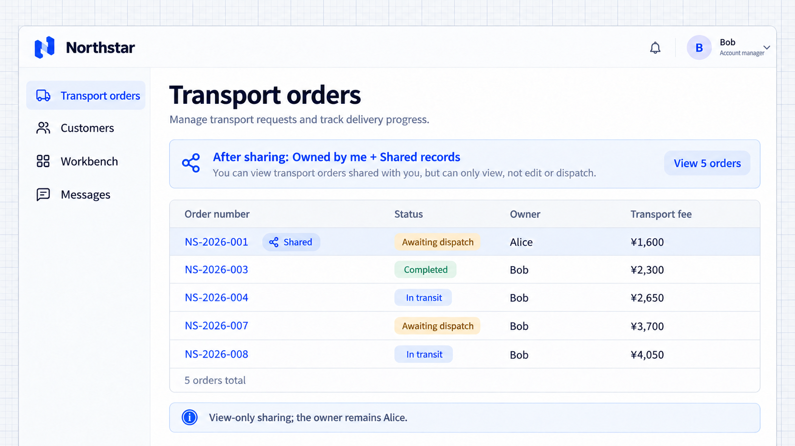

# Quy tắc chia sẻ

Chia sẻ bổ sung phạm vi bản ghi cho những người được chọn hoặc các chủ thể tổ chức đã đăng ký. Người nhận vẫn cần quyền trên trang và thao tác tương ứng.

## Cộng tác tạm thời

Cộng tác tạm thời có thể cần truy cập một số bản ghi cụ thể mà không mở rộng toàn bộ phạm vi công việc của một người. Hãy chia sẻ các bản ghi được chọn trong khi vẫn giữ quyền sở hữu và quyền thông thường.

```text
Alice needs Bob to help follow up transport order NS-2026-001.
Bob already has order viewing permission; share this order's viewing scope with him.
Keep Alice as owner and preserve Bob's normal job and owned-record scope.
Do not grant editing, driver assignment, or approval through this sharing.
Let administrators select an employee and order in Access rules, save a view-only sharing rule, and remove it after collaboration ends.
```

Bob xem đơn cộng tác ngay trên trang đơn hàng hiện có, cùng với phạm vi hiện tại của mình. Chia sẻ không thay đổi quyền sở hữu.

## Chỉ định thao tác

Chia sẻ quyền xem cho cộng tác chỉ cần xem xét. Sửa cần quyền và phạm vi riêng. Chia sẻ không thể bỏ qua các quy tắc hạn chế đang áp dụng.

Gỡ một quy tắc sẽ gỡ nguồn đó, nhưng các nguồn khác từ công việc, mặc định hoặc chia sẻ có thể vẫn còn. Dùng [kiểm tra quyền](./inspector.md) để hiểu kết quả.

Chia sẻ với nhóm hoặc phòng ban cần chủ thể đã đăng ký và tư cách thành viên thực tế.

## Chọn nhân viên và đơn hàng

Mở **Quy tắc truy cập → Chia sẻ đơn hàng**, chọn Bob và đơn **NS-2026-001** của Alice, rồi nhấn **Lưu quy tắc**. Danh sách quy tắc hiện tại hiển thị người nhận, đơn hàng và thao tác xem. Gỡ một quy tắc cần xác nhận.


**Quy tắc chia sẻ cho Bob quyền xem đơn hàng được chọn.**

## Xem kết quả của người nhận

Chỉ với phạm vi công việc của mình, Bob thấy bốn đơn hàng. Chia sẻ bổ sung NS-2026-001, nâng danh sách lên năm đơn; chủ sở hữu vẫn là Alice.



**Trước khi chia sẻ, Bob thấy bốn đơn hàng của mình.**



**Sau khi chia sẻ, Bob thấy đơn được chọn của Alice mà chủ sở hữu không thay đổi.**

Các kết quả này thể hiện việc chia sẻ trước khi thêm truy cập chung và giới hạn chi phí. Chia sẻ không cấp quyền sửa hay điều phối.
