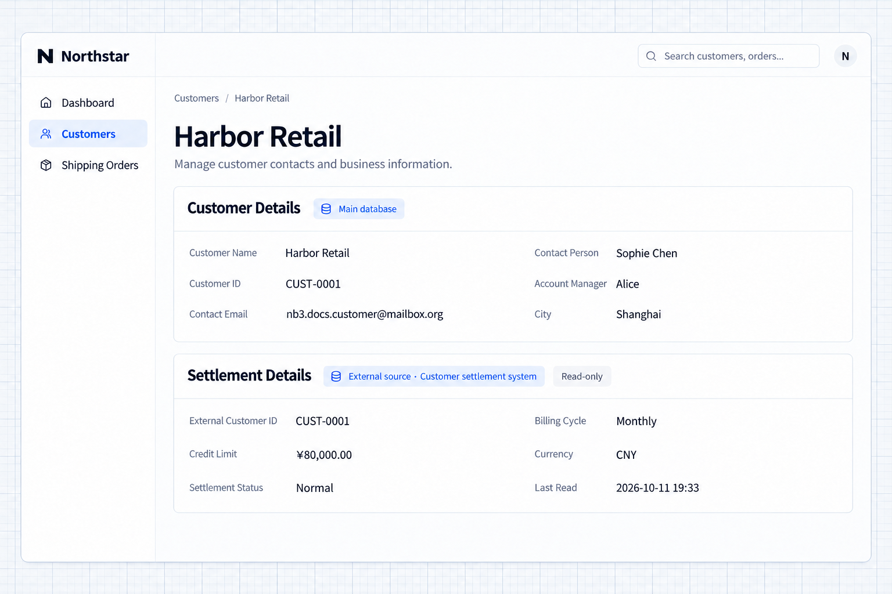

# Nguồn dữ liệu

Ứng dụng có thể tự chọn cơ sở dữ liệu chính và kết nối các cơ sở dữ liệu có sẵn làm nguồn dữ liệu bên ngoài, dùng trực tiếp dữ liệu của chúng trong các trang.

## Các loại cơ sở dữ liệu cho ứng dụng

Ứng dụng dùng driver cơ sở dữ liệu tương ứng. Template mặc định dùng SQLite; các loại khác cần driver và thiết lập kết nối riêng.

| Cơ sở dữ liệu             | Dialect trong cấu hình |
| -------------------- | --------------------- |
| SQLite               | `sqlite`              |
| PostgreSQL           | `postgres`            |
| MySQL và MariaDB    | `mysql`               |
| Microsoft SQL Server | `mssql`               |
| Oracle Database      | `oracle`              |
| Dameng (Đạt Mộng)               | `dameng`              |
| KingbaseES           | `kingbase`            |
| OceanBase            | `oceanbase`           |

Khi chọn driver, hãy xác nhận phiên bản server được hỗ trợ, nền tảng triển khai và khả năng kết nối. Bảng này mô tả các loại có thể cấu hình, không phải các driver đã được cài sẵn. Thay đổi kết nối không tự động di chuyển dữ liệu nghiệp vụ hiện có.

## Nguồn dữ liệu bên ngoài

Khi dữ liệu đã có trong một cơ sở dữ liệu khác, hãy kết nối nó làm nguồn dữ liệu bên ngoài để đọc và hiển thị bản ghi mà không phải nhập lại. Cơ sở dữ liệu chính tiếp tục lưu dữ liệu nghiệp vụ của chính ứng dụng, còn hệ thống hiện có tiếp tục duy trì dữ liệu bên ngoài của nó.

### Ví dụ: hiển thị thông tin quyết toán từ nguồn dữ liệu bên ngoài

Ví dụ này kết nối một cơ sở dữ liệu quyết toán riêng và hiển thị kỳ thanh toán, hạn mức tín dụng và trạng thái quyết toán trên trang chi tiết khách hàng.

Chuẩn bị thông tin kết nối cơ sở dữ liệu và cấu trúc bảng, rồi yêu cầu Agent:

```text
Connect Northstar’s existing settlement database as an external data source. Read its data without altering its tables.
Match records by customer identifier and add Settlement details to customer pages, showing billing cycle, credit limit, settlement status, and data source.
Keep reading customer contact information from the main database. Read settlement information directly from the external database without importing it into the main one.
Read connection credentials from server runtime configuration.
```

### Xem kết quả

Mở chi tiết khách hàng Harbor Retail. Thông tin liên hệ từ cơ sở dữ liệu chính hiển thị phía trên phần Chi tiết quyết toán lấy từ cơ sở dữ liệu riêng, gồm kỳ thanh toán hằng tháng và hạn mức tín dụng 80.000 CNY.



**Một trang hiển thị cùng lúc thông tin khách hàng từ cơ sở dữ liệu chính và dữ liệu quyết toán bên ngoài, không phải nhập trùng.**

:::tip Lưu ý quan trọng

- **Xác định cách khớp bản ghi**: ví dụ này khớp bản ghi theo mã khách hàng. Hãy chỉ rõ trường tương ứng trong ứng dụng và trong nguồn bên ngoài thay vì khớp theo tên.
- **Xác định quyền đọc và ghi**: ví dụ này chỉ đọc. Nếu cần ghi ngược lại, hãy chỉ rõ những bảng và trường được phép thay đổi.
- **Xác định ai được truy cập dữ liệu**: kết nối một cơ sở dữ liệu không có nghĩa là mọi người dùng đều được xem bản ghi của nó. Hãy kiểm soát quyền truy cập ở phía server theo yêu cầu nghiệp vụ.
- **Kết nối không tạo ra đồng bộ**: ví dụ này đọc dữ liệu bên ngoài khi mở trang mà không sao chép vào cơ sở dữ liệu chính. Đồng bộ cần lịch chạy tường minh và cách xử lý khi thất bại.

:::

Driver KingbaseES, Dameng và OceanBase là các gói thương mại NocoBase Pro, cần giấy phép thương mại phù hợp và quyền truy cập đã xác thực vào registry gói riêng. Cài gói đã chọn vào dependencies production của ứng dụng, rồi cấu hình dialect và thiết lập kết nối. Tự động nạp và `config init --dialect` vẫn được hỗ trợ; đăng ký tường minh trong `database.drivers` là tùy chọn và được ưu tiên hơn.
