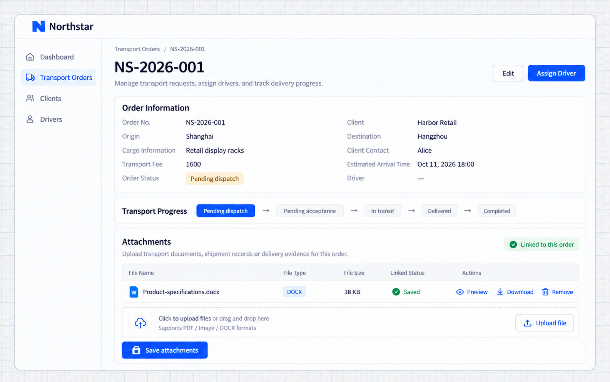
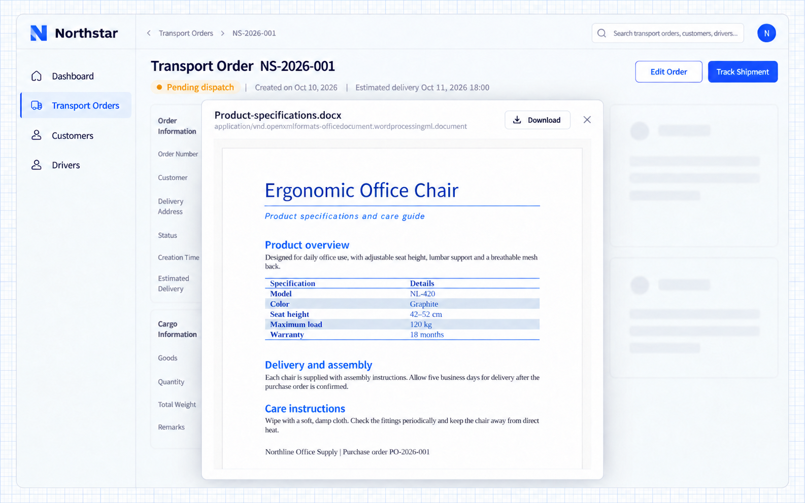

# Tệp

Northstar gắn chứng từ hàng hóa và bằng chứng giao hàng vào các đơn vận chuyển.

NocoBase 3 cung cấp chức năng tải lên, xem trước, tải xuống và quản lý lưu trữ tệp. Dùng các năng lực này để thêm tệp đính kèm và lưu trữ hình ảnh cho ứng dụng của bạn. Tệp đính kèm có thể gắn với bản ghi nghiệp vụ để người dùng truy cập các tài liệu liên quan. Lưu trữ hình ảnh hỗ trợ các mục đích như ảnh đại diện nhân viên và hình ảnh sản phẩm.

Hãy cho Agent biết tính năng nghiệp vụ nào cần tệp, mỗi bản ghi có thể có bao nhiêu tệp và ai được truy cập. Agent sẽ kết nối năng lực tệp vào các trang phù hợp.

## Trước khi bắt đầu

Ví dụ này thêm tệp đính kèm vào một ứng dụng quản lý đơn hàng có sẵn. Hãy chuẩn bị một đơn hàng và các chứng từ hàng hóa để tải lên, chẳng hạn chứng từ vận chuyển và thông số kỹ thuật sản phẩm.

Hãy cho Agent biết tệp đính kèm hiển thị ở đâu, hỗ trợ định dạng nào, ai được tải lên và xem, và có giữ lại tệp khi gỡ tệp đính kèm hay không.

## Ví dụ: thêm chứng từ hàng hóa vào đơn hàng

Nhân viên quản lý khách hàng cần lưu báo giá và thông số sản phẩm cùng với đơn hàng. Người duyệt cần đọc được các tài liệu này khi duyệt đơn.

```text
Add transport attachments to my existing order management application.

Add an attachment area to order details. Each order can have multiple files, including PDF, images, and DOCX.
Show filenames and sizes, with actions to preview, download, and remove attachments.
After uploading, let users save the attachments to the current order. Keep them available when the order is reopened.
Anyone with access to an order can view and download its attachments. Account managers and dispatchers can add or remove attachments.
Removing an attachment only unlinks it from the current order; retain the file.
```

### Xem kết quả

1. Mở chi tiết đơn hàng, nhấn **Chọn tệp** trong khu vực tệp đính kèm và chọn các chứng từ hàng hóa. Nhấn **Lưu tệp đính kèm** để gắn chúng với đơn hàng. Các tệp vẫn còn khi bạn mở lại đơn hàng.

2. Nhấn **Xem trước** bên cạnh một tệp đính kèm để đọc nội dung ngay trong ứng dụng.

3. Nhấn **Tải xuống** để tải tệp gốc. Nhấn **Gỡ** rồi lưu để bỏ liên kết tệp đính kèm khỏi đơn hàng hiện tại.

## Cách dùng khác

### Ảnh đại diện nhân viên và hình ảnh sản phẩm

Gắn ảnh đại diện hoặc hình ảnh với bản ghi khi người hoặc sản phẩm cần được nhận diện bằng hình ảnh trong danh sách và trang chi tiết.

Ảnh đại diện nhân viên hoặc ảnh bìa sản phẩm thường chỉ cần một tệp. Tải lên ảnh thay thế sẽ cập nhật liên kết. Bộ ảnh sản phẩm và tệp đính kèm đơn hàng có thể chứa nhiều tệp. Ví dụ:

```text
Add an avatar to each employee, with one image per employee.
Support uploading and replacing the avatar, and show it in employee lists and details.
Use the new avatar after replacement and keep it visible after refreshing the page.
```

### Lưu trữ tệp

Tên tệp, kích thước và liên kết nghiệp vụ được lưu trong cơ sở dữ liệu. Nội dung tệp được lưu ở vị trí đã cấu hình cho ứng dụng. Ứng dụng mặc định dùng lưu trữ cục bộ và cũng hỗ trợ object storage tương thích S3.

Với object storage, quản trị viên lưu trữ chuẩn bị bucket, endpoint, region và thông tin xác thực truy cập. Lập trình viên hoặc quản trị viên triển khai của ứng dụng cấu hình các thông tin này ở phía server. Sau đó Agent có thể kết nối tính năng nghiệp vụ liên quan với cấu hình lưu trữ đó. Bản sao lưu ứng dụng cần bao gồm cả cơ sở dữ liệu lẫn nội dung tệp.

Sau khi chuyển nơi lưu trữ, các tệp tải lên mới sẽ dùng cấu hình mới. Hãy chỉ định phạm vi di chuyển riêng nếu các tệp hiện có cũng cần chuyển đi.

### Quyền truy cập tệp đính kèm

Tệp đính kèm nghiệp vụ nên tuân theo quy tắc truy cập của bản ghi cha. Ví dụ, nhân viên có thể xem tệp đính kèm của các đơn hàng mà họ được truy cập, và người duyệt có thể đọc chứng từ hàng hóa của các đơn họ xử lý.

Yêu cầu Agent áp dụng kiểm tra xác thực và quyền nghiệp vụ cho các endpoint tải lên, liệt kê tệp, xem trước và tải xuống. Xem [Phân quyền](.././authorization/index.md) để biết các quy tắc liên quan.

## Tài liệu tham khảo cho lập trình viên

Bảng tệp lưu metadata, còn dịch vụ lưu trữ quản lý nội dung. Phần tích hợp cần giữ nguyên các trường tệp chuẩn và lưu liên kết giữa bản ghi nghiệp vụ và tệp.

<details>
<summary>Các trường tệp chuẩn</summary>

| Trường                         | Mục đích                                      |
| ----------------------------- | -------------------------------------------- |
| `id`                          | Mã định danh tệp dạng UUID                         |
| `disk`, `key`                 | Tên cấu hình lưu trữ và vị trí tệp |
| `filename`, `ext`, `mimeType` | Tên tệp, phần mở rộng và loại tệp                |
| `size`                        | Kích thước tệp tính bằng byte                           |
| `createdAt`, `updatedAt`      | Thời điểm tạo và cập nhật               |

Tên trường là cố định và năng lực tệp tự điền chúng khi tải lên. `contentUrl` được suy ra từ mã định danh và phần mở rộng của tệp, nên không cần trường trong cơ sở dữ liệu. Các trường nghiệp vụ bổ sung nên cho phép rỗng hoặc có giá trị mặc định; hãy lưu liên kết nghiệp vụ sau khi tải lên.

</details>

## Câu hỏi thường gặp

### Những định dạng nào có thể xem trước?

Component tệp hỗ trợ hình ảnh, PDF, văn bản, Markdown, âm thanh và video. DOCX, XLSX và PPTX có thể xem trước ngay trong trình duyệt. Các định dạng khác có thể cung cấp thao tác tải xuống. Các định dạng Office cũ cũng có thể dùng Office Online, nhưng cần URL tệp truy cập được từ Internet.

### Vì sao tệp đã tải lên không có trong đơn hàng?

Tải lên tạo ra một bản ghi tệp. Lưu tệp đính kèm mới gắn tệp với đơn hàng. Trong ví dụ này, hãy nhấn **Lưu tệp đính kèm** sau khi chọn tệp, rồi mở lại đơn hàng để xem.

### Gỡ tệp đính kèm có xóa tệp không?

Ví dụ này chỉ bỏ liên kết tệp đính kèm khỏi đơn hàng hiện tại, vẫn giữ bản ghi và nội dung tệp. Nếu muốn dọn dẹp vĩnh viễn, hãy chỉ rõ những tệp cần xóa và cách xử lý các tham chiếu từ bản ghi nghiệp vụ khác. Agent có thể triển khai hành vi đó.

### Làm sao thay đổi giới hạn tải lên?

Hãy cho Agent biết các định dạng được phép, kích thước tối đa của mỗi tệp và số tệp đính kèm trên mỗi bản ghi. Agent có thể cấu hình cả phần hướng dẫn trên trang lẫn giới hạn ở server. Các endpoint tích hợp sẵn mặc định giới hạn 5 MiB cho mỗi request tải lên một tệp và 20 MiB cho mỗi request hàng loạt, tính cả toàn bộ body của request.

## Kết quả với Northstar

Mở NS-2026-001, chọn một tệp trong Tệp đính kèm vận chuyển rồi chọn Lưu tệp đính kèm. Tệp DOCX đã tải lên vẫn được gắn sau khi mở lại đơn hàng. Xem trước mở tệp ngay trong ứng dụng; Tải xuống trả về tệp gốc, còn Gỡ rồi lưu sẽ bỏ liên kết mà không xóa tệp đã lưu.



**Tệp đính kèm được gắn với đơn hàng và vẫn còn sau khi mở lại.**



**Người dùng có thể xem trước tài liệu liên quan ngay trong ứng dụng.**
