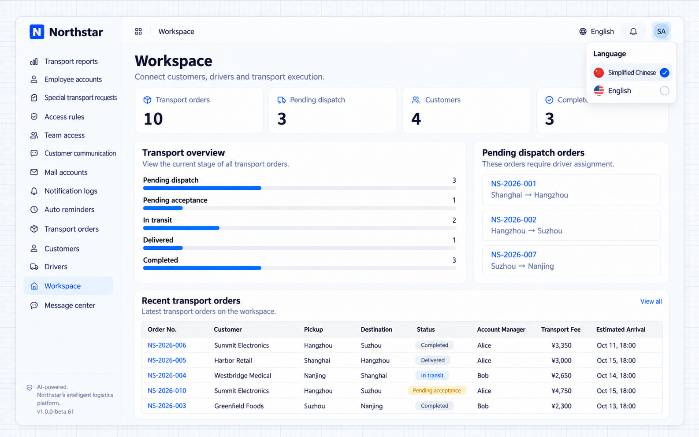

# Chuyển đổi ngôn ngữ

Ứng dụng NocoBase 3 hỗ trợ đa ngôn ngữ ngay từ đầu, có sẵn tiếng Anh và tiếng Trung.

Chuyển giữa các ngôn ngữ có sẵn, hoặc yêu cầu Coding Agent thêm ngôn ngữ hay thay đổi ngôn ngữ mặc định.

## Chuyển ngôn ngữ

Mở menu tài khoản ở góc trên bên phải, chọn **Ngôn ngữ** rồi chọn một ngôn ngữ.

Thay đổi có hiệu lực ngay mà không cần tải lại trang, và phần giao diện do plugin cung cấp cũng thay đổi theo.

Lựa chọn được lưu trong trình duyệt hiện tại và vẫn giữ sau khi làm mới trang, nhưng không đồng bộ sang thiết bị khác dùng cùng tài khoản. Chuyển sang tiếng Trung không ảnh hưởng đến người khác và không thay đổi ngôn ngữ mặc định của ứng dụng.

## Thêm ngôn ngữ

Thêm bản dịch giao diện và thông báo của server khi người dùng cần một ngôn ngữ khác cho cùng ứng dụng nghiệp vụ. Ví dụ này thêm tiếng Tây Ban Nha.

Các ngôn ngữ mà ứng dụng cung cấp đến từ chính các tệp locale của nó — **thêm một tệp locale là thêm một ngôn ngữ**.

Các tệp này nằm ở cả hai phía: `client/locales/` quyết định ngôn ngữ nào xuất hiện trong bộ chuyển ngôn ngữ, còn `server/locales/` quyết định server có thể trả lời bằng ngôn ngữ nào. Nên giữ hai phía đồng bộ. Một ngôn ngữ chỉ có ở phía client vẫn có thể được chọn: giao diện sẽ chuyển, server dùng tiếng Anh, và một thông báo nhỏ giải thích việc dùng ngôn ngữ dự phòng.

Hãy cho Coding Agent biết cần hỗ trợ ngôn ngữ nào và dùng ở đâu. Ví dụ:

```text
Add Spanish to my application. Translate the interface and server messages, and add Spanish to the language menu.
```

Agent tạo các tệp locale, đăng ký chúng trong bảng ánh xạ của loader và kiểm tra hai phía có khớp nhau không. Sau đó làm mới trang, bộ chuyển ngôn ngữ sẽ có thêm một mục mới.

Nếu một ngôn ngữ chỉ có ở một phía, lệnh sau sẽ báo lại:

```bash
pnpm nocobase locales check
```

## Đặt ngôn ngữ mặc định

Ngôn ngữ mặc định là ngôn ngữ mà **người chưa từng chọn ngôn ngữ** nhìn thấy khi mở ứng dụng lần đầu. Đặt nó trong `config.yml`:

```yaml
i18n:
  defaultLocale: zh-CN
```

Nếu không đặt, giá trị là `en-US`. Làm mới trang sau khi cấu hình mới có hiệu lực.

Ở cả môi trường phát triển và production, server đặt thuộc tính HTML `lang` theo ngôn ngữ mặc định này trước khi gửi trang. Sau đó client đồng bộ `lang` và hướng văn bản với ngôn ngữ đã xác định, kể cả lựa chọn đã lưu trước đó, và tiếp tục cập nhật khi ngôn ngữ thay đổi. Thay đổi ngôn ngữ mặc định của bản triển khai không cần build lại client.

:::tip Người đã chọn ngôn ngữ sẽ không bị ảnh hưởng

Ngôn ngữ mặc định chỉ áp dụng cho trình duyệt chưa từng chọn ngôn ngữ. Nếu bạn đổi thiết lập này mà giao diện của bạn vẫn như cũ, nhiều khả năng bạn đã từng tự chuyển ngôn ngữ — hãy thử trình duyệt khác hoặc xóa dữ liệu trang web.

:::

Ngôn ngữ mặc định còn có vai trò thứ hai: văn bản chưa có bản dịch trong ngôn ngữ đang dùng sẽ dùng ngôn ngữ mặc định thay thế.

## Ngôn ngữ của plugin

Một plugin chưa chắc đã dịch mọi ngôn ngữ mà ứng dụng của bạn cung cấp. Phần chưa được dịch sẽ dùng ngôn ngữ dự phòng theo thứ tự sau:

```text
the language in use  →  the application's default  →  English
```

Ví dụ: ứng dụng mặc định là tiếng Trung, bạn đã thêm tiếng Tây Ban Nha, còn một plugin chỉ dịch tiếng Trung và tiếng Anh. Người dùng nói tiếng Tây Ban Nha sẽ thấy văn bản của bạn bằng tiếng Tây Ban Nha và văn bản của plugin đó bằng tiếng Trung.

Để dùng câu chữ của riêng bạn thay cho câu chữ của plugin, hãy yêu cầu Coding Agent làm theo hướng dẫn quốc tế hóa của ứng dụng và ghi đè trong các tệp locale của ứng dụng.

## Câu hỏi thường gặp

### Tôi đã chuyển ngôn ngữ nhưng một phần giao diện vẫn là tiếng Anh

Văn bản đó có thể chưa có bản dịch trong ngôn ngữ đã chọn. Nó sẽ dùng ngôn ngữ mặc định của ứng dụng, rồi đến tiếng Anh. Hãy yêu cầu Coding Agent thêm bản dịch cho ứng dụng hoặc ghi đè văn bản tương ứng của plugin.

### Tôi đã thêm tệp locale nhưng bộ chuyển ngôn ngữ không hiển thị

Hãy kiểm tra bạn đã thêm tệp vào `client/locales/` chưa — đó là phía mà bộ chuyển ngôn ngữ đọc. Sau đó chạy `pnpm nocobase locales check` để xem hai phía có khớp không. Tệp locale mới cũng cần khởi động lại dev server.

### Giao diện đã chuyển nhưng nội dung server trả về vẫn là ngôn ngữ cũ

Thường là do ngôn ngữ chỉ được thêm vào `client/locales/`. Khi không có bản dịch tương ứng ở server, server sẽ dùng tiếng Anh. Hãy yêu cầu Coding Agent thêm tệp ngôn ngữ vào `server/locales/`.

### Hai tab dùng cùng tài khoản ảnh hưởng lẫn nhau

Server lưu ngôn ngữ theo phiên đăng nhập, và các tab dùng chung tài khoản thì dùng chung một phiên, nên lần chuyển sau sẽ ghi đè lần trước. Bản thân giao diện không bị ảnh hưởng — mỗi tab hiển thị ngôn ngữ riêng. Phần bị ảnh hưởng là nội dung do server tạo ra, chẳng hạn thông báo lỗi. Đây là một hạn chế đã biết.

## Ví dụ Northstar

Nhân viên điều phối có thể chuyển cùng một không gian làm việc sang tiếng Trung, trong khi đồng nghiệp ở nước ngoài dùng tiếng Anh. Tên khách hàng, điểm đến và các giá trị nghiệp vụ khác vẫn giữ nguyên.



**Cùng một giao diện nghiệp vụ có thể chuyển sang tiếng Trung mà không thay đổi bản ghi.**
