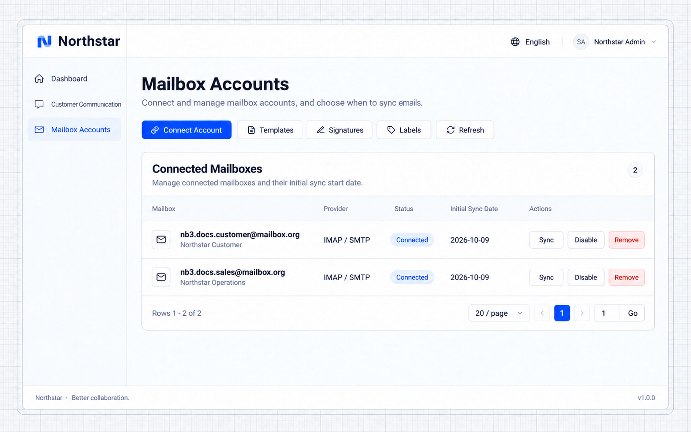
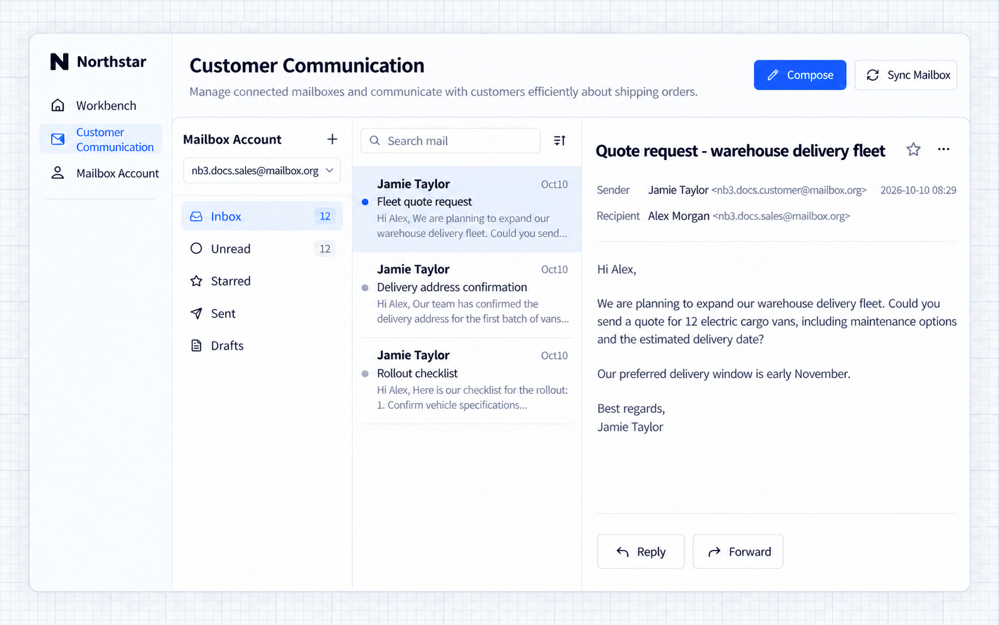
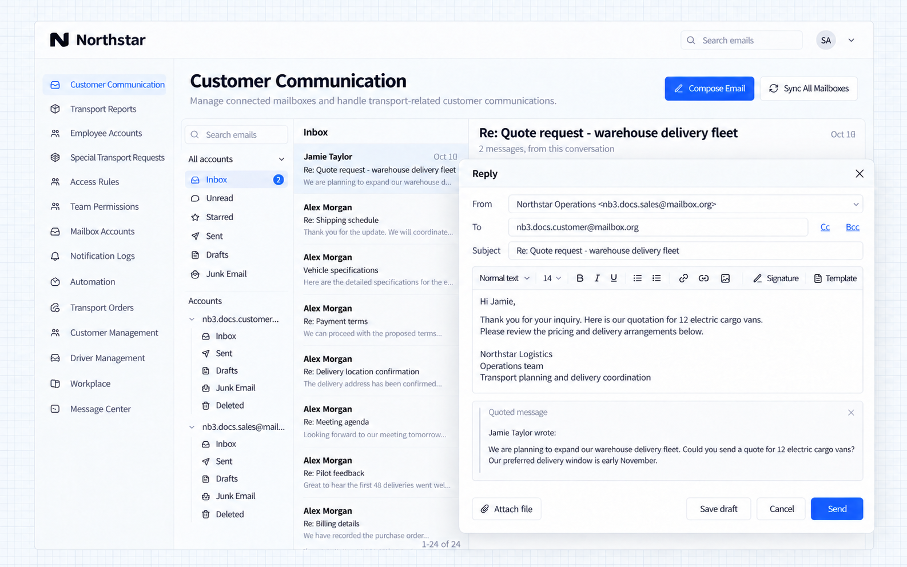
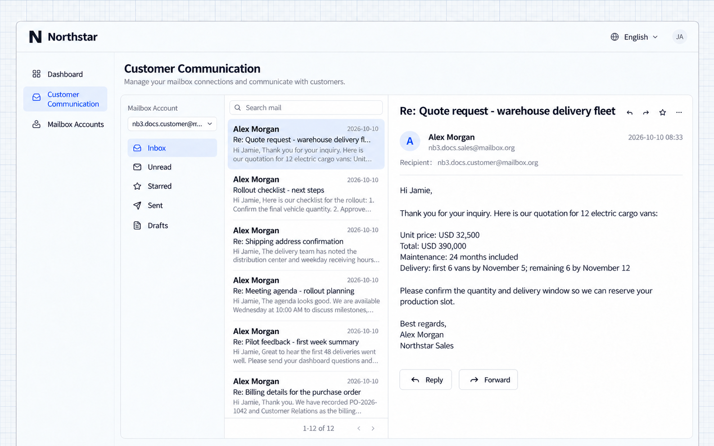

# Đồng bộ và gửi email

Ví dụ này thêm một trung tâm thư, nơi nhân viên bán hàng đọc và trả lời yêu cầu báo giá của khách hàng. Danh sách thư, chế độ đọc và các thao tác trả lời nằm trong cùng một không gian làm việc.

## Trước khi bắt đầu

- Quản trị viên cấu hình một nhà cung cấp email khả dụng. Xem [Cấu hình hộp thư](./configuration.md).
- Người dùng chuẩn bị thông tin đăng nhập hộp thư hoặc mật khẩu ứng dụng. Gmail và Microsoft 365 dùng cơ chế cấp quyền của nhà cung cấp.

## Ví dụ: trả lời email của khách hàng

Kết nối hộp thư khi nhân viên cần đọc và trả lời thư của khách hàng ngay trong ứng dụng. Giữ nguyên tiêu đề, nội dung và ngữ cảnh, đồng thời giảm việc chuyển qua lại giữa các hệ thống.

Đưa prompt sau cho Agent của bạn:

```text
Add a mail center and a mailbox account management entry to the application. Users can connect their own mailboxes, select a mailbox, synchronize incoming messages, read messages and attachments, and reply.

When a sales representative receives a quotation request, they can reply from the mail center. Keep the original subject and conversation context, and address the reply to the original sender. Each user works with their own connected mailboxes.
```

### 1. Kết nối hộp thư

Mở trang tài khoản hộp thư và nhấn **Kết nối tài khoản**. Chọn nhà cung cấp, nhập thông tin hộp thư và chọn ngày bắt đầu cho lần đồng bộ đầu tiên. Ví dụ này dùng một hộp thư bán hàng riêng. Địa chỉ và trạng thái kết nối của hộp thư hiển thị trong danh sách tài khoản.

### 2. Đồng bộ và đọc thư đến

Mở trung tâm thư, chọn hộp thư bán hàng và đồng bộ thư đến. Danh sách gồm yêu cầu báo giá, sắp xếp giao hàng và yêu cầu thông tin. Chọn một thư để đọc.

### 3. Trả lời khách hàng

Nhấn **Trả lời** và nhập thông tin giá cùng chi tiết giao hàng. Thư trả lời bao gồm người nhận, tiêu đề và ngữ cảnh ban đầu. Nhấn **Gửi** khi đã sẵn sàng.

### 4. Xem thư trả lời đã nhận

Hộp thư của khách hàng nhận được thông tin giá và giao hàng. Hai bên có thể tiếp tục cùng một cuộc trao đổi.

Về chữ ký, mẫu thư và tích hợp trang nghiệp vụ, xem [Các tính năng Mail khác](./usage.md).

## Ví dụ Northstar

Ứng dụng mới đồng bộ các hộp thư demo riêng và hiển thị cuộc trao đổi hiện có về nghiệp vụ đội xe, trình soạn thư trả lời và báo giá đã nhận. Không cần thư mới từ bên ngoài để tái tạo các ảnh chụp màn hình này.



**Hộp thư cá nhân đã được kết nối và trạng thái kết nối hiển thị rõ ràng.**



**Người dùng có thể đọc thư đã đồng bộ và nội dung của chúng ngay trong ứng dụng.**



**Trình soạn thư trả lời giữ nguyên ngữ cảnh và cho phép người dùng soạn phản hồi.**



**Hộp thư của khách hàng hiển thị thư trả lời báo giá trong cuộc trao đổi demo có sẵn.**
