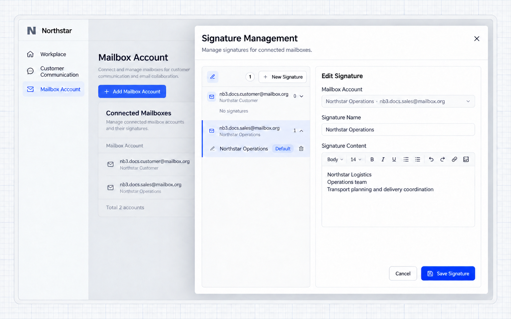
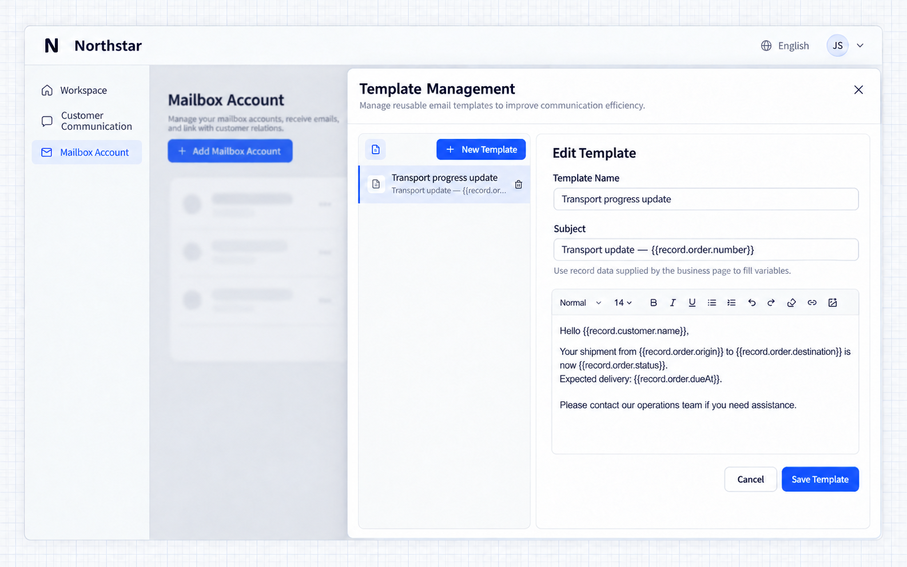
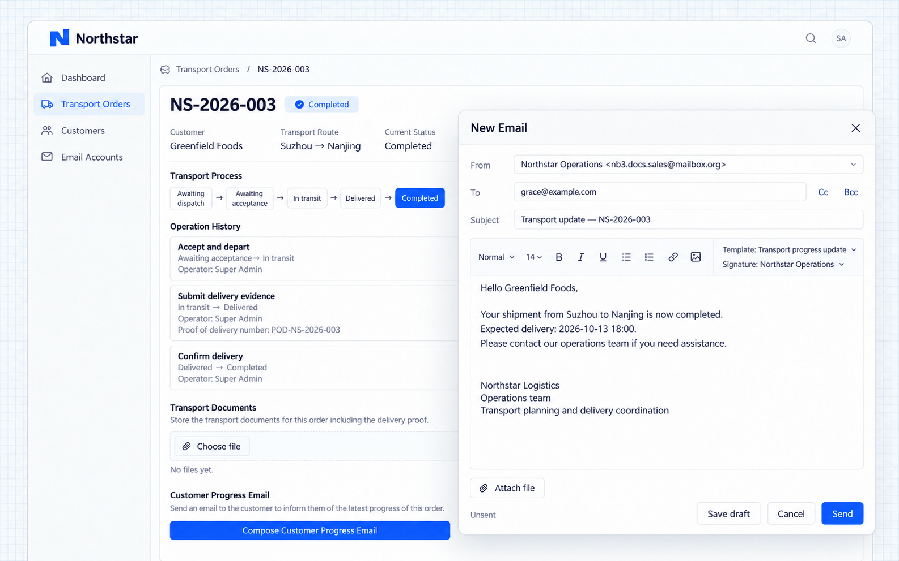
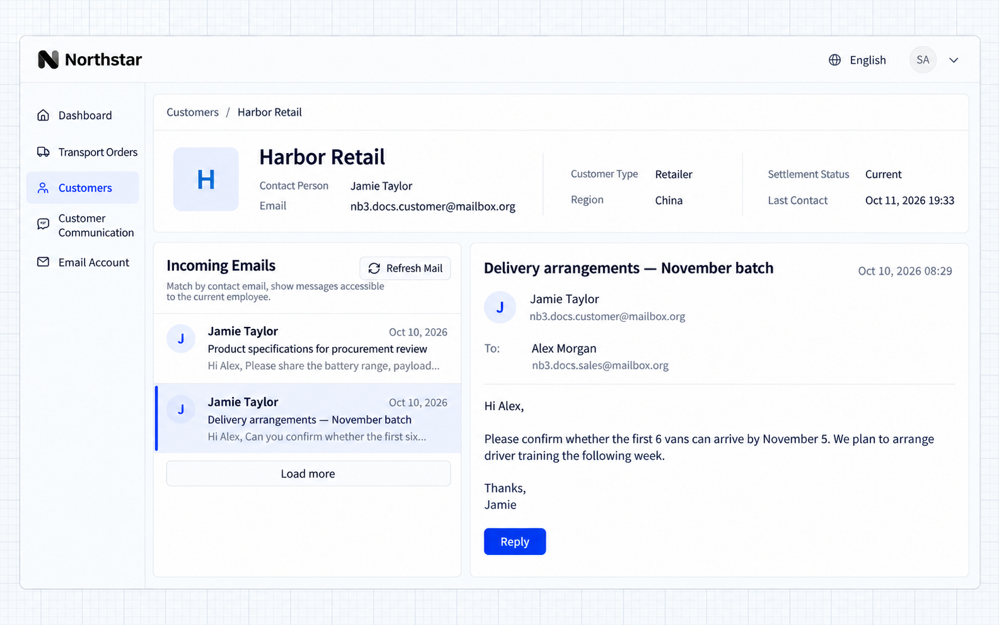
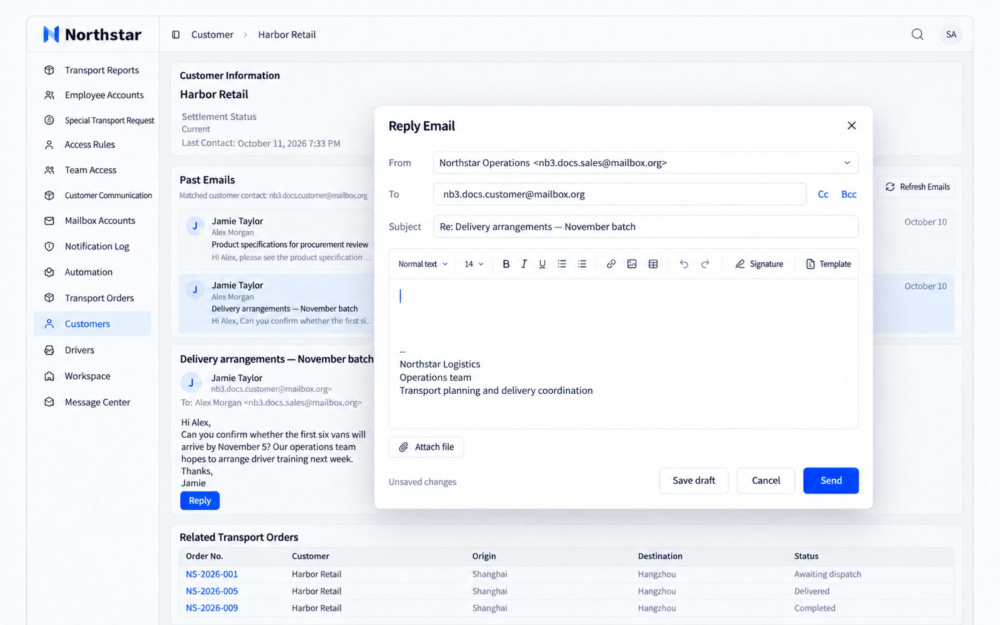
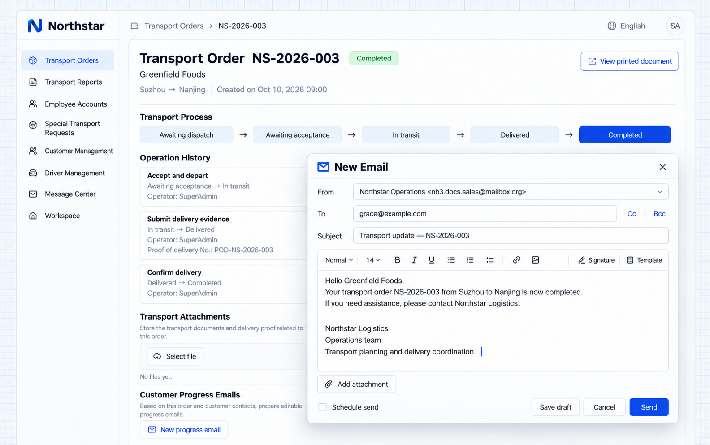

# Các tính năng Mail khác

Mail cung cấp chữ ký, mẫu thư, đọc thư và trình soạn thư. Ứng dụng có thể đặt các năng lực này trên trang tài khoản, chi tiết khách hàng hoặc chi tiết đơn hàng.

Northstar cung cấp các mục điều hướng **Tài khoản hộp thư** và **Liên lạc khách hàng**, đồng thời nhúng thao tác thư vào chi tiết khách hàng và chi tiết đơn vận chuyển. Yêu cầu Agent:

```text
Add Mailbox accounts and Customer communication to the application navigation.
Embed NocoBase's account management page for mailbox connections, signatures, and templates.
Embed the mail workspace for employees to read and send through their own connected mailboxes.
```

Xem [Cấu hình Mail](./configuration.md) để biết về kết nối và [Tài liệu tham khảo cho lập trình viên](./development.md) để biết về tích hợp.

## Dùng chữ ký thư

Lưu tên nhóm, chức danh và thông tin liên hệ thường dùng thành chữ ký để không phải nhập lại mỗi lần. Chữ ký thuộc về một tài khoản hộp thư và có thể đặt một chữ ký mặc định.

```text
Prepare a Northstar Operations signature for the business mailbox,
including Northstar Logistics, Operations team, and transport coordination details.
Let employees manage signatures from Mailbox accounts and select them when composing.
```

Mở **Tài khoản hộp thư → Chữ ký**, chọn một tài khoản, nhập tên và nội dung chữ ký rồi lưu. Đặt chữ ký hay dùng làm mặc định.



**Hộp thư nghiệp vụ đã có chữ ký mặc định được lưu, sẵn sàng dùng khi soạn thư.**

## Dùng mẫu thư

Lưu các tiêu đề và nội dung thư lặp lại thành mẫu thư. Mẫu thư thuộc về người dùng hiện tại. Ứng dụng cũng có thể cung cấp bản ghi nghiệp vụ hiện tại để điền các biến như tên khách hàng và mã đơn hàng.

```text
Prepare a Transport progress update template with the order number in the subject
and customer name, origin, destination, transport status, and expected delivery in the body.
Provide the current order and customer when opening the composer from order details.
Employees can apply the template, edit the content, and select an existing signature.
```

Mở **Tài khoản hộp thư → Mẫu thư** để quản lý tiêu đề và nội dung. Ví dụ này dùng các biến như `{{record.customer.name}}` và `{{record.order.number}}`.



Mở trình soạn thư từ chi tiết đơn vận chuyển, nhấn **Mẫu thư** và chọn **Cập nhật tiến độ vận chuyển**. Nhấn **Chữ ký** để chọn chữ ký.



**Mẫu thư điền thông tin khách hàng và đơn hàng vào tiêu đề và nội dung, theo sau là chữ ký. Mọi thứ vẫn có thể chỉnh sửa trước khi gửi.**

:::info Lưu ý quan trọng

Trang nghiệp vụ nhúng trình soạn thư phải cung cấp các biến của mẫu thư. Lưu mẫu thư không tự động nạp dữ liệu khách hàng hay đơn hàng. Các biến không khớp sẽ giữ nguyên. Hãy kiểm tra người nhận và nội dung trước khi gửi.

:::

## Đọc thư từ trên trang nghiệp vụ

Nhúng danh sách thư và chế độ đọc thư vào chi tiết khách hàng để xem lịch sử liên lạc trong khi xem thông tin khách hàng. Thư được khớp theo email liên hệ.

```text
Add Correspondence to customer details.
Match the customer's contact email against senders, recipients, and copied recipients.
Only show messages accessible through the current employee's own connected mailboxes.
Select a message to read its body. Reply opens the mail composer with its reply relationship retained.
The employee reviews the content before sending. Provide Refresh mail and Load more.
```

Mở chi tiết khách hàng và chọn một thư trong mục **Thư từ**. Ví dụ này đọc các thư đã được đồng bộ bằng component đọc thư.



**Thông tin khách hàng và thư từ liên quan hiển thị trên cùng một trang, không cần tìm riêng theo email liên hệ.**

Nhấn **Trả lời** để mở trình soạn thư.



**Trình soạn thư trả lời điền sẵn người nhận và tiêu đề ban đầu. Nhân viên có thể sửa thư và chọn chữ ký hoặc mẫu thư.**

:::info Lưu ý quan trọng

Hãy nhập chính xác email liên hệ: nó quyết định việc khớp thư từ. Quyền truy cập bản ghi nghiệp vụ và quyền truy cập hộp thư được kiểm soát riêng. Có quyền xem một khách hàng không có nghĩa là được truy cập hộp thư của nhân viên khác.

:::

## Soạn thư từ trang nghiệp vụ

Điền sẵn người liên hệ và chi tiết bản ghi khi soạn thư cập nhật tiến độ đơn hàng để giảm sao chép và nhập sai.

```text
Add Compose progress email to transport order details.
Read the recipient from the customer contact and include the order number in the subject.
Populate the body with the customer, origin, destination, and transport status.
Employees review and edit before sending through their connected mailbox.
Allow existing templates and signatures; do not send automatically.
```

Mở chi tiết đơn vận chuyển và nhấn **Soạn email tiến độ**.



**Thông tin đơn hàng được điền vào tiêu đề và nội dung, sẵn sàng để chỉnh sửa trước khi gửi.**

## Mẹo sử dụng

- Đồng bộ để lấy thư mới; làm mới trang chỉ hiển thị các thư đã được đồng bộ vào ứng dụng.
- Chọn phạm vi lịch sử cần thiết cho lần đồng bộ đầu tiên.
- Sắp xếp thư bằng tìm kiếm, gắn sao và nhãn. Thay đổi có được cập nhật lên nhà cung cấp hay không tùy thuộc vào cách tích hợp.
