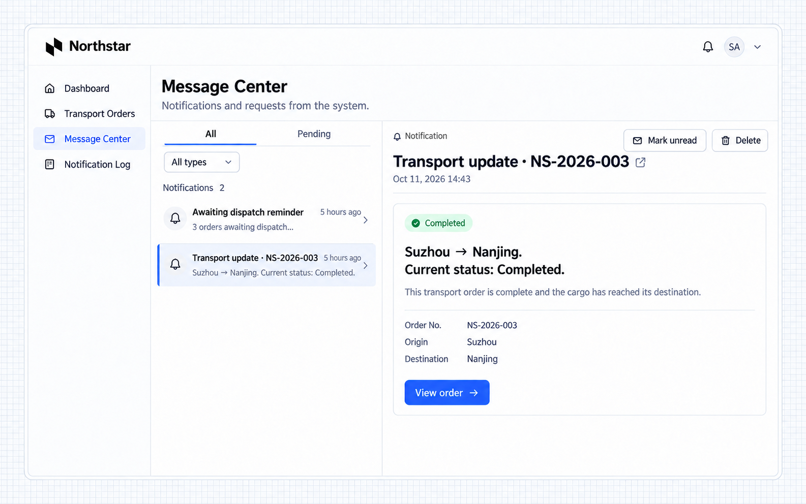
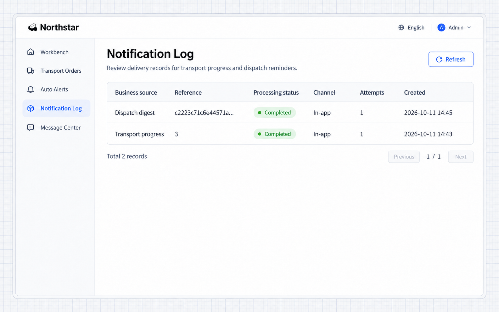

# Thông báo

Thông báo hỗ trợ **bốn nhóm kênh: tin nhắn trong ứng dụng, email, robot nhóm Feishu và robot nhóm DingTalk**. Email hỗ trợ **SMTP và Resend**. Một sự kiện nghiệp vụ có thể dùng nhiều kênh, mỗi kênh có kết quả gửi độc lập.

| Kênh               | Cách tích hợp được hỗ trợ      | Mục đích                                                   |
| --------------------- | -------------------------- | ----------------------------------------------------- |
| Tin nhắn trong ứng dụng       | Trung tâm tin nhắn của ứng dụng | Thông báo cho người dùng ứng dụng và liên kết đến bản ghi liên quan. |
| Email                 | SMTP hoặc Resend             | Gửi thông báo đến địa chỉ email của người nhận.    |
| Robot nhóm Feishu   | Webhook của robot nhóm        | Gửi tin nhắn nghiệp vụ vào một nhóm Feishu.             |
| Robot nhóm DingTalk | Webhook của robot nhóm        | Gửi tin nhắn nghiệp vụ vào một nhóm DingTalk.           |

Ứng dụng quyết định khi nào thông báo, người nhận, nội dung và trang đích. Dịch vụ thông báo xử lý việc gửi, bản ghi gửi và lịch sử thử lại. Có thể thêm các dịch vụ thông báo khác qua phần mở rộng.

## Ví dụ: gửi thông báo trong ứng dụng

Dùng tin nhắn trong ứng dụng để gửi nhắc nhở nghiệp vụ cho người dùng ứng dụng. Ví dụ này thông báo tiến độ vận chuyển cho nhân viên vận hành và liên kết đến chi tiết đơn hàng.

```text
Add Send progress update to Northstar transport orders. Send an in-app notification with the current status to the current operator's message center. Include the order number, origin, destination, and status, with a link to the order detail. Notify the same recipient only once for each order version. Do not change the transport state. Add a personal Message center and an administrator-only Notification log.
```

Mở NS-2026-003, chọn **Gửi cập nhật tiến độ**, rồi mở **Trung tâm tin nhắn**. Ví dụ này gửi tin nhắn cho nhân viên vận hành demo, hiển thị tuyến Tô Châu → Nam Kinh và trạng thái đã hoàn tất.



**Trung tâm tin nhắn hiển thị lời nhắc tiến độ và liên kết đến đơn hàng tương ứng.**

Chọn tiêu đề tin nhắn để mở đơn hàng. Tin nhắn vẫn còn sau khi làm mới trang và hỗ trợ đánh dấu đã đọc, chưa đọc và xóa. Tin nhắn không cấp thêm quyền truy cập vào đơn hàng được tham chiếu.

## Kích hoạt từ quy trình nghiệp vụ

Thông báo cho đúng người nộp đơn khi phê duyệt hoặc công việc nghiệp vụ khác có kết quả, kèm liên kết đến chi tiết.

Khi đã có người nộp đơn và kết quả phê duyệt thực tế, hãy yêu cầu Agent chỉ thông báo cho người nộp đơn sau khi phê duyệt hoặc từ chối, kèm đơn hàng và kết quả, và liên kết về ứng dụng. Đơn đang chờ không được tạo thông báo kết quả, và mỗi kết quả chỉ thông báo một lần. Gửi thông báo thất bại không được làm đảo ngược kết quả nghiệp vụ đã lưu. Danh tính người dùng và quyết định phải đến từ quy trình nghiệp vụ. Xem [Phê duyệt](.././approval/index.md).

## Xem nhật ký thông báo

Dịch vụ thông báo cung cấp nhật ký gửi và API truy vấn. Ứng dụng có thể xây dựng một trang cho quản trị viên. **Trong ví dụ này, Agent đã xây dựng trang Nhật ký thông báo cho ứng dụng vận tải, dùng bản ghi gửi thực tế.**

Quản trị viên mở **Nhật ký thông báo** để xem các cập nhật vận chuyển và bản tổng hợp điều phối, với nguồn, tham chiếu, kênh, trạng thái, số lần thử và thời gian.



**Quản trị viên có thể kiểm tra kênh thông báo, trạng thái xử lý và số lần thử.**

`completed` mô tả việc xử lý các lượt gửi của thông báo; nhà cung cấp đã chấp nhận và người nhận đã đọc tin nhắn là những dữ kiện khác. Các kênh độc lập với nhau. Nếu không nhận được tin nhắn, trước tiên hãy kiểm tra nghiệp vụ đã tạo bản ghi chưa, sau đó kiểm tra lượt gửi, người nhận và cấu hình.

Để kiểm tra một kênh, hãy yêu cầu Agent thêm lối vào **Gửi thông báo thử**. Chọn một kênh đã cấu hình và người nhận, gửi tin nhắn, rồi kiểm tra bản ghi gửi.

## Email và kênh nhóm

Liên lạc với người dùng bên ngoài ứng dụng qua email hoặc kênh nhóm. Theo dõi từng kênh độc lập để nắm tình trạng gửi và xử lý lỗi.

| Kênh            | Cần chuẩn bị                                                                  | Cấu hình                           |
| ------------------ | ---------------------------------------------------------------------------- | --------------------------------------- |
| SMTP               | Server, cổng, tài khoản gửi, mật khẩu hoặc mã ủy quyền, địa chỉ người gửi | `notification.channels` trong `config.yml` |
| Resend             | API Key và người gửi đã được xác thực                                                | Như trên                                    |
| Feishu hoặc DingTalk | Webhook của robot nhóm và secret ký (tùy chọn)                              | Như trên                                    |
| Trong ứng dụng             | ID người dùng thực tế của ứng dụng                                                   | Kênh trong ứng dụng có sẵn                 |

Giữ thông tin xác thực ở phía server. Hãy yêu cầu Agent thêm email thông báo kết quả phê duyệt bên cạnh thông báo trong ứng dụng, lấy đúng email của người nộp đơn, bỏ qua email khi không có địa chỉ, giữ kết quả độc lập của từng kênh và hiển thị nhật ký gửi mà không làm lộ thông tin xác thực. Dùng một mã định danh ổn định cho mỗi thông báo logic. Kiểm tra các lượt gửi ra bên ngoài chưa rõ kết quả trước khi gửi lại; việc thử lại và bù trừ tùy theo kịch bản nghiệp vụ.

## Năng lực liên quan

- [Tác vụ định kỳ](.././scheduler.md)
- [Workflow](.././workflow/index.md)
- [Mail](.././mail/index.md)
