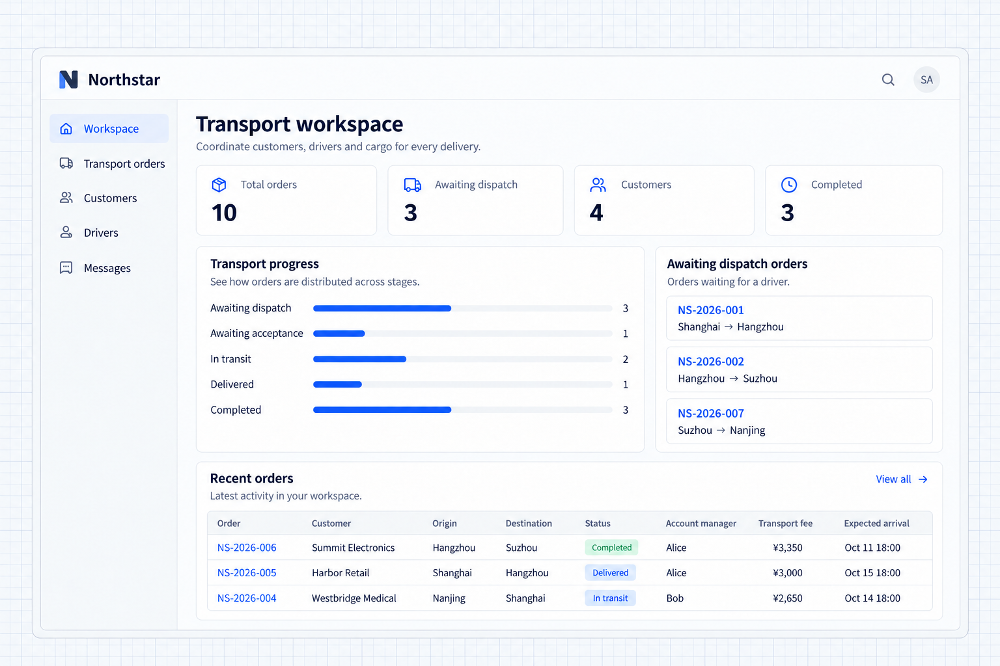
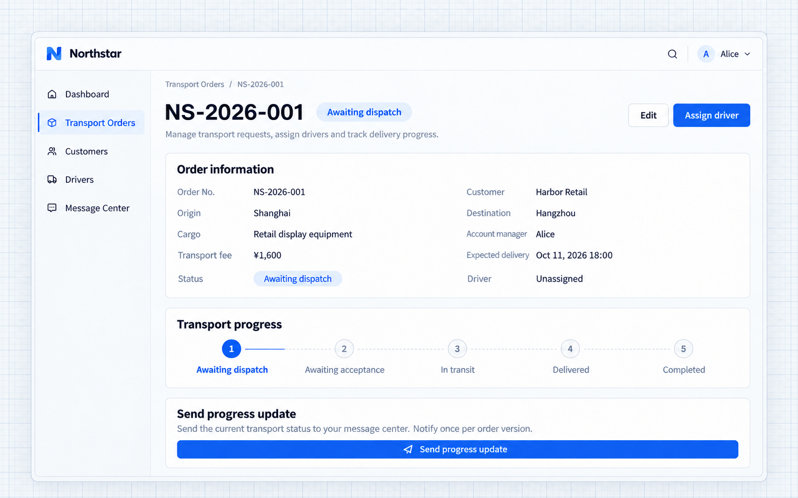

# Bắt đầu nhanh

Khởi động một ứng dụng NocoBase, mô tả nghiệp vụ của bạn cho AI Agent và bắt đầu xây dựng hệ thống. Hướng dẫn này dùng Northstar Logistics để tạo khách hàng, tài xế, đơn vận chuyển và một không gian làm việc chỉ với một prompt. Các chương sau tiếp tục mở rộng chính ứng dụng này với nhiều năng lực hơn.

## Chuẩn bị AI Agent

Chuẩn bị một Coding Agent, Node.js 24 trở lên và pnpm 11. Dùng terminal Bash, hoặc WSL trên Windows, để cài đặt NocoBase 3 Skills ở phạm vi toàn cục:

```bash
npx skills@latest add nocobase/skills-v3 --skill '*' -g
```

Chọn Coding Agent của bạn khi được hỏi, rồi mở một phiên Agent mới để nạp các Skill đã cài. [Kho phân phối gọn nhẹ](https://github.com/nocobase/skills-v3) cung cấp các Skill này, bao gồm hướng dẫn tạo ứng dụng.

Khi tạo ứng dụng, các Skill phát triển của nó được đồng bộ vào `.agents/skills/` trong thư mục ứng dụng. Hãy mở một phiên mới trong thư mục đó để Agent làm theo `AGENTS.md` và các Skill của dự án khi phát triển.

## 1. Tạo và khởi động ứng dụng

Trong thư mục bạn lưu các dự án, chạy lệnh sau để lấy công cụ tạo ứng dụng và template ứng dụng mặc định từ kênh beta của npm, đồng thời cài đặt dependencies:

```bash
PNPM_CONFIG_MINIMUM_RELEASE_AGE=0 pnpm create @nocobase/app@beta northstar-logistics --template-tag=beta
```

Vào thư mục ứng dụng, khởi tạo cấu hình và khởi động ứng dụng. Ví dụ này dùng SQLite, không cần dịch vụ cơ sở dữ liệu riêng:

```bash
cd northstar-logistics
pnpm nocobase config init --dialect sqlite
pnpm nocobase config check
pnpm dev
```

Mở URL ứng dụng được in ra trong terminal và đăng nhập bằng tài khoản quản trị viên đã cấu hình khi khởi tạo. Agent cũng có thể hoàn tất các bước này giúp bạn bằng Skill `nocobase-create-app` đã cài.

## 2. Xây dựng nghiệp vụ chỉ với một prompt

Northstar Logistics cung cấp dịch vụ vận tải và giao hàng khu vực cho khách hàng doanh nghiệp. Công ty cần quản lý khách hàng, tài xế và đơn vận chuyển, đồng thời giúp điều phối viên tìm các đơn cần tài xế.

Mở một phiên AI Agent với thư mục ứng dụng mới làm thư mục làm việc và gửi yêu cầu sau:

```text
Build a transport management application for Northstar Logistics with four pages: Workspace, Transport orders, Customers, and Drivers. Use a blue theme and left sidebar navigation.
The workspace shows four statistics: total orders, awaiting dispatch, customers, and completed orders, plus stage distribution, orders awaiting dispatch, and recent orders.
Support order search, stage filtering, creation, editing, and driver assignment. Order details show the customer, route, cargo, owner, fee, and expected delivery. Customer and driver pages include lists, details, and related orders.
Add English demo data with 10 orders, 4 customers, and 4 drivers across different transport stages. Connect the statistics, lists, and details to the same data.
```

Agent xây dựng mô hình dữ liệu, các trang nghiệp vụ và điều hướng. Khi Agent hoàn tất, hãy mở ứng dụng để xem kết quả.

## 3. Xem kết quả

### Không gian làm việc vận tải

Không gian làm việc tổng hợp tổng số đơn, số đơn chờ điều phối, khách hàng và đơn đã hoàn tất. Biểu đồ phân bố theo giai đoạn cho thấy tiến độ tổng thể, còn danh sách điều phối làm nổi bật các đơn cần tài xế. Các đơn gần đây liên kết đến trang chi tiết.

Ví dụ này có mười đơn hàng và bốn khách hàng. Thống kê và danh sách dùng dữ liệu đơn hàng của ứng dụng.



**Không gian làm việc tập hợp thống kê, các giai đoạn và các đơn đang chờ xử lý.**

### Chi tiết đơn hàng

Mở **NS-2026-001** để xem khách hàng, tuyến đường, hàng hóa, người phụ trách, chi phí và thời gian giao dự kiến. Đơn này đang chờ điều phối, có sẵn thao tác sửa và phân công tài xế.



**Chi tiết đơn hàng hiển thị thông tin nghiệp vụ cùng lối vào để sửa và phân công tài xế.**

Ứng dụng giờ đã có các trang quản lý khách hàng, tài xế và đơn hàng cơ bản. Hãy tiếp tục mô tả nhu cầu nghiệp vụ để thêm trang đăng nhập mang thương hiệu, phân quyền theo vai trò, vòng đời vận chuyển, phê duyệt, tệp đính kèm và tin nhắn vào cùng ứng dụng này.

## Mở rộng cùng một ứng dụng

Các chương sau giới thiệu các năng lực thông qua hoạt động vận tải của Northstar. Nhân viên quản lý khách hàng ghi nhận yêu cầu, điều phối viên phân công tài xế, tài xế giao hàng và tải lên bằng chứng giao hàng, giám sát vận hành theo dõi tiến độ, còn bộ phận tài chính duyệt các chi phí vận chuyển phát sinh.

| Vai trò                      | Trách nhiệm                                                                               |
| ------------------------- | ---------------------------------------------------------------------------------------------- |
| Quản lý khách hàng           | Duy trì khách hàng, tạo đơn vận chuyển, theo dõi giao hàng và liên lạc với khách hàng. |
| Điều phối viên                | Phân công tài xế và xử lý chậm trễ.                                                             |
| Tài xế                    | Xử lý các chuyến vận chuyển được giao và tải lên bằng chứng giao hàng.                                  |
| Giám sát vận hành     | Theo dõi tiến độ và duyệt các yêu cầu vận chuyển đặc biệt.                                        |
| Người duyệt tài chính          | Duyệt chi phí phát sinh và thông tin tài chính liên quan.                                    |
| Quản trị viên ứng dụng | Quản lý quyền truy cập, kiểm tra tác vụ định kỳ và nhật ký gửi.                                   |

Xác thực đưa nhân viên vào hệ thống, phân quyền kiểm soát mỗi vai trò được truy cập và xử lý những đơn nào, còn Workflow thúc đẩy hoạt động vận tải. Tệp, thông báo và email hỗ trợ cộng tác. Nhắc nhở theo lịch, nguồn dữ liệu bên ngoài, ngôn ngữ và theme được bổ sung khi nghiệp vụ cần.

Agent tích hợp các năng lực này và xây dựng trang nghiệp vụ cùng giao diện quản lý xoay quanh cách làm việc của công ty.
