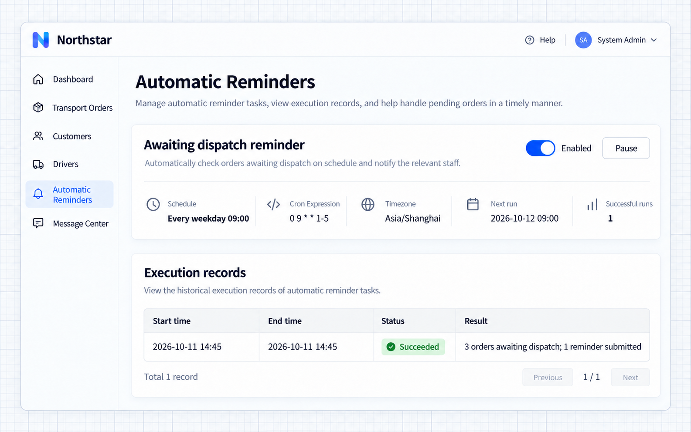
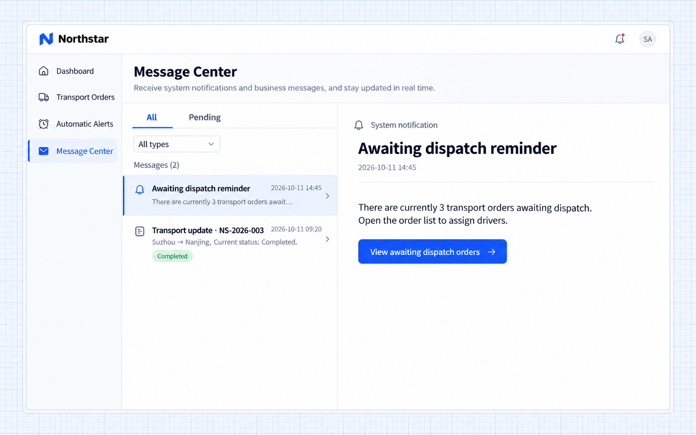

# Tác vụ định kỳ

NocoBase 3 có thể chạy các thao tác nghiệp vụ vào thời điểm hoặc theo chu kỳ đã định. Ví dụ, nhắc mọi người xử lý công việc tồn đọng mỗi ngày, tạo báo cáo hằng tuần hoặc định kỳ đồng bộ dữ liệu nghiệp vụ.

Hãy cho Agent biết khi nào chạy, xử lý dữ liệu nào và tạo ra kết quả gì. Sau khi Agent tích hợp logic nghiệp vụ, quản trị viên có thể xem lịch chạy và bản ghi thực thi trong Cài đặt, cũng như tạm dừng hoặc tiếp tục tác vụ.

## Trước khi bắt đầu

Ví dụ này thêm nhắc nhở phê duyệt vào một ứng dụng đơn hàng có sẵn. Hãy chuẩn bị các đơn đang chờ và tài khoản điều phối viên, đồng thời chỉ rõ ai duyệt từng đơn.

Hãy cho Agent biết thời gian chạy và múi giờ, những đơn nào được đưa vào, ai nhận thông báo và khi nhấn vào thì mở đến đâu.

## Ví dụ: nhắc điều phối viên về các đơn đang chờ

Người duyệt cần xử lý kịp thời các đơn đang chờ. Vào các ngày làm việc, ứng dụng kiểm tra các đơn đang chờ, nhóm theo điều phối viên và gửi nhắc nhở trong ứng dụng.

```text
Add a Awaiting dispatch reminder to the existing order application.

At 09:00 Beijing time every weekday, find orders awaiting approval, group them by coordinator, and send each coordinator one in-app notification.
Include the pending order count and link to the pending order list. Send nothing when there are no pending orders.
Administrators can view the schedule and execution records in Settings, and pause or resume reminders.
```

### Xem kết quả

1. Với vai trò quản trị viên, mở **Tự động hóa**. **Nhắc nhở đơn chờ điều phối** hiển thị lịch chạy, múi giờ, lần kích hoạt tiếp theo và trạng thái hiện tại.

2. Nhấn vào tên tác vụ để mở chi tiết. **Bản ghi thực thi** hiển thị thời gian, thời lượng và trạng thái của từng lần chạy. Trong ví dụ này, **Thành công** nghĩa là tác vụ nhắc nhở đã chạy thành công.

3. Với vai trò điều phối viên, mở trung tâm thông báo để xem số đơn đang chờ. Nhấn vào thông báo để mở danh sách đơn đang chờ và xử lý phê duyệt.

Lịch chạy quyết định khi nào chạy. Việc tìm đơn, đếm số lượng và gửi thông báo là các thao tác nghiệp vụ do Agent tích hợp. Xem [Thông báo](.././notification.md) để biết về năng lực thông báo.

## Quản lý tác vụ

### Tạm dừng và tiếp tục

Quản trị viên có thể dùng công tắc trong danh sách tác vụ hoặc trang chi tiết. Tạm dừng sẽ ngăn các lần kích hoạt theo lịch mới; tiếp tục sẽ chạy lại theo lịch đã cấu hình. Các bản ghi lịch sử vẫn được giữ, và công việc nghiệp vụ đã bắt đầu vẫn tiếp tục dưới executor của nó.

### Thay đổi thời gian hoặc quy tắc nghiệp vụ

Điều chỉnh một tác vụ định kỳ có sẵn theo lịch làm việc mới trong khi vẫn giữ bản ghi, người nhận và nội dung nghiệp vụ.

Yêu cầu Agent cập nhật tác vụ hiện có. Ví dụ:

```text
Change Awaiting dispatch reminder to run at 10:00 Beijing time every weekday.
Keep the existing order selection, recipients, and notification content.
```

Sau khi thay đổi, hãy kiểm tra lịch chạy mới và lần kích hoạt tiếp theo trong trang chi tiết. Agent thêm, sửa hoặc xóa định nghĩa tác vụ trong mã ứng dụng; quản trị viên xem và bật hoặc tắt tác vụ trong Cài đặt.

## Cách dùng khác

### Tạo báo cáo

Tạo báo cáo theo lịch cố định và thông báo cho người phụ trách thay vì dựa vào nhắc nhở thủ công.

Thêm lịch chạy và thông báo kết quả cho một năng lực báo cáo có sẵn:

```text
At 08:00 Beijing time every Monday, generate last week's sales summary and notify the sales manager.
Include sales revenue, order count, and regional totals. Administrators can view the task and execution records.
```

### Đồng bộ dữ liệu

Định kỳ đồng bộ các trường được chọn do hệ thống bên ngoài duy trì để ứng dụng luôn cập nhật mà không phải duy trì trùng lặp.

Với một tích hợp có sẵn, hãy chỉ rõ chu kỳ và dữ liệu cần xử lý:

```text
Every 10 minutes, synchronize customer statuses from the existing customer system into the matching application records.
Keep other customer information unchanged. Administrators can view the schedule and execution records.
```

## Câu hỏi thường gặp

### Vì sao tác vụ chạy vào thời điểm khác với dự kiến?

Kiểm tra múi giờ trong trang chi tiết. Hãy chỉ rõ giờ Bắc Kinh hoặc múi giờ nghiệp vụ của bạn trong yêu cầu; ví dụ này dùng `Asia/Shanghai`. Sau khi Agent thay đổi thời gian, hãy kiểm tra lần kích hoạt tiếp theo.

### Xem kết quả nghiệp vụ ở đâu?

Xem bản ghi thực thi trong chi tiết tác vụ và kết quả trên trang nghiệp vụ liên quan. Ví dụ này dùng hộp thư của điều phối viên và danh sách đơn đang chờ; tác vụ báo cáo tạo ra báo cáo, còn tác vụ đồng bộ cập nhật dữ liệu nghiệp vụ.

### Tác vụ có chạy khi ứng dụng đã dừng không?

Tác vụ cần một tiến trình ứng dụng đang chạy. Để chạy liên tục, quản trị viên triển khai cần giữ dịch vụ luôn hoạt động. Bản triển khai nhiều instance còn cần một backend lập lịch dùng chung.

## Tài liệu tham khảo cho lập trình viên

Mã ứng dụng sở hữu định nghĩa tác vụ và đích thực thi. Đây là các điểm tích hợp chính:

| Điểm tích hợp                             | Mục đích                                         |
| --------------------------------------------- | ----------------------------------------------- |
| `schedulerServiceToken`                       | Lấy dịch vụ scheduler                   |
| `registerTarget()`                            | Đăng ký đích thực thi nghiệp vụ          |
| `defineSchedule()`                            | Định nghĩa tên, lịch chạy, múi giờ và đích |
| `register()` hoặc `boot()` của Provider ứng dụng | Đăng ký đích và định nghĩa lịch chạy       |

Dùng một `key` ổn định, duy nhất trong ứng dụng. Lịch chạy hỗ trợ biểu thức Cron 5 hoặc 6 trường và tên múi giờ IANA; múi giờ mặc định là `UTC`. Tác vụ ngắn có thể hoàn tất trực tiếp. Tác vụ dài hơn có thể dùng dịch vụ thực thi nền của ứng dụng và báo lại kết quả cuối cùng.

Khi ứng dụng khởi động, các định nghĩa được đồng bộ trong khi vẫn giữ lựa chọn bật/tắt của quản trị viên. Lập trình viên cũng có thể đồng bộ từ thư mục gốc của ứng dụng:

```bash
pnpm nocobase scheduler sync --json
```

Sau khi xóa các định nghĩa tác vụ cũ trong một bản triển khai, quản trị viên triển khai có thể chạy lệnh sau khi toàn bộ mã và manifest plugin đã được nạp:

```bash
node dist/cli/index.js scheduler sync --finalize --json
```

Lệnh này hủy kích hoạt các tác vụ đã bị xóa khỏi mã và giữ lại lịch sử của chúng. Một tiến trình đơn có thể dùng backend bộ nhớ tích hợp sẵn. Bản triển khai nhiều instance dùng backend Redis dùng chung, chọn qua `jobs.default`. Dùng `scheduler.jobs` cho cấu hình lập lịch riêng và giữ `attempts` của nó ở `1`.

## Kết quả với Northstar

Quản trị viên demo nhận được bản tổng hợp các đơn chờ điều phối. Danh sách hiển thị lịch chạy 09:00 các ngày làm việc theo Asia/Shanghai và một lần chạy thành công thực tế; tin nhắn liên kết về danh sách đơn hàng. Việc gửi thông báo vẫn có thể theo dõi độc lập.



**Trang tác vụ giữ lại lịch chạy và lần chạy thành công này.**



**Bản tổng hợp đơn chờ điều phối đã đến trung tâm tin nhắn của tài khoản demo.**

Ví dụ này trước tiên chạy một lần với chu kỳ ngắn, sau đó khôi phục lịch 09:00 các ngày làm việc. Lần thực thi được hiển thị thuộc về lần demo đó; lần chạy tiếp theo sẽ theo cấu hình đã khôi phục.
