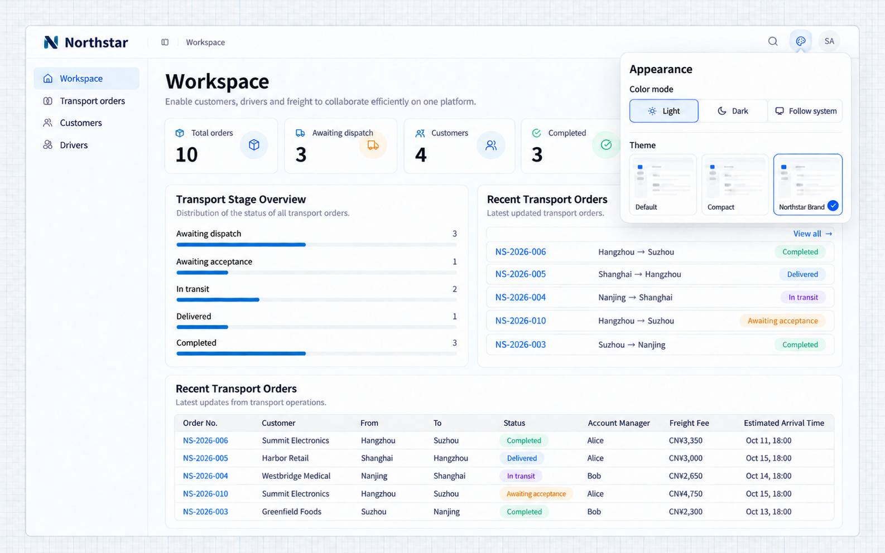
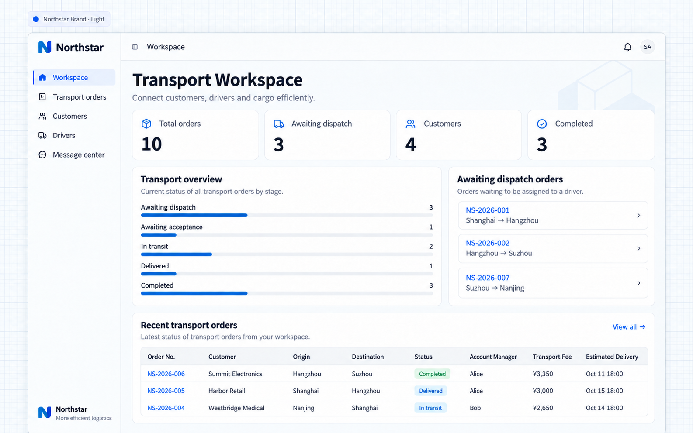
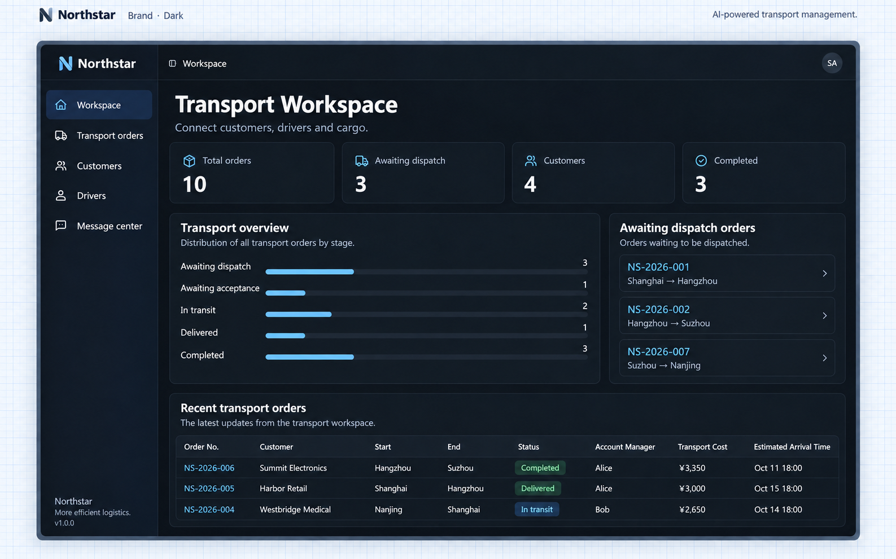

# Theme

Theme của NocoBase 3 điều khiển màu sắc, phông chữ, cỡ chữ, khoảng cách, bo góc và đổ bóng. **Mã theme nằm trong dự án ứng dụng của bạn**, nên bạn có thể tùy chỉnh trực tiếp mà không cần cài plugin.

Dùng một theme có sẵn, hoặc mô tả giao diện bạn muốn cho Coding Agent. Ví dụ, khớp với màu thương hiệu của tổ chức hoặc làm cho bảng và biểu mẫu gọn hơn.

## Theme có sẵn

Có hai theme đi kèm:

| Theme   | Giao diện                                                                                                                 |
| ------- | -------------------------------------------------------------------------------------------------------------------------- |
| Default | Màu trung tính với khoảng cách tiêu chuẩn và bo góc tròn                                                                   |
| Compact | Cùng màu với Default, nhưng giảm khoảng cách, chiều cao dòng của một số văn bản và bán kính bo góc để hiển thị nhiều thông tin hơn |

Trong bảng **Giao diện**, chọn một theme và một chế độ màu: **Sáng**, **Tối** hoặc **Theo hệ thống**. Theme và chế độ màu là hai lựa chọn độc lập. Cả hai theme có sẵn đều hỗ trợ chế độ sáng và tối.

Lựa chọn theme được lưu trong trình duyệt hiện tại và được khôi phục sau khi làm mới trang. Nó không đồng bộ sang các thiết bị khác dùng tài khoản của bạn. Chọn theme chỉ thay đổi giao diện trong trình duyệt của bạn; sửa mã theme sẽ thay đổi giao diện cho tất cả mọi người dùng theme đó.

## Sửa theme

Nếu một theme gần giống với nhu cầu, hãy yêu cầu Coding Agent điều chỉnh. Hãy chỉ rõ theme cần sửa, các thay đổi mong muốn và những gì cần giữ nguyên.

Ví dụ, giữ bố cục gọn và đổi màu chủ đạo sang xanh dương:

```text
Update the Compact theme: use blue as the primary color and slightly increase the corner radius. Keep the current fonts, text sizes, and compact spacing.
```

Bạn có thể kèm theo mã màu thương hiệu, yêu cầu về phông chữ hoặc ảnh chụp màn hình tham khảo. Ví dụ, chỉ định `#2563EB` làm màu chủ đạo hoặc cung cấp ảnh chụp màn hình thể hiện kiểu bo góc và đổ bóng mong muốn.

Để chỉ đổi tên, hãy yêu cầu: “Đổi tên Compact thành High Density. Giữ nguyên giao diện và cập nhật tên trong tất cả các ngôn ngữ được hỗ trợ.”

## Thêm theme

Để giữ các theme hiện có và thêm một giao diện khác, hãy yêu cầu Coding Agent tạo theme mới. Mô tả tên, phong cách, mục đích và theme hiện có nào dùng làm điểm xuất phát.

Ví dụ:

```text
Create a Forest theme with green as the primary color, soft backgrounds, moderately rounded corners, and subtle shadows.
```

Coding Agent tạo theme, thêm vào danh sách lựa chọn và cấu hình tên cho theme. Chọn theme đó trong **Giao diện**.

## Xóa theme

Gỡ các theme không còn dùng khỏi lựa chọn giao diện và để các lựa chọn hiện có quay về theme mặc định của ứng dụng.

Cho Coding Agent biết theme nào cần xóa. Các trình duyệt đã từng chọn theme đó sẽ dùng theme mặc định của ứng dụng.

```text
Remove the Forest theme.
```

Khi xóa theme mặc định hiện tại của ứng dụng, hãy chỉ định một theme khác làm mặc định cho lần truy cập đầu tiên và khi theme đã chọn trước đó không còn khả dụng.

## Xem kết quả

Sau khi thay đổi, chọn theme trong **Giao diện** để xem màu sắc, phông chữ và bố cục. Chuyển giữa chế độ sáng và tối để xem theme hiển thị thế nào ở mỗi chế độ.

Hình ảnh, trang nhúng và một số component bên thứ ba cần điều chỉnh riêng. Hãy đưa chúng vào yêu cầu nếu cần dùng cùng màu sắc hoặc phong cách.

## Tài liệu tham khảo cho lập trình viên

Để sửa trực tiếp mã theme, hãy tham khảo các tệp sau. Đường dẫn tính từ thư mục gốc của dự án ứng dụng và lấy template ứng dụng mặc định làm ví dụ.

| Tệp                                 | Mục đích                     | Dùng khi                                   |
| ------------------------------------ | --------------------------- | ------------------------------------------ |
| `client/theme/themes/default.css`    | Giao diện theme thoáng   | Sửa Default                            |
| `client/theme/themes/compact.css`    | Giao diện theme gọn    | Sửa hoặc xóa Compact                |
| `client/theme/themes/<theme-id>.css` | Giao diện theme tùy chỉnh     | Thêm, sửa hoặc xóa theme tùy chỉnh |
| `client/theme/theme-presets.ts`      | Các lựa chọn theme trong Giao diện | Thêm hoặc xóa theme                  |
| `client/styles.css`                  | Nạp style của theme        | Thêm hoặc xóa theme                  |
| `client/locales/zh-CN.ts`            | Tên theme tiếng Trung         | Thêm, xóa hoặc đổi tên theme       |
| `client/locales/en-US.ts`            | Tên theme tiếng Anh         | Thêm, xóa hoặc đổi tên theme       |

Sửa giao diện của một theme thường chỉ cần thay đổi tệp theme của nó. Thêm hoặc xóa theme còn liên quan đến danh sách theme, import style và các tệp locale. Ngôn ngữ bổ sung hoặc phông chữ mới có thể cần bản dịch hoặc tài nguyên phông chữ tương ứng.

## Theme thương hiệu Northstar

```text
Add a Northstar theme based on Compact. Use a deep blue primary color, retain its fonts and density, and slightly increase the corner radius. Support light and dark modes. Keep the existing presets and translate the new name into Chinese and English.
```



**Người dùng có thể chọn theme và chế độ màu sáng, tối hoặc theo hệ thống.**



**Theme thương hiệu hiển thị cùng nghiệp vụ ở chế độ sáng.**



**Chuyển sang chế độ tối vẫn giữ nguyên dữ liệu và thao tác nghiệp vụ.**
