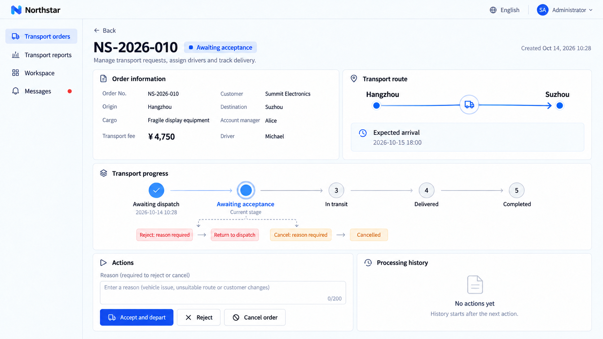

# Định nghĩa quy trình và kiểm soát thao tác

Định nghĩa các giai đoạn mà một bản ghi đi qua, các thao tác được phép ở mỗi giai đoạn và giai đoạn tiếp theo sau mỗi thao tác. Thao tác có thể yêu cầu người được chỉ định, thông tin bắt buộc hoặc điều kiện như giới hạn số tiền. Các điều kiện khác nhau có thể dẫn đến các nhánh khác nhau hoặc quay về một giai đoạn trước.

Server kiểm tra các quy tắc này, còn trang hiển thị các thao tác áp dụng được. Khi hai người cùng xử lý một bản ghi, lần gửi sau phải làm mới thay vì ghi đè kết quả đã lưu.

## Ví dụ: kiểm soát trình tự của một đơn vận chuyển

Định nghĩa các bước nhận đơn, vận chuyển, giao hàng và xác nhận cho đơn hàng Northstar, và trả các phân công bị từ chối về điều phối. Mô tả trình tự trước, sau đó đến yêu cầu của từng thao tác:

```text
Add a workflow to Northstar orders: Awaiting dispatch → Awaiting acceptance → In transit → Delivered → Completed.
Assign a driver during dispatch. Accept and depart starts transport. Rejection requires a reason, returns to dispatch and clears the assignment.
Require delivery evidence to mark delivery, then confirm completion. Allow cancellation with a reason before departure.
Show only actions applicable to the current stage; ordinary editing must not change workflow stages directly.
Check stages and required inputs on the server and prevent concurrent actions from overwriting another person’s result.
```

| Giai đoạn hiện tại                   | Thao tác và yêu cầu       | Giai đoạn tiếp theo          |
| ------------------------------- | ----------------------------- | ------------------- |
| Chờ điều phối               | Chọn và phân công tài xế    | Chờ nhận đơn |
| Chờ nhận đơn             | Nhận đơn và xuất phát             | Đang vận chuyển          |
| Chờ nhận đơn             | Nhập lý do từ chối    | Chờ điều phối   |
| Đang vận chuyển                      | Nộp bằng chứng giao hàng      | Đã giao           |
| Đã giao                       | Xác nhận giao hàng              | Đã hoàn tất           |
| Chờ điều phối hoặc chờ nhận đơn | Nhập lý do hủy | Đã hủy           |

## Xem kết quả

Mở đơn **NS-2026-010**. Ở giai đoạn Chờ nhận đơn trong ảnh chụp, **Quy trình vận chuyển** cung cấp các thao tác nhận đơn, từ chối và hủy, không có thao tác giao hàng ở bước sau.



**Đơn hàng đang chờ nhận và cung cấp các thao tác của giai đoạn đó.**

Ví dụ này gộp nhận đơn và xuất phát làm một. Hãy yêu cầu Agent tách giai đoạn xuất phát riêng khi cần. Dùng [Phân quyền](../authorization/index.md) cho quyền truy cập trang, thao tác và bản ghi.

:::tip Lưu ý quan trọng

Điều kiện của quy trình quyết định thao tác có hợp lệ ở thời điểm hiện tại không; quyền quyết định người dùng này có được thực hiện hay không. Hãy cấu hình cả hai. Các ảnh chụp màn hình này dùng tài khoản quản trị viên; thao tác của nhân viên cần theo đúng trách nhiệm của họ.

:::

## Xác nhận mô hình nghiệp vụ trước

Mô tả bản ghi, vai trò, giai đoạn, điều kiện kích hoạt, đầu vào bắt buộc, các nhánh và điểm kết thúc. Yêu cầu Agent đưa ra bảng giai đoạn và sơ đồ trước khi xác nhận triển khai. Mọi giai đoạn chưa kết thúc đều cần lối ra; hãy xác định điều gì xảy ra nếu hệ thống bên ngoài không bao giờ phản hồi. Điều kiện thao tác và quyền phải áp dụng nhất quán trên mọi lối vào.

```text
First outline Northstar's transport stages and diagram, showing who or which system advances each step, required input and outcomes. Do not write code yet. Ensure refusal, cancellation and redispatch have exits. Only dispatchers can assign drivers; drivers handle only their own orders. Explain unavailable actions, and require delivery evidence before confirming arrival. List unresolved business decisions for me.
```

Kiểm tra các trường hợp giao hàng, từ chối và điều phối lại, hủy, thiếu quyền, thiếu đầu vào và thao tác đồng thời. Sửa thông thường và nhập dữ liệu không được bỏ qua quy tắc để thay đổi giai đoạn trực tiếp.
